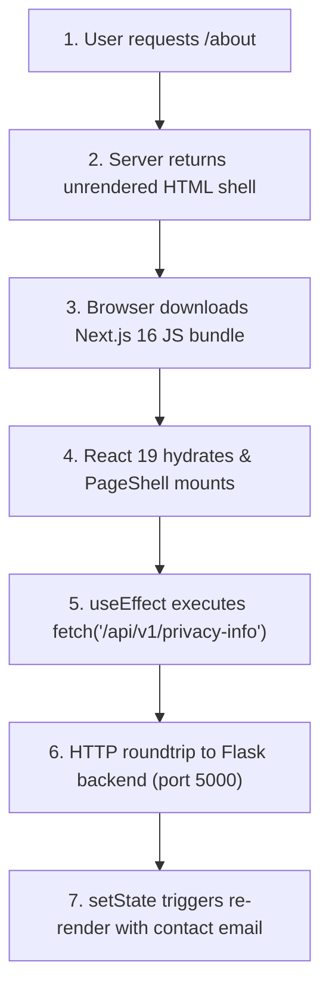
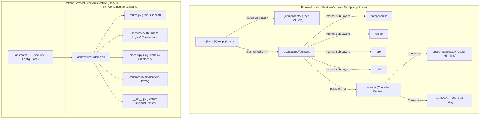

# LemonDBD Comprehensive Code Review & Redundancy Analysis

> **Date:** October 2026  
> **Target Codebase:** LemonDBD (`frontend/src/` & `backend/app/`)  
> **Scope:** Full-stack architecture, App Router slugs and pages, UI components, custom hooks, services, utilities, TypeScript types, Flask routes, SQLAlchemy models, schemas, and database services.

---

## Table of Contents
1. [Executive Summary & Verified Technology Manifest](#1-executive-summary--verified-technology-manifest)
   - 1.1 [Executive Summary & High-Level Metrics](#11-executive-summary--high-level-metrics)
   - 1.2 [Verified Frontend Stack Manifest (`frontend/package.json`)](#12-verified-frontend-stack-manifest-frontendpackagejson)
   - 1.3 [Verified Backend Stack Manifest (`backend/requirements.txt` & Docker)](#13-verified-backend-stack-manifest-backendrequirementstxt--docker)
   - 1.4 [Verified Multi-Container Topography (`docker-compose.base.yml`)](#14-verified-multi-container-topography-docker-composebaseyml)
2. [Frontend Route & Slug Layer (`app/[locale]/...`)](#2-frontend-route--slug-layer)
   - 2.1 [Identical Sub-Route Layouts (19 Redundant Layout Files)](#21-identical-sub-route-layouts-19-redundant-layout-files)
   - 2.2 [Duplicate Route Loading Skeletons (`loading.tsx`)](#22-duplicate-route-loading-skeletons-loadingtsx)
   - 2.3 [Streaks Route Duplication & Dynamic Slug Opportunity](#23-streaks-route-duplication--dynamic-slug-opportunity)
   - 2.4 [Locale Resolution Boilerplate Across Pages & Components](#24-locale-resolution-boilerplate-across-pages--components)
   - 2.5 [Next.js Route Handlers vs Flask Backend Duplication (`proxy-image`)](#25-nextjs-route-handlers-vs-flask-backend-duplication-proxy-image)
3. [Frontend Component Layer & UI Redundancies](#3-frontend-component-layer--ui-redundancies)
   - 3.1 [Dual `SegmentedControl` Implementations](#31-dual-segmentedcontrol-implementations)
   - 3.2 [Missing Global `PerkIcon` / `SafeImage` Component (17 Duplicate Fallbacks)](#32-missing-global-perkicon--safeimage-component-17-duplicate-fallbacks)
   - 3.3 [Dead/Unused `Dictionary` Type Imports Across 129 Files](#33-deadunused-dictionary-type-imports-across-129-files)
   - 3.4 [Duplicate Button Architectures (`Button` vs `DbdButton` vs Raw CTAs)](#34-duplicate-button-architectures-button-vs-dbdbutton-vs-raw-ctas)
   - 3.5 [Duplicate Perk Diamond Slot UI Patterns](#35-duplicate-perk-diamond-slot-ui-patterns)
   - 3.6 [Empty & Not Found State Duplication](#36-empty--not-found-state-duplication)
   - 3.7 [Modal Dialog Shells & Backdrop Repetition](#37-modal-dialog-shells--backdrop-repetition)
4. [Frontend Hooks, Services, Utilities & Types](#4-frontend-hooks-services-utilities--types)
   - 4.1 [Browser File Download Boilerplate (5 Duplicate Implementations)](#41-browser-file-download-boilerplate-5-duplicate-implementations)
   - 4.2 [Clipboard Utility Bypass](#42-clipboard-utility-bypass)
   - 4.3 [Four Independent Slug / Name Sanitizer Implementations](#43-four-independent-slug--name-sanitizer-implementations)
   - 4.4 [Misplaced Code in `types.tsx` and `.tsx` Extension on Non-JSX Files](#44-misplaced-code-in-typestsx-and-tsx-extension-on-non-jsx-files)
   - 4.5 [API Fetch & Error Handling Drift Across Services](#45-api-fetch--error-handling-drift-across-services)
   - 4.6 [Storage Wrappers vs `versionedStore` / `safeStorage`](#46-storage-wrappers-vs-versionedstore--safestorage)
   - 4.7 [Roster Loading Hook Wrapper Proliferation in Streaks](#47-roster-loading-hook-wrapper-proliferation-in-streaks)
   - 4.8 [Duplicate Interface & Type Declarations (67 Type Names)](#48-duplicate-interface--type-declarations-67-type-names)
5. [Backend Route Layer (`backend/app/routes/`)](#5-backend-route-layer)
   - 5.1 [Misplaced Admin Database Endpoints in `users.py`](#51-misplaced-admin-database-endpoints-in-userspy)
   - 5.2 [Inconsistent API Error Response Envelopes](#52-inconsistent-api-error-response-envelopes)
   - 5.3 [Omission of `make_streak_blueprint` in `page_streak.py`](#53-omission-of-make_streak_blueprint-in-page_streakpy)
   - 5.4 [Incomplete Adoption of Central `paginate_args()`](#54-incomplete-adoption-of-central-paginate_args)
   - 5.5 [Incomplete Adoption of Central `extract_lang()`](#55-incomplete-adoption-of-central-extract_lang)
6. [Backend Service & Database Layer (`backend/app/services/`)](#6-backend-service--database-layer)
   - 6.1 [Dual Architecture: Monolithic Class Facades vs Functional Packages](#61-dual-architecture-monolithic-class-facades-vs-functional-packages)
   - 6.2 [Dead / Stale Map Query Duplication (`services/perks/queries_map.py`)](#62-dead--stale-map-query-duplication-servicesperksqueries_mappy)
   - 6.3 [Manual 365-Line SQLite DDL in `raw_schema.py` vs SQLAlchemy Models](#63-manual-365-line-sqlite-ddl-in-raw_schemapy-vs-sqlalchemy-models)
   - 6.4 [Duplicate Model Serializers (`services/db/serializers.py` - 349 Lines)](#64-duplicate-model-serializers-servicesdbserializerspy---349-lines)
7. [Backend Models & Schemas Layer (`backend/app/models/` & `schemas/`)](#7-backend-models--schemas-layer)
   - 7.1 [Zero Adoption of `ColumnDictMixin` (32 Models Hand-Coding `to_dict()`)](#71-zero-adoption-of-columndictmixin-32-models-hand-coding-to_dict)
   - 7.2 [Repeated Translation Resolution Boilerplate Across 8 Models](#72-repeated-translation-resolution-boilerplate-across-8-models)
   - 7.3 [Image URL Validator Duplication Across Schemas](#73-image-url-validator-duplication-across-schemas)
8. [Cross-Cutting Architectural Synergies](#8-cross-cutting-architectural-synergies)
   - 8.1 [PageShell Mounting in Root Layout vs Per-Page Re-Mounting](#81-pageshell-mounting-in-root-layout-vs-per-page-re-mounting)
   - 8.2 [Shared Validation Specifications Across Frontend and Backend](#82-shared-validation-specifications-across-frontend-and-backend)
9. [Next.js 16 & React 19 App Router Architectural Audit](#9-nextjs-16--react-19-app-router-architectural-audit)
   - 9.1 [Inverted Component Boundaries (60.5% Client Pages & Bundle Bloat)](#91-inverted-component-boundaries-605-client-pages--bundle-bloat)
   - 9.2 [Next.js 16 Cache Components & Data Fetching Cascades](#92-nextjs-16-cache-components--data-fetching-cascades)
   - 9.3 [Dynamic Route Parameters Inconsistency (`use(params)` vs `useParams()` vs `await params`)](#93-dynamic-route-parameters-inconsistency-useparams-vs-useparams-vs-await-params)
   - 9.4 [Obsolete React 17/18 Imports in React 19 & Tailwind CSS v4 Configuration](#94-obsolete-react-1718-imports-in-react-19--tailwind-css-v4-configuration)
10. [Backend Flask 3.1 & SQLAlchemy 2.0 Architectural Audit](#10-backend-flask-31--sqlalchemy-20-architectural-audit)
    - 10.1 [Deconstructing "Fat Routes" (SRP Violations in `users.py`, `smash_or_pass.py`, `minigames.py`)](#101-deconstructing-fat-routes-srp-violations-in-userspy-smash_or_passpy-minigamespy)
    - 10.2 [The Hidden N+1 Query Cascade (`to_dict()` Relationship Traversal vs `selectinload` / `joinedload`)](#102-the-hidden-n1-query-cascade-to_dict-relationship-traversal-vs-selectinload--joinedload)
    - 10.3 [Pydantic DTO Schema Inversion (Bypassed Schemas & Unvalidated `request.get_json()`)](#103-pydantic-dto-schema-inversion-bypassed-schemas--unvalidated-requestget_json)
    - 10.4 [Eradicating Legacy SQLAlchemy 1.x Query Syntax (`db.session.query(...)` -> SQLAlchemy 2.0 `select(...)`)](#104-eradicating-legacy-sqlalchemy-1x-query-syntax-dbsessionquery---sqlalchemy-20-select)
    - 10.5 [Transaction Boundary & Unit of Work Anti-Patterns (Scattered Commits)](#105-transaction-boundary--unit-of-work-anti-patterns-scattered-commits)
11. [Docker, PostgreSQL Multi-Tenancy & Infrastructure Audit](#11-docker-postgresql-multi-tenancy--infrastructure-audit)
    - 11.1 [PostgreSQL Connection Pool Saturation Risk (Gunicorn 4×50 vs PostgreSQL max_connections=200)](#111-postgresql-connection-pool-saturation-risk-gunicorn-450-vs-postgresql-max_connections200)
    - 11.2 [Single-Container Multi-Database Co-Location Architecture](#112-single-container-multi-database-co-location-architecture)
    - 11.3 [In-Process APScheduler Multi-Worker Race Conditions](#113-in-process-apscheduler-multi-worker-race-conditions)
    - 11.4 [Startup Hook Regressions & Double Blueprint Registration](#114-startup-hook-regressions--double-blueprint-registration)
    - 11.5 [Docker Volume Mount Discrepancy (`/var/lib/postgresql` vs `/var/lib/postgresql/data`)](#115-docker-volume-mount-discrepancy-varlibpostgresql-vs-varlibpostgresqldata)
    - 11.6 [Floating Image Tags & Production Non-Determinism](#116-floating-image-tags--production-non-determinism)
12. [Full-Stack Production Best Practices Comparison Matrix](#12-full-stack-production-best-practices-comparison-matrix)
13. [Full-Stack File Organization & Directory Architecture Blueprint](#13-full-stack-file-organization--directory-architecture-blueprint)
    - 13.1 [Current Structural Smells & Layer-Based Sprawl ("Package-by-Type")](#131-current-structural-smells--layer-based-sprawl-package-by-type)
    - 13.2 [Modern Architectural Standards: Next.js 16 Feature Modules vs Flask 3 Vertical Slices](#132-modern-architectural-standards-nextjs-16-feature-modules-vs-flask-3-vertical-slices)
    - 13.3 [Concrete Proposed Directory Structure (Before vs. After Trees)](#133-concrete-proposed-directory-structure-before-vs-after-trees)
    - 13.4 [Domain-to-Feature Migration & Mapping Matrix (Exhaustive Full-Stack File Relocation)](#134-domain-to-feature-migration--mapping-matrix-exhaustive-full-stack-file-relocation)
    - 13.5 [Architectural Guardrails & Colocation Rules (Public API Barrels & Dependency Flow)](#135-architectural-guardrails--colocation-rules-public-api-barrels--dependency-flow)
14. [Prioritized Action Plan & Refactoring Roadmap](#14-prioritized-action-plan--refactoring-roadmap)

---

## 1. Executive Summary & Verified Technology Manifest

### 1.1 Executive Summary & High-Level Metrics

A deep, systematic static analysis of the entire LemonDBD codebase was conducted across **823 frontend source files** and **196 backend Python files** (excluding tests, build artifacts, and vendor packages).

#### Key Quantitative Findings:
- **Connection Pool Exhaustion Risk:** Gunicorn runs 4 workers with `pool_size=20, max_overflow=30`, creating a peak demand of **200 connections** ($4 \times 50$), exactly saturating PostgreSQL's configured `max_connections=200` and starving Umami analytics and pgAdmin.
- **25 of 38 route pages (65.8%)** declare `'use client'` at line 1, inverting Next.js 16 Server-First principles and forcing completely static pages (`rules`, `terms-of-service`, `privacy-policy`, `about`, `characters`, `welcome`) into the client JavaScript bundle.
- **Image Pipeline De-Optimization:** `frontend/next.config.ts` sets `images.unoptimized: true`, completely bypassing server-side WebP/AVIF transcoding despite Sharp `^0.35.4` being installed.
- **14 instances of legacy SQLAlchemy 1.x syntax** (`db.session.query(...)`) remain active across routes and services instead of modern SQLAlchemy 2.0 `select(...)` execution.
- **9 backend route modules** parsing JSON bypass Pydantic v2 schemas completely, parsing raw JSON with ad-hoc `request.get_json()` imperative checks.
- **26 relationship traversals** in model `to_dict()` methods trigger hidden N+1 SQL query cascades during list requests (e.g., `Offering.category`, `Map.realm`, `Entity.stat`).
- **129 frontend files** carry an unused `import type { Dictionary } from '@/locales/types'`.
- **19 sub-route `layout.tsx` files** are identical 8-line passthroughs returning `<>{children}</>`.
- **4 `loading.tsx` files** in `tier-lists` are 100% byte-for-byte identical.
- **17 component files** duplicate the image fallback pattern (`useState(false)` + `onError` + `?`/`Sparkles`).
- **5 frontend files** duplicate raw DOM blob download logic (`createObjectURL` + anchor click in `userProfileApi.ts`, `ExportModal.tsx`, `useExportTab.ts`, `RecoveryCodesPanel.tsx`, `jsonExportImport.ts`).
- **4 independent implementations** exist for slug / character name sanitization (`staticUrl.ts`, `perkUtils.tsx`, `types.tsx`, `slug.ts`).
- **2 parallel implementations** exist for `SegmentedControl`.
- **67 interface and type names** are defined in multiple files instead of centralized types.
- **Partial Adoption of `ColumnDictMixin`:** Only 5 streak models adopt `ColumnDictMixin`; over **25 core domain models** manually hand-roll `to_dict()` methods.
- **349 lines of manual serializers** in `backend/app/services/db/serializers.py` mirror model `to_dict()`.
- **365 lines of raw SQLite DDL** in `backend/app/services/db/raw_schema.py` duplicate SQLAlchemy models and suffer from schema drift.
- **5 monolithic class facades** (`UserService`, `PerkService`, `PageStreakService`, `MinigameService`, `DatabaseService`) act as redundant wrappers around modular functional packages.
- **Layer-Based Directory Sprawl & "Junk-Drawer" Utils:** 42 files loose in `src/utils/` (including 5 map voice scripts, streak preferences, audio player helpers), 17 loose feature components in `src/components/` root, and 11 backend services mirroring package folders. Zero route colocation in Next.js `app/[locale]/`.

**Estimated Code Reduction Potential:** ~3,500 – 4,500 lines of redundant code can be eliminated, dramatically improving bundle size, server throughput, type safety, and architectural maintainability.

---

### 1.2 Verified Frontend Stack Manifest (`frontend/package.json`)

Verification of `frontend/package.json` and `frontend/next.config.ts` establishes the frontend runtime baseline:
- **Core Framework:** Next.js **16.3.4** (`"next": "^16.3.4"`). Next.js 16 defaults to Turbopack for production builds, requires Node.js 20.9+, introduces Cache Components (`'use cache'`), layout deduplication, and modern request route handlers (`proxy.ts`).
- **React Runtime:** React **19.2.8** (`"react": "^19.2.8"`, `"react-dom": "^19.2.8"`). Native modern JSX transform, React Server Components (RSC), View Transitions, Action hooks (`useActionState`), and compiler-assisted memoization.
- **Styling Architecture:** Tailwind CSS **4.3.3** (`"tailwindcss": "^4.3.3"`, `"@tailwindcss/postcss": "^4.3.3"`). Pure CSS engine loaded via `@import "tailwindcss";` in `src/app/globals.css`.
- **TypeScript:** TypeScript **7.0.2** (`"typescript": "^7.0.2"`).
- **Client ML & Animation Engines:**
  - `@xenova/transformers: ^2.17.2` (in-browser ONNX ML model execution).
  - `framer-motion: ^13.1.1` (declarative UI transitions).
  - `@tsparticles/react`, `@tsparticles/slim`, `@tsparticles/engine: ^4.3.2` (particle canvas effects).
  - `@dnd-kit/core: ^6.3.1`, `@dnd-kit/sortable: ^10.0.0` (accessible drag-and-drop for tier lists).
- **Containerization & Deployment:**
  - Multi-stage build (`frontend/Dockerfile`) using `node:alpine` base.
  - `output: 'standalone'` in `next.config.ts`, generating a minimal Node runner image with non-root user `nextjs:nodejs` (UID 1001).

---

### 1.3 Verified Backend Stack Manifest (`backend/requirements.txt` & Docker)

Verification of `backend/requirements.txt` and `backend/Dockerfile` establishes the backend runtime baseline:
- **Python Runtime:** Python **3.14-slim** (`FROM python:3.14-slim` in `backend/Dockerfile`).
- **Web Framework:** Flask **3.1.0+** (`Flask>=3.1.0`).
- **WSGI Production Server:** Gunicorn **23.0.0+** (`gunicorn>=23.0.0`) configured with `gthread` worker class (`GUNICORN_WORKERS=4`, `GUNICORN_THREADS=8` in `gunicorn.conf.py`).
- **ORM & Data Layer:** SQLAlchemy **2.0.38+** (`SQLAlchemy>=2.0.38`) and Flask-SQLAlchemy **3.1.1+** (`Flask-SQLAlchemy>=3.1.1`).
- **PostgreSQL Database Driver:** `psycopg[binary]>=3.2.5` (Modern **psycopg 3** with `postgresql+psycopg://` URI dialect, NOT legacy `psycopg2`).
- **Database Migrations:** Flask-Migrate **4.1.0+** / Alembic (`backend/migrations/versions/0002_baseline.py` through `0013_login_and_username.py`).
- **Data Validation & DTO:** Pydantic **2.10.6+** (`pydantic>=2.10.6`) and `email-validator>=2.2.0`.
- **Serialization Acceleration:** `orjson>=3.10.0` integrated into Flask via `ORJSONProvider(flask_app)`.
- **Shared Cache & Distributed Rate Limiter:** `redis>=5.0.0` and `Flask-Limiter>=3.10.0`.
- **Cryptographic Security:** `cryptography>=43.0.0` (Fernet symmetric key encryption for TOTP secrets at rest in `app/core/two_factor_crypto.py`), `PyJWT>=2.10.1`.
- **Computer Vision & Headless OCR:** `rapidocr-onnxruntime`, `onnxruntime>=1.18`, `opencv-python-headless>=4.9`, `shapely>=2.0`, `pyclipper>=1.3` for scoreboard screenshot OCR.

---

### 1.4 Verified Multi-Container Topography (`docker-compose.base.yml`)

The LemonDBD ecosystem is orchestrated via a multi-container Docker Compose stack:
1. **PostgreSQL Database (`db`):**
   - Base image: `postgres:alpine` (unpinned tag).
   - Server capacity: `command: postgres -c max_connections=200`.
   - Dual-database multi-tenancy: Hosts two distinct relational databases:
     - `dbd_db`: The primary LemonDBD relational schema.
     - `umami`: Dedicated analytics database initialized via `docker/postgres-init/01-init-umami.sql`.
   - Volume: `postgres_data:/var/lib/postgresql`.
2. **Redis Ephemeral Cache (`redis`):**
   - Base image: `redis:alpine`.
   - Ephemeral memory configuration: `redis-server --save "" --appendonly no --maxmemory 256mb --maxmemory-policy allkeys-lru`.
   - No persistent volume on purpose: evicts least-recently-used keys under memory pressure; coordinates rate limits and catalog caching across all 4 Gunicorn workers.
3. **Analytics Layer (`umami`):**
   - Image: `docker.umami.is/umami-software/umami:postgresql-latest` running on port 8117.
4. **Database Administration (`pgadmin`):**
   - Image: `dpage/pgadmin4:latest` mounted on port 5050 with automatic server definitions (`docker/pgadmin/servers.json`).
5. **Reverse Proxy & Edge Gateway (`nginx`):**
   - Nginx reverse proxy routing `/` to Next.js (port 3000), `/api` to Flask (port 5000), `/analytics` to Umami (port 8117), and `/pgadmin` to pgAdmin (port 5050).
   - Production WAF (`crowdsec`): `crowdsecurity/crowdsec:latest` in `docker-compose.prod.yml` tailing Nginx access logs to execute automated IP bans against HTTP attack vectors.

---

## 2. Frontend Route & Slug Layer

### 2.1 Identical Sub-Route Layouts (19 Redundant Layout Files)
**Files Affected:**
```
frontend/src/app/[locale]/about/layout.tsx
frontend/src/app/[locale]/achievements/layout.tsx
frontend/src/app/[locale]/admin/layout.tsx
frontend/src/app/[locale]/characters/layout.tsx
frontend/src/app/[locale]/maps/layout.tsx
frontend/src/app/[locale]/minigames/creator/layout.tsx
frontend/src/app/[locale]/minigames/idle/layout.tsx
frontend/src/app/[locale]/minigames/layout.tsx
frontend/src/app/[locale]/perks/layout.tsx
frontend/src/app/[locale]/privacy-policy/layout.tsx
frontend/src/app/[locale]/randomizer/layout.tsx
frontend/src/app/[locale]/reset-password/layout.tsx
frontend/src/app/[locale]/rules/layout.tsx
frontend/src/app/[locale]/smash-or-pass/layout.tsx
frontend/src/app/[locale]/streaks/layout.tsx
frontend/src/app/[locale]/terms-of-service/layout.tsx
frontend/src/app/[locale]/tier-lists/layout.tsx
frontend/src/app/[locale]/user/layout.tsx
frontend/src/app/[locale]/welcome/layout.tsx
```

**Problem:**  
Each of these 19 files contains verbatim:
```tsx
import { pageMetadata } from '@/i18n/metadata';

export const generateMetadata = pageMetadata('/route', (d) => ({ title: d.section.title }));

export default function Layout({ children }: { children: React.ReactNode }) {
  return <>{children}</>;
}
```
In Next.js App Router, a `layout.tsx` that only returns `<>{children}</>` introduces an extra React component tree layer. In addition, `generateMetadata` can be defined directly on the respective `page.tsx` (or handled via route metadata conventions).

**Recommendation:**  
Move `export const generateMetadata` into the corresponding `page.tsx` and delete the redundant `layout.tsx` files. This eliminates 19 files and simplifies the route hierarchy.

---

### 2.2 Duplicate Route Loading Skeletons (`loading.tsx`)

#### A. 100% Identical Loading Files in Tier Lists
**Files Affected:**
```
frontend/src/app/[locale]/tier-lists/loading.tsx
frontend/src/app/[locale]/tier-lists/custom/[id]/loading.tsx
frontend/src/app/[locale]/tier-lists/new/loading.tsx
frontend/src/app/[locale]/tier-lists/[slug]/loading.tsx
```

**Problem:**  
All four files are 100% identical byte-for-byte:
```tsx
export default function TierListsLoading() {
  return (
    <PageShellFallback
      mainClassName="min-h-[500px] flex items-center justify-center"
      skeleton={<DbdSpinner size="responsive" layout="inline" accent="blood" needleSpeed={1.6} labelKey="tierLists.loading" />}
    />
  );
}
```
In Next.js App Router, `app/[locale]/tier-lists/loading.tsx` automatically cascades to all nested child routes (`custom/[id]`, `new`, `[slug]`) unless an override is provided. Because none of the child routes provide a different UI, the three child files are completely redundant.

**Recommendation:**  
Delete `custom/[id]/loading.tsx`, `new/loading.tsx`, and `[slug]/loading.tsx`. Rely on the parent `tier-lists/loading.tsx`.

#### B. Hand-Rolled Sidebar Loading HTML (Bypassing `PageShellFallback`)
**Files Affected:**
```
frontend/src/app/[locale]/characters/[slug]/loading.tsx
frontend/src/app/[locale]/smash-or-pass/loading.tsx
frontend/src/app/[locale]/streaks/loading.tsx
```

**Problem:**  
These 3 loading files manually replicate 15+ lines of raw Tailwind markup for the sidebar placeholder and mobile spacer:
```tsx
<div className="min-h-screen text-text-primary flex flex-col lg:flex-row dbd-fog-overlay transition-colors duration-300">
  <div aria-hidden="true" className="lemon-shell-aside hidden lg:fixed lg:inset-y-0 lg:left-0 lg:z-40 lg:block lg:w-64 border-r border-border-color bg-bg-surface" />
  <div aria-hidden="true" className="h-16 shrink-0 border-b border-border-color lg:hidden" />
  <main className="...">...</main>
</div>
```
`frontend/src/components/layout/PageShellFallback.tsx` was specifically authored to solve this exact issue and provide a single source of truth for loading shells.

**Recommendation:**  
Refactor all three files to render `<PageShellFallback skeleton={<...>} />`.

---

### 2.3 Streaks Route Duplication & Dynamic Slug Opportunity
**Files Affected:**
```
frontend/src/app/[locale]/streaks/killer/gauntlet-streak/page.tsx
frontend/src/app/[locale]/streaks/survivor/gauntlet-streak/page.tsx
frontend/src/app/[locale]/streaks/killer/page.tsx
frontend/src/app/[locale]/streaks/survivor/page.tsx
frontend/src/app/[locale]/streaks/challenge/page.tsx
```

**Problem:**  
`killer/gauntlet-streak/page.tsx` and `survivor/gauntlet-streak/page.tsx` are identical, with only the string literal `"killer"` vs `"survivor"` passed as the `role` prop to `<GauntletBoard />`.  
Similarly, `killer/page.tsx`, `survivor/page.tsx`, and `challenge/page.tsx` are identical single-expression wrappers rendering `<StreakPanelGrid locale={locale} role={...} />`.

**Recommendation:**  
Consolidate to a dynamic route `app/[locale]/streaks/[role]/gauntlet-streak/page.tsx` and `app/[locale]/streaks/[role]/page.tsx`, validating `role in ['killer', 'survivor', 'challenge']` with `notFound()` on invalid slugs.

---

### 2.4 Locale Resolution Boilerplate Across Pages & Components
**Files Affected (19 files):**
```
frontend/src/app/[locale]/characters/[slug]/page.tsx
frontend/src/app/[locale]/about/page.tsx
frontend/src/app/[locale]/achievements/page.tsx
frontend/src/app/[locale]/characters/page.tsx
frontend/src/app/[locale]/maps/page.tsx
frontend/src/app/[locale]/perks/page.tsx
frontend/src/app/[locale]/privacy-policy/page.tsx
frontend/src/app/[locale]/randomizer/page.tsx
frontend/src/app/[locale]/reset-password/page.tsx
frontend/src/app/[locale]/smash-or-pass/page.tsx
frontend/src/app/[locale]/smash-or-pass/create/page.tsx
frontend/src/app/[locale]/streaks/page.tsx
frontend/src/app/[locale]/user/page.tsx
frontend/src/app/[locale]/welcome/page.tsx
frontend/src/components/CharactersHub.tsx
frontend/src/components/Sidebar.tsx
frontend/src/components/landing/HomePage.tsx
frontend/src/components/streaks/StreaksLayoutShell.tsx
frontend/src/components/user/TwoFactorSection.tsx
```

**Problem:**  
All 19 files import `useParams()` and execute repetitive defensive parsing:
```tsx
const params = useParams();
const rawLocale = params?.locale;
const locale = (Array.isArray(rawLocale) ? rawLocale[0] : rawLocale || 'en') as Locale;
```
Meanwhile, `useLocale()` is already exported by `frontend/src/context/DictionaryContext.tsx`, returning the validated active locale synchronously from React context without parameter parsing or array checking.

**Recommendation:**  
Replace all manual `useParams()?.locale` logic in client components with `const locale = useLocale();`.

---

### 2.5 Next.js Route Handlers vs Flask Backend Duplication (`proxy-image`)
**Files Affected:**
- Next.js Route Handler: `frontend/src/app/api/proxy-image/route.ts` (90 lines)
- Flask Endpoint: `backend/app/routes/smash_or_pass.py` (`@smash_or_pass_bp.route("/proxy-image")`, lines 510–566)
- Client Consumer: `frontend/src/components/smash-or-pass/creator/CoverImageCropModal.tsx`

**Problem:**  
Both Next.js and Flask implement a complete image proxy with private IP blocklists, CORS headers, content-type checks, and image streaming.  
`CoverImageCropModal.tsx` explicitly calls the backend endpoint:
```ts
const proxiedUrl = `/api/v1/smash-or-pass/proxy-image?url=${encodeURIComponent(currentUrl)}`;
```
The Next.js App Router Route Handler (`app/api/proxy-image/route.ts`) is completely bypassed and exists as dead code. Furthermore, housing an image proxy under `smash_or_pass_bp` on the backend is an improper domain boundary.

**Recommendation:**  
Choose one proxy location:
1. If proxied by Flask, move it from `smash_or_pass_bp` to a global utility blueprint (e.g. `media_bp` or `core_bp`) and delete `frontend/src/app/api/proxy-image/route.ts`.
2. Or, point `CoverImageCropModal.tsx` to Next.js `/api/proxy-image` and remove the proxy endpoint from Flask.

---

## 3. Frontend Component Layer & UI Redundancies

### 3.1 Dual `SegmentedControl` Implementations
**Files Affected:**
- `frontend/src/components/common/SegmentedControl.tsx` (161 lines)
- `frontend/src/components/generator/shared/SegmentedControl.tsx` (91 lines)

**Problem:**  
There are two distinct components named `SegmentedControl`:
1. `components/common/SegmentedControl.tsx`: Features an animated sliding background thumb measured with `ResizeObserver`, support for `Link` options, responsive padding scales, and accessibility semantics (`role="radiogroup"`).
2. `components/generator/shared/SegmentedControl.tsx`: Features a `bare` property (red underline instead of pill), responsive grid scaling, and `Tooltip` support.

Consumers are split: `maps/page.tsx` and `PerkFilters.tsx` use `common/SegmentedControl`, while `ModeSwitcher.tsx` uses `generator/shared/SegmentedControl`.

**Recommendation:**  
Consolidate into `components/common/SegmentedControl.tsx` by adding `variant?: 'pill' | 'underline'` and `tooltip?: { title?: string; description: string }` support to `SegmentedControlOption`. Delete `generator/shared/SegmentedControl.tsx`.

---

### 3.2 Missing Global `PerkIcon` / `SafeImage` Component (17 Duplicate Fallbacks)
**Files Affected (17 files):**
```
frontend/src/components/PerkCard.tsx
frontend/src/components/PerkModal.tsx
frontend/src/components/streaks/chaos/ChaosPerkPoolModal.tsx
frontend/src/components/streaks/chaos/KillerPickerGrid.tsx
frontend/src/components/streaks/chaos/SlotMachineStage.tsx
frontend/src/components/streaks/gauntlet/ActiveTargetStageParts.tsx
frontend/src/components/streaks/history/HistoryNextRowPreview.tsx
frontend/src/components/streaks/history/HistoryPerkModal.tsx
frontend/src/components/streaks/history/HistoryPerkPoolPanel.tsx
frontend/src/components/streaks/page-streak/BuildPanel.tsx
frontend/src/components/streaks/page-streak/KillerRosterGrid.tsx
frontend/src/components/streaks/page-streak/PerkTile.tsx
frontend/src/components/tier-lists/TierItemTile.tsx
frontend/src/components/user/DownloadDataSection.tsx
frontend/src/components/user/MainCard.tsx
frontend/src/components/user/PerkDiamondSlot.tsx
frontend/src/components/user/ShowcasePerkModal.tsx
```

**Problem:**  
In all 17 components, developers have written local sub-components (`PerkImg`, `PerkTile`, `PerkGridItem`) or inline `` tags duplicating the exact same error state and fallback logic:
```tsx
const [failed, setFailed] = useState(false);
const src = perk ? perkIconUrl(perk) : undefined;
if (!src || failed) {
  return <Sparkles className="w-5 h-5 text-text-muted" />; // or '?' or fallback icon
}
return  setFailed(true)} />;
```

**Recommendation:**  
Create a reusable global component: `frontend/src/components/common/PerkIcon.tsx`:
```tsx
export interface PerkIconProps {
  perk?: Pick<Perk, 'name' | 'icon_local_path' | 'icon_url'> | null;
  size?: 'xs' | 'sm' | 'md' | 'lg' | 'responsive';
  fallbackIcon?: React.ReactNode;
  className?: string;
}
```
Adopting this component across all 17 locations eliminates over 350 lines of duplicate state and markup.

---

### 3.3 Dead/Unused `Dictionary` Type Imports Across 129 Files
**Files Affected:**  
**129 files** across `frontend/src/` (e.g. `characters/[slug]/page.tsx:2`, `about/page.tsx:2`, `admin/page.tsx`, `perks/page.tsx:3`, `Sidebar.tsx`, `AuthModal.tsx`, etc.).

**Problem:**  
Each of these 129 files contains:
```tsx
import type { Dictionary } from '@/locales/types';
```
In all 129 files, `Dictionary` is **never used as a type annotation**. The dictionary is obtained via:
```tsx
const dict = useDictionary();
```
TypeScript automatically infers `dict: Dictionary` from the return type of `useDictionary()`. This import was mass-copied during an earlier i18n refactoring and remained as dead code.

**Recommendation:**  
Remove the unused `import type { Dictionary } from '@/locales/types';` line from all 129 files.

---

### 3.4 Duplicate Button Architectures (`Button` vs `DbdButton` vs Raw CTAs)
**Files Affected:**
- `frontend/src/components/common/Button.tsx` (104 lines, variants: `primary`, `secondary`, `soft`, `ghost`, `danger`, `success`, `amber`)
- `frontend/src/components/generator/shared/DbdButton.tsx` (81 lines, sizes: `sm`, `md`, `lg`)
- 10+ components using raw `<button className="... bg-accent-red ...">` (e.g., `ChaosWheelModal.tsx`, `ChapterToolbar.tsx`, `RosterSelectModal.tsx`)

**Problem:**  
`Button.tsx` is documented in its header as *"The one button. Variants cover every recurring style"*. However, `DbdButton.tsx` was implemented separately with duplicate styling (`bg-accent-red`, uppercase, hover scale, active scale). Additionally, several modals and toolbars bypass both and write raw Tailwind strings for primary red buttons.

**Recommendation:**  
Deprecate `DbdButton.tsx` in favor of `<Button variant="primary" size="lg" uppercase />` and replace raw `<button className="... bg-accent-red ...">` instances with `<Button variant="primary">`.

---

### 3.5 Duplicate Perk Diamond Slot UI Patterns
**Files Affected:**
- `frontend/src/components/user/PerkDiamondSlot.tsx`
- `frontend/src/components/streaks/page-streak/PerkTile.tsx`
- `frontend/src/components/streaks/ChallengePanel.tsx`
- `frontend/src/components/streaks/gauntlet/ActiveTargetStageParts.tsx`
- `frontend/src/components/user/MainCard.tsx`

**Problem:**  
The Dead by Daylight iconic 45-degree diamond perk slot container is implemented in multiple conflicting ways:
1. `PerkDiamondSlot.tsx`: Rotates a container button 45 degrees (`rotate-45 rounded-xl border-2`) and counter-rotates inner contents (`-rotate-45`).
2. `PerkTile.tsx`: Uses SVG polygon diamond clipping: `polygon(43% 0, 57% 0, 100% 43%, 100% 57%, 57% 100%, 43% 100%, 0 57%, 0 43%)`.
3. `ActiveTargetStageParts.tsx`: Duplicates inline Tailwind `rotate-45` styles.

**Recommendation:**  
Create a single global component: `frontend/src/components/common/DiamondSlot.tsx` capable of rendering empty states, perk icons, clear buttons, selection rings, and tooltip metadata.

---

### 3.6 Empty & Not Found State Duplication
**Files Affected:**
- `frontend/src/components/common/EmptyState.tsx` (72 lines, variants: `solid`, `dashed`, `compact`, `inline`)
- `frontend/src/app/[locale]/characters/[slug]/page.tsx` (lines 78–95, hand-rolled 404 container)
- `frontend/src/components/tier-lists/TierPool.tsx`
- `frontend/src/components/smash-or-pass/hub/DeckFinished.tsx`
- `frontend/src/components/changelog/WhatsNewLauncher.tsx`

**Problem:**  
`characters/[slug]/page.tsx` hand-rolls an empty state container with an icon wrapper, heading, body text, and back link instead of using the existing `<EmptyState />` or `<ErrorPage variant="not-found" />`. Several other components also render ad-hoc empty messages rather than using `<EmptyState variant="compact" />`.

**Recommendation:**  
Standardize all empty/not-found displays on `<EmptyState />` or `<ErrorPage />`.

---

### 3.7 Modal Dialog Shells & Backdrop Repetition
**Files Affected:**
- `frontend/src/components/common/Modal.tsx` (489 lines)
- `frontend/src/components/smash-or-pass/RosterSelectModal.tsx`
- `frontend/src/components/smash-or-pass/hub/RosterModals.tsx`

**Problem:**  
While most modals consume `components/common/Modal.tsx`, `RosterSelectModal.tsx` and `RosterModals.tsx` hand-roll raw `<div className="fixed inset-0 z-50 backdrop-blur-md bg-black/70 flex items-center justify-center">` containers, duplicating escape key listeners, outside click detection, and focus trapping.

**Recommendation:**  
Wrap `RosterSelectModal` and `RosterModals` with `<Modal isOpen={...} onClose={...}>`.

---

## 4. Frontend Hooks, Services, Utilities & Types

### 4.1 Browser File Download Boilerplate (5 Duplicate Implementations)
**Files Affected:**
```
frontend/src/services/userProfileApi.ts
frontend/src/components/common/ExportModal.tsx
frontend/src/components/scraper-config/useExportTab.ts
frontend/src/components/user/RecoveryCodesPanel.tsx
frontend/src/utils/minigames/jsonExportImport.ts
```

**Problem:**  
Every single one of these 5 files independently constructs an invisible DOM anchor element to trigger file downloads:
```ts
const blob = new Blob([data], { type: 'text/plain' });
const url = URL.createObjectURL(blob);
const a = document.createElement('a');
a.href = url;
a.download = filename;
document.body.appendChild(a);
a.click();
document.body.removeChild(a);
URL.revokeObjectURL(url);
```

**Recommendation:**  
Create a central utility in `frontend/src/utils/download.ts`:
```ts
export function downloadBlob(blob: Blob, filename: string): void {
  const url = URL.createObjectURL(blob);
  const a = document.createElement('a');
  a.href = url;
  a.download = filename;
  document.body.appendChild(a);
  a.click();
  document.body.removeChild(a);
  URL.revokeObjectURL(url);
}

export function downloadText(content: string, filename: string, mimeType = 'text/plain'): void {
  downloadBlob(new Blob([content], { type: mimeType }), filename);
}
```

---

### 4.2 Clipboard Utility Bypass
**Files Affected:**
- `frontend/src/utils/clipboard.ts` (`copyTextWithFallback(text)`)
- `frontend/src/components/user/RecoveryCodesPanel.tsx` (line 33)
- `frontend/src/components/user/TwoFactorSetupModal.tsx`

**Problem:**  
`utils/clipboard.ts` was written to provide reliable clipboard operations with automatic fallback to `document.execCommand('copy')` on older browsers or restrictive iframe environments. However, both 2FA recovery components bypass it and call raw `navigator.clipboard.writeText(...)` directly.

**Recommendation:**  
Replace raw `navigator.clipboard.writeText` calls with `copyTextWithFallback`.

---

### 4.3 Four Independent Slug / Name Sanitizer Implementations
**Files Affected:**
1. `frontend/src/utils/staticUrl.ts` (`sanitizeName`)
2. `frontend/src/utils/perkUtils.tsx` (`sanitizeCharacterNameForAvatar`)
3. `frontend/src/components/character-detail/types.tsx` (`getCharacterSlug`)
4. `frontend/src/utils/slug.ts` (`slugify`)

**Problem:**  
All 4 functions perform identical Unicode normalization, punctuation stripping, and separator collapsing:
```ts
name.toLowerCase().trim().normalize('NFD').replace(/[\u0300-\u036f]/g, '').replace(/[\s\-/]+/g, '_').replace(/[\\/*?:"<>|]/g, '').replace(/_+/g, '_').replace(/^_+|_+$/g, '');
```
Functions #1 and #2 are completely identical character-for-character.

**Recommendation:**  
Centralize canonical slug and avatar name sanitization in `frontend/src/utils/slug.ts` and import it everywhere.

---

### 4.4 Misplaced Code in `types.tsx` and `.tsx` Extension on Non-JSX Files
**Files Affected:**
- `frontend/src/components/character-detail/types.tsx` (335 lines)
- `frontend/src/utils/perkUtils.tsx` (133 lines)

**Problem:**  
1. `frontend/src/utils/perkUtils.tsx` contains zero JSX or React elements, yet has a `.tsx` extension. It should be `.ts`.
2. `frontend/src/components/character-detail/types.tsx` has a `.tsx` extension and contains **11 executable helper functions** (including date formatters, character slugifiers, rarity calculators, asset URL builders, and meters localizers) mixed in with TypeScript interface declarations. These functions do not belong in a types file.
3. `CharacterItem` is defined in both `character-detail/types.tsx` and `types/perks.ts`.

**Recommendation:**  
- Rename `perkUtils.tsx` to `perkUtils.ts`.
- Move the 11 helper functions from `character-detail/types.tsx` into `utils/characterUtils.ts`.
- Centralize `CharacterItem`, `PerkItem`, `AddonItem`, `EquipmentItem` into `frontend/src/types/character.ts` and delete duplicate definitions.

---

### 4.5 API Fetch & Error Handling Drift Across Services
**Files Affected:**
```
frontend/src/services/streakApiClient.ts (defines createStreakApiClient)
frontend/src/services/changelogApi.ts (defines parseOrThrow)
frontend/src/services/smashApi.ts (defines handleResponse)
frontend/src/services/minigameApi.ts
frontend/src/services/userProfileApi.ts
frontend/src/services/userShowcaseApi.ts
frontend/src/services/scoreboardApi.ts
frontend/src/services/twoFactorApi.ts
```

**Problem:**  
`createStreakApiClient` was built to standardize base URL resolution, `authHeaders`, and JSON error parsing across streak modes. However, other API services continue to hand-roll their own private copies of `handleResponse(response)` or `parseOrThrow(res)`:
```ts
async function handleResponse<T>(response: Response): Promise<T> {
  if (!response.ok) {
    const errorData = await response.json().catch(() => ({}));
    throw new Error(errorData.error || `HTTP error! status: ${response.status}`);
  }
  return response.json();
}
```

**Recommendation:**  
Promote `handleResponse` and a universal API client builder from `services/streakApiClient.ts` to `utils/api.ts` (e.g. `apiFetchJson<T>(endpoint, options)`) and use it across all services.

---

### 4.6 Storage Wrappers vs `versionedStore` / `safeStorage`
**Files Affected:**
- `frontend/src/utils/safeStorage.ts`
- `frontend/src/utils/versionedStore.ts`
- `frontend/src/utils/minigames/storage.ts`
- `frontend/src/utils/onboardingStorage.ts`

**Problem:**  
`versionedStore.ts` was built to unify versioned client-side JSON persistence with `useSyncExternalStore` integration and safe quota degradation. `smashOrPass/storage.ts` and `tierLists/storage.ts` use it properly. However, `minigames/storage.ts` and `onboardingStorage.ts` bypass `versionedStore` and write direct `safeStorage.getItem()` / `JSON.parse` wrappers.

**Recommendation:**  
Migrate `minigames/storage.ts` and `onboardingStorage.ts` to use `createVersionedStore` from `versionedStore.ts`.

---

### 4.7 Roster Loading Hook Wrapper Proliferation in Streaks
**Files Affected:**
- `frontend/src/components/streaks/useOwnedRoster.ts` (81 lines)
- `frontend/src/components/streaks/gauntlet/useOwnedCharacters.ts` (16 lines)
- `frontend/src/components/streaks/chaos/useOwnedKillers.ts` (13 lines)

**Problem:**  
`useOwnedCharacters.ts` and `useOwnedKillers.ts` are trivial single-expression files wrapping `useOwnedRoster`:
```ts
export function useOwnedKillers() {
  const { characters, loading, releaseOrder, reload } = useOwnedRoster('Killer');
  const killers = useMemo(() => characters.map((c) => c.name), [characters]);
  return { killers, loading, releaseOrder, reload };
}
```
Creating isolated files for two-line hook wrappers adds file tree noise and import friction.

**Recommendation:**  
Export `useOwnedKillers` and `useOwnedCharacters` directly from `useOwnedRoster.ts` and delete the two extra files.

---

### 4.8 Duplicate Interface & Type Declarations (67 Type Names)
**Top Duplicated Types Identified:**
- `Particle` (defined in 5 files: `CampfireParticles.tsx`, `useEmberDrift.ts`, `CardDisintegrationOverlay.tsx`, `InteractiveDragBackground.tsx`, `SmashAnimations.tsx`)
- `OnboardingCharacter` & `OnboardingPerk` (defined in 4 files)
- `TierDefinition`, `TierListDocument`, `TierPlacements` (defined in 4 files: `CustomTierListView.tsx`, `OfficialTierListView.tsx`, `tierList.ts`, `tierLists/codec.ts`)
- `SegmentedControlProps` (defined in 2 files)
- `SlotMachineStageProps` (defined in 2 files)
- `MapAttributeFilters`, `MapSizeBucket`, `MapSortOrder` (defined in 2 files: `MapExplorer.tsx` and `mapUtils.ts`)
- `SpeechRecognitionInstance`, `SpeechRecognitionEvent`, `WindowWithSpeech` (defined in 2 files)

**Recommendation:**  
Consolidate all domain types in `frontend/src/types/` and import them rather than re-declaring them locally in component files.

---

## 5. Backend Route Layer (`backend/app/routes/`)

### 5.1 Misplaced Admin Database Endpoints in `users.py`
**Files Affected:**
- `backend/app/routes/users.py` (581 lines)
- `backend/app/routes/admin_control.py` (286 lines)

**Problem:**  
`backend/app/routes/users.py` contains 4 administrative database operations that have no relation to user identity:
- `@users_bp.route("/admin/stats", methods=["GET"])`
- `@users_bp.route("/admin/database/purge", methods=["POST"])`
- `@users_bp.route("/admin/database/export", methods=["GET"])`
- `@users_bp.route("/admin/database/import", methods=["POST"])`

Meanwhile, `backend/app/routes/admin_control.py` is the designated admin blueprint. Placing admin database endpoints under `users_bp` violates single responsibility and inflates `users.py` to nearly 600 lines.

**Recommendation:**  
Move the database maintenance endpoints (`/admin/database/*` and `/admin/stats`) into `routes/admin_control.py` (or a dedicated `routes/admin_database.py`).

---

### 5.2 Inconsistent API Error Response Envelopes
**Files Affected:**
- `backend/app/routes/smash_or_pass.py` (35 raw `jsonify` errors)
- `backend/app/routes/users.py` (25 raw `jsonify` errors)
- `backend/app/routes/auth.py` (16 raw `jsonify` errors)
- `backend/app/routes/minigames.py` (11 raw `jsonify` errors)
- `backend/app/routes/page_streak.py` (9 raw `jsonify` errors)

**Problem:**  
Error responses are formatted inconsistently throughout the backend routes:
- Shape A: `jsonify({"error": "Message"}), 400`
- Shape B: `jsonify({"error": "Message", "status": 400}), 400`
- Shape C: `jsonify({"status": "error", "message": "Message"}), 400`
- Shape D: `error_response("i18n_key", status_code=400)` (via `api_i18n.py`)

This creates inconsistent API contracts for frontend clients and prevents clean global error unwrapping.

**Recommendation:**  
Create a standard response helper in `backend/app/utils/responses.py`:
```python
def api_error(message: str, status_code: int = 400, code: str | None = None) -> tuple[Response, int]:
    payload: dict[str, Any] = {"error": message, "status": status_code}
    if code:
        payload["code"] = code
    return jsonify(payload), status_code
```

---

### 5.3 Omission of `make_streak_blueprint` in `page_streak.py`
**Files Affected:**
- `backend/app/core/streak_blueprint.py` (`make_streak_blueprint`)
- `backend/app/routes/page_streak.py` (140 lines)
- `backend/app/routes/chaos_streak.py` (uses `make_streak_blueprint`)
- `backend/app/routes/gauntlet_streak.py` (uses `make_streak_blueprint`)
- `backend/app/routes/history_streak.py` (uses `make_streak_blueprint`)

**Problem:**  
`make_streak_blueprint` was created specifically to eliminate duplicate route wiring for streak endpoints (`/run`, `/run/abandon`, `/stats`, `/completions`).  
While `chaos_streak.py`, `gauntlet_streak.py`, and `history_streak.py` cleanly use `make_streak_blueprint`, `page_streak.py` manually hand-rolls `get_run()`, `abandon_run()`, `get_stats()`, and `get_completions()`, duplicating 70+ lines of route boilerplate.

**Recommendation:**  
Refactor `page_streak.py` to instantiate `make_streak_blueprint` or extend it for its custom `killer` parameter.

---

### 5.4 Incomplete Adoption of Central `paginate_args()`
**Files Affected:**
- `backend/app/utils/pagination.py` (`paginate_args`)
- Routes that use it: `admin_control.py`, `bug_reports.py`, `perks.py`, `users.py`
- Routes that manually duplicate it: `maps.py`, `minigames.py`, `page_streak.py`, `smash_or_pass.py`

**Problem:**  
`paginate_args(default_per_page=20, max_per_page=100)` cleanly parses and clamps pagination parameters. Yet `maps.py`, `minigames.py`, and `smash_or_pass.py` continue to parse query parameters with manual `request.args.get('page')`, `int()` casts, and `try...except ValueError` blocks.

**Recommendation:**  
Standardize all list endpoints across `maps.py`, `minigames.py`, and `smash_or_pass.py` on `paginate_args()`.

---

### 5.5 Incomplete Adoption of Central `extract_lang()`
**Files Affected:**
- `backend/app/utils/lang.py` (`extract_lang`)
- `backend/app/routes/users.py` (manual `request.args.get("lang")`)
- `backend/app/routes/smash_or_pass.py` (mixed usage)

**Problem:**  
`extract_lang()` checks the `?lang=` query parameter, then falls back to extracting the locale from the `Referer` path (e.g., `/pl/characters`), and finally inspects `Accept-Language`. In `users.py`, endpoints use a bare `request.args.get("lang")`, which fails to recognize language context when the query parameter is omitted.

**Recommendation:**  
Use `extract_lang()` consistently across all route handlers.

---

## 6. Backend Service & Database Layer (`backend/app/services/`)

### 6.1 Dual Architecture: Monolithic Class Facades vs Functional Packages
**Files Affected:**
- `backend/app/services/user_service.py` (161 lines) vs `backend/app/services/user/` (8 modules)
- `backend/app/services/perk_service.py` (143 lines) vs `backend/app/services/perks/` (9 modules)
- `backend/app/services/page_streak_service.py` (104 lines) vs `backend/app/services/page_streak/` (6 modules)
- `backend/app/services/minigame_service.py` (76 lines) vs `backend/app/services/minigames/` (5 modules)

**Problem:**  
The backend codebase is in an incomplete state between two architectural paradigms:
1. Modular functional packages (e.g., `app.services.user.profile`, `app.services.perks.queries_character`).
2. Legacy OOP facade classes (`UserService`, `PerkService`, `PageStreakService`, `MinigameService`).

Every method on `UserService` is literally a single line forwarding to an imported function:
```python
def get_user_showcase(self, user_id: int):
    return get_user_showcase(user_id)
```
This adds cognitive overhead: developers must decide whether to import the class or the function, and changes to function signatures must be manually synchronized across both files.

**Recommendation:**  
Decide on one pattern across the backend: import functions directly from domain packages (e.g. `from app.services.user import get_user_showcase`), deprecating the thin forwarding classes.

---

### 6.2 Dead / Stale Map Query Duplication (`services/perks/queries_map.py`)
**Files Affected:**
- `backend/app/services/perks/queries_map.py` (70 lines)
- `backend/app/services/maps/queries.py` (151 lines)

**Problem:**  
`services/perks/queries_map.py` defines `fetch_maps` which queries `MapRealm`, `MapSource`, and `Realm`. This is an older, drifted duplicate of the canonical `fetch_maps` in `services/maps/queries.py`. The copy in `perks` lacks language translation support, does not order by name, and omits session rollback error handling. It is only imported by `services/perks/__init__.py`.

**Recommendation:**  
Delete `backend/app/services/perks/queries_map.py`. In `services/perks/__init__.py`, import `fetch_maps` directly from `app.services.maps.queries`.

---

### 6.3 Manual 365-Line SQLite DDL in `raw_schema.py` vs SQLAlchemy Models
**Files Affected:**
- `backend/app/services/db/raw_schema.py` (366 lines)
- `backend/app/services/db_service.py` (`DatabaseService.init_db`)
- `backend/app/models/` (all 23 model files)

**Problem:**  
Lines 7–11 of `raw_schema.py` explicitly state:
```python
# Hand-written DDL for the SQLite fallback path. It had drifted from the
# SQLAlchemy models -- map_realms here was missing realm_id,
# callout_image_url, callout_image_local_path and translations...
# Keep this in step with app/models/ when either changes.
```
Maintaining manual SQL DDL alongside SQLAlchemy ORM models guarantees continuous schema drift. In `DatabaseService.init_db()`, the system executes `init_raw_sqlite_schema(conn)` and immediately follows with `db.create_all()`. SQLAlchemy natively generates compatible SQLite DDL for all models via `db.create_all()` or `Base.metadata.create_all(engine)`.

**Recommendation:**  
Eliminate `SQLITE_FALLBACK_DDL` from `raw_schema.py` and rely on SQLAlchemy's `db.create_all()` across all environments.

---

### 6.4 Duplicate Model Serializers (`services/db/serializers.py` - 349 Lines)
**Files Affected:**
- `backend/app/services/db/serializers.py` (349 lines)
- `backend/app/models/` (`Survivor`, `Killer`, `Item`, `Perk`, `Addon`, `Offering`, `Chapter`, etc.)

**Problem:**  
`serializers.py` contains 349 lines defining `serialize_survivor`, `serialize_killer`, `serialize_item`, `serialize_perk`, `serialize_addon`, `serialize_offering`, etc.  
These serializers manually list every single model column and ISO format check, duplicating the exact serialization logic present in each model's `to_dict()` method.

**Recommendation:**  
Replace the custom serializers with the model's native serialization (`to_dict()`) or Pydantic export schemas.

---

## 7. Backend Models & Schemas Layer (`backend/app/models/` & `schemas/`)

### 7.1 Incomplete Adoption of `ColumnDictMixin` (25+ Models Hand-Coding `to_dict()`)
**Files Affected:**
- `backend/app/models/base.py` (`ColumnDictMixin`, lines 34–41)
- 25+ core models across `admin.py`, `changelog.py`, `chapter.py`, `character.py`, `community.py`, `equipment.py`, `map.py`, `minigame.py`, `perk.py`, `smash_or_pass.py`, `tier_list.py`, `user.py`
- (Contrast with 5 streak models that properly adopted it: `chaos.py`, `gauntlet.py`, `history.py`, `page_streak.py`, `challenge_completion.py`)

**Problem:**  
`ColumnDictMixin` was created in `base.py` using `sqlalchemy.orm.object_mapper` to dynamically generate clean dictionaries with automatic datetime ISO serialization and `_api_exclude` support.  
While streak challenge models adopted `ColumnDictMixin`, **not a single core domain model** (characters, perks, equipment, maps, users, minigames, smash-or-pass, tier lists) adopts `ColumnDictMixin`. Every one of these 25+ core models manually writes 15–30 lines of boilerplate dictionary mapping:
```python
def to_dict(self) -> dict[str, Any]:
    return {
        "id": self.id,
        "title": self.title,
        # ... 10+ columns ...
        "created_at": self.created_at.isoformat() if self.created_at else None,
        "updated_at": self.updated_at.isoformat() if self.updated_at else None,
    }
```

**Recommendation:**  
Standardize model serialization by having the remaining 25+ domain models inherit `ColumnDictMixin` and specify `_api_exclude` for hidden/sensitive columns (e.g. `password_hash`).

---

### 7.2 Repeated Translation Resolution Boilerplate Across 8 Models
**Files Affected:**
- `backend/app/models/character.py` (`Survivor`, `Killer`)
- `backend/app/models/perk.py` (`Perk`)
- `backend/app/models/equipment.py` (`Item`, `KillerAddon`, `ItemAddon`, `Offering`)
- `backend/app/models/map.py` (`MapRealm`)
- `backend/app/models/smash_or_pass.py` (`Entity`, `Roster`)

**Problem:**  
All 8 models repeat the exact same translation lookup logic:
```python
if lang and self.translations and lang in self.translations:
    trans = self.translations.get(lang) or {}
```
and:
```python
def localized(self, lang: str | None, field: str, fallback: str) -> str:
    if lang and self.translations:
        trans = self.translations.get(lang)
        if isinstance(trans, dict) and trans.get(field):
            return str(trans[field])
    return fallback
```

**Recommendation:**  
Create a shared mixin `TranslatableModelMixin` in `backend/app/models/base.py`:
```python
class TranslatableModelMixin:
    def get_translation(self, lang: str | None) -> dict[str, Any]:
        if lang and hasattr(self, "translations") and self.translations:
            return self.translations.get(lang) or {}
        return {}

    def localized(self, lang: str | None, field: str, fallback: str = "") -> str:
        trans = self.get_translation(lang)
        return str(trans.get(field)) if field in trans and trans[field] else fallback
```

---

### 7.3 Image URL Validator Duplication Across Schemas
**Files Affected:**
- `backend/app/schemas/common.py` (`clean_image_url`)
- `backend/app/schemas/tier_list.py` (lines 28, 39, 57, 71)
- `backend/app/schemas/smash_or_pass.py` (lines 192, 219)

**Problem:**  
In both `tier_list.py` and `smash_or_pass.py`, multiple Pydantic models define identical `@field_validator("cover_image_url")` methods that do nothing except return `clean_image_url(value)`.

**Recommendation:**  
Use a shared Pydantic annotated type `CleanImageUrl = Annotated[str | None, BeforeValidator(clean_image_url)]` in `schemas/common.py` instead of repeating field validators on 6 separate schema classes.

---

## 8. Cross-Cutting Architectural Synergies

### 8.1 PageShell Mounting in Root Layout vs Per-Page Re-Mounting
**Problem:**  
In `frontend/src/app/[locale]/layout.tsx`, the layout wraps `children` in providers (`AuthProvider`, `LocaleDictionaryProvider`, etc.), but **omits** `<PageShell>`. As a consequence, every single page file across the site manually mounts `<PageShell locale={locale} activeCategory="...">`.  
Because `<PageShell>` renders `<Sidebar>`, client-side navigation between pages causes `<Sidebar>` to re-mount on every route change. To prevent layout flickering, the developers had to introduce `SIDEBAR_INIT_SCRIPT` in `layout.tsx`.

**Recommendation:**  
Move `<PageShell>` into `app/[locale]/layout.tsx` (or a route group `(main)/layout.tsx`). The sidebar will remain mounted permanently across client-side navigations, preventing re-renders and removing 20+ lines of wrapper boilerplate from every page component.

---

### 8.2 Shared Validation Specifications Across Frontend and Backend
Noticeable patterns exist where business invariants are maintained in parallel across the stack:
- **Image Proxy URL Patterns**: Regex `data:image/(png|jpe?g|webp|gif|avif);base64,...` is independently maintained in `frontend/src/utils/shareCodec.ts` and `backend/app/schemas/common.py`.
- **Character Name to WebP Avatar Mappings**: `CHARACTER_AVATAR_NAME_MAP` in `frontend/src/utils/perkUtils.tsx` mirrors filename conventions generated by backend scraping scripts in `backend/app/services/image_conversion.py`.

---

## 9. Next.js 16 & React 19 App Router Architectural Audit

The application manifest (`frontend/package.json`) confirms that LemonDBD is built on **Next.js 16.3.4** and **React 19.2.8**, utilizing **Tailwind CSS 4.3.3** (`@import "tailwindcss";`) and **TypeScript 7.0.2**. Next.js 16 and React 19 introduce foundational evolutions: Turbopack as the default production bundler, Cache Components (`'use cache'`), compiler-driven automatic memoization, View Transitions, and modern JSX transforms.

However, static analysis reveals an architectural paradox: the codebase is architected using legacy React 17/18 and Next.js 13 client-side mental models, completely nullifying the performance advantages of Next.js 16.

### 9.1 Inverted Component Boundaries (65.8% Client Pages & Bundle Bloat)

**Files Affected:**  
25 out of 38 `page.tsx` entrypoints declare `'use client'` at line 1:
- `frontend/src/app/[locale]/about/page.tsx`
- `frontend/src/app/[locale]/rules/page.tsx`
- `frontend/src/app/[locale]/terms-of-service/page.tsx`
- `frontend/src/app/[locale]/privacy-policy/page.tsx`
- `frontend/src/app/[locale]/characters/page.tsx`
- `frontend/src/app/[locale]/characters/[slug]/page.tsx`
- `frontend/src/app/[locale]/tier-lists/page.tsx`
- `frontend/src/app/[locale]/tier-lists/[slug]/page.tsx`
- `frontend/src/app/[locale]/tier-lists/new/page.tsx`
- `frontend/src/app/[locale]/tier-lists/custom/[id]/page.tsx`
- `frontend/src/app/[locale]/streaks/page.tsx`
- `frontend/src/app/[locale]/welcome/page.tsx`
- `frontend/src/app/[locale]/achievements/page.tsx`
- `frontend/src/app/[locale]/maps/page.tsx`
- `frontend/src/app/[locale]/perks/page.tsx`
- `frontend/src/app/[locale]/randomizer/page.tsx`
- `frontend/src/app/[locale]/reset-password/page.tsx`
- `frontend/src/app/[locale]/smash-or-pass/page.tsx`
- `frontend/src/app/[locale]/smash-or-pass/create/page.tsx`
- `frontend/src/app/[locale]/minigames/page.tsx`
- `frontend/src/app/[locale]/minigames/play/page.tsx`
- `frontend/src/app/[locale]/minigames/idle/page.tsx`
- `frontend/src/app/[locale]/minigames/creator/page.tsx`
- `frontend/src/app/[locale]/admin/page.tsx`
- `frontend/src/app/[locale]/user/page.tsx`

#### The Problem: Root Boundary Inversion
In Next.js 16 App Router, the core architectural principle is **Server-First**:
> Components are React Server Components (RSCs) by default. Client interactivity (`useState`, `useEffect`, event listeners) must be pushed down to isolated leaf nodes at the edge of the render tree.

In LemonDBD, this architecture is inverted:
1. Purely static document pages (`rules`, `terms-of-service`, `privacy-policy`, `about`) declare `'use client'` at line 1.
2. For instance, `[locale]/rules/page.tsx` is an 8-line file rendering `<LegalDocPage doc="rules" />`.
3. `[locale]/characters/page.tsx` (38 lines) contains zero event handlers, zero browser API calls, and zero local state, yet is marked `'use client'`.

#### Real-World Impact:
- **Client Bundle Bloat:** Next.js packages the entire page tree and imported modules into client JavaScript chunks. The browser is forced to download, parse, and execute hundreds of kilobytes of JavaScript to render immutable legal markdown.
- **Hydration Overhead:** Static text undergoes unnecessary client-side React hydration, increasing Total Blocking Time (TBT) and delaying Largest Contentful Paint (LCP) on mobile clients.
- **Bypassing Next.js 16 Turbopack Prerendering:** Turbopack and React Server Components cannot stream pre-rendered static HTML when the route root is an interactive client component.

#### Architectural Recommendation:
Push `'use client'` down to interactive leaf components. Transform page entrypoints into async Server Components:
```tsx
// frontend/src/app/[locale]/characters/page.tsx (Async Server Component)
import { Suspense } from 'react';
import { PageShell } from '@/components/layout/PageShell';
import { CharactersHub } from '@/components/CharactersHub'; // Client leaf component
import { CharactersGridSkeleton } from '@/components/character-detail/CharactersSkeleton';
import type { Locale } from '@/i18n/config';

export default async function CharactersPage({
  params,
}: {
  params: Promise<{ locale: Locale }>;
}) {
  const { locale } = await params;

  return (
    <PageShell locale={locale} activeCategory="characters" mainClassName="relative overflow-y-auto">
      <div className="relative z-10">
        <Suspense fallback={<CharactersGridSkeleton />}>
          <CharactersHub locale={locale} />
        </Suspense>
      </div>
    </PageShell>
  );
}
```

---

### 9.2 Next.js 16 Cache Components & Data Fetching Cascades

#### The Problem: Client Fetch Cascades
Multiple routes fetch core data inside client-side `useEffect` hooks:
1. **`usePrivacyInfo`** (`frontend/src/hooks/usePrivacyInfo.ts`):
   Mounted in both `about/page.tsx` (line 45) and `privacy-policy/page.tsx` (line 45).
   Client requests `GET /api/v1/privacy-info` only *after* the browser downloads JS, runs React, and mounts the DOM.
2. **`streaks/page.tsx`** (lines 13–15):
   Executes a client-side routing redirect inside `useEffect` (`router.replace`), returning `null` during initial render.

#### The Client Request Waterfall:


#### Best Practice in Next.js 16:
1. **Next.js 16 Cache Components (`'use cache'`):**
   Next.js 16 replaces unpredictable fetch caching with explicit Cache Components. Static data like `privacy-info` can be cached at the component level:
   ```tsx
   // Data Access Layer:
   export async function getPrivacyInfo() {
     'use cache';
     const res = await fetch(`${process.env.INTERNAL_API_URL}/api/v1/privacy-info`);
     return res.json();
   }
   ```
2. **Instant Server Redirects for Streaks:**
   Instead of mounting a client bundle that calls `router.replace()`, use Next.js `redirect()` directly in the Server Component or read cookies via `await cookies()`:
   ```tsx
   import { redirect } from 'next/navigation';
   import { cookies } from 'next/headers';

   export default async function StreaksPage({ params }: { params: Promise<{ locale: string }> }) {
     const { locale } = await params;
     const cookieStore = await cookies();
     const role = cookieStore.get('lemondbd_streak_role')?.value || 'killer';
     redirect(`/${locale}/streaks/${role}`);
   }
   ```
   This delivers an immediate HTTP 307 redirect from the server, eliminating client round-trips.

---

### 9.3 Dynamic Route Parameters Inconsistency (`use(params)` vs `useParams()` vs `await params`)

In Next.js 16, dynamic route parameters (`params` and `searchParams`) are strictly asynchronous Promises across all App Router segments.

Across LemonDBD's 38 routes, three incompatible patterns exist:
1. **`const params = useParams()`** (`about/page.tsx:41`, `characters/page.tsx:17`, `privacy-policy/page.tsx:37`, `welcome/page.tsx:18`):
   Invokes the client navigation hook even though the page component already receives `params` as a prop.
2. **`const { slug } = use(params)`** (`tier-lists/[slug]/page.tsx:11`):
   Uses React 19's `use()` hook inside a Client Component solely because the page was needlessly marked `'use client'`.
3. **`async Page({ params }) { const { slug } = await params; }`** (`characters/[slug]/page.tsx`):
   The canonical Next.js 16 standard, but applied inconsistently across sibling routes.

#### Architectural Recommendation:
Standardize all App Router pages to the canonical asynchronous signature:
```tsx
type PageProps = {
  params: Promise<{ locale: Locale; slug?: string }>;
  searchParams?: Promise<{ [key: string]: string | string[] | undefined }>;
};

export default async function Page({ params, searchParams }: PageProps) {
  const { locale, slug } = await params;
  const query = await searchParams;
  // pass clean scalar props down to client components
}
```

---

### 9.4 Obsolete React 17/18 Imports in React 19 & Tailwind CSS v4 Configuration

1. **Obsolete `import React from 'react'` in React 19:**
   React 19 supports the modern JSX transform natively. Over 200 files in `frontend/src/` begin with `import React from 'react';`. This is obsolete boilerplate that should be stripped or auto-removed via ESLint / codemods.
2. **Image Pipeline De-Optimization in `next.config.ts`:**
   Line 10 of `frontend/next.config.ts` explicitly sets:
   ```ts
   images: {
     unoptimized: true,
   },
   ```
   While `frontend/package.json` specifies `"sharp": "^0.35.4"` under `overrides`, setting `unoptimized: true` disables Next.js's built-in image optimization server. The browser receives full-resolution images rather than dynamically scaled WebP/AVIF variants, degrading mobile performance on perk/character avatar grids.
3. **Tailwind CSS v4 Integration:**
   Tailwind CSS v4 uses a CSS-first configuration model (`@import "tailwindcss";` in `src/app/globals.css`). The project properly structures CSS layers (`tokens.css`, `type-roles.css`, `layout.css`, `accessibility.css`), but developers should verify that custom utility classes use Tailwind v4 `@theme` blocks rather than legacy PostCSS plugins.

---

## 10. Backend Flask 3.1 & SQLAlchemy 2.0 Architectural Audit

The LemonDBD backend runs on **Python 3.14-slim**, **Flask 3.1.0+**, **SQLAlchemy 2.0.38+**, and **psycopg 3.2.5+** (`psycopg[binary]`). While these dependencies represent cutting-edge Python libraries, the codebase suffers from severe architectural drift.

### 10.1 Deconstructing "Fat Routes" (SRP Violations in `users.py`, `smash_or_pass.py`, `minigames.py`)

A primary violation of clean architecture in the backend is the presence of monolithic route handlers that mix HTTP parsing, database mutations, table purging, and transaction commits in a single block.

#### Case Study 1: `backend/app/routes/users.py` (582 lines)
`users.py` exposes 18 endpoints and mixes unrelated domains:
- **Admin Database Purging inside User Controller**: Lines 209–280 define `/admin/database/purge`. The route function directly executes raw table-level deletions across 8 unrelated models (`KillerAddon`, `Survivor`, `Killer`, `Item`, `MapRealm`, `UserCharacterOwnership`, `GauntletRun`, etc.) and commits transactions in the handler!
- **Database Export/Import Streaming**: Lines 282–352 handle binary JSON download packaging and file decoding for database backup/restore.
- **Ownership Toggling**: Lines 354–445 manage user character ownership states.

#### Case Study 2: `backend/app/routes/smash_or_pass.py` (567 lines)
- `cast_vote()` (lines 191–260) spans 70 lines: manually inspects 5 fallback keys from `request.get_json()`, constructs custom client keys for IP rate limiting, checks vote types via ad-hoc sets, delegates to service, and formats JSON.
- `reset_session()` and `sync_session()` (lines 306–370) duplicate 25 lines of session-ID resolution logic.

#### Case Study 3: `backend/app/routes/minigames.py` (273 lines)
- `create_daily_challenge()` (lines 130–162) and `update_user_stats()` (lines 185–235) instantiate SQLAlchemy models directly (`MinigameDailyChallenge`, `MinigameUserStat`), query the database, mutate columns, and call `db.session.commit()`, completely bypassing any service layer.

---

### 10.2 The Hidden N+1 Query Cascade (`to_dict()` Relationship Traversal vs `selectinload` / `joinedload`)

When serializing ORM models into JSON dictionaries via `to_dict()`, accessing related model attributes triggers **lazy loading** (`lazy='select'`) by default in SQLAlchemy. If an endpoint lists N entities, serializing that list fires 1 initial query plus N additional SQL queries to fetch the relationship—a severe performance bottleneck known as the **N+1 query problem**.

#### Concrete Evidence Across LemonDBD Models:

1. **`backend/app/models/equipment.py` (lines 108–109)**:
   ```python
   class Offering(Base):
       # ...
       def to_dict(self) -> dict[str, Any]:
           return {
               # ...
               "category": self.category.name if self.category else "",
               "role": self.category.role if self.category else "Survivor",
           }
   ```
   *Impact:* When fetching the catalog of 65 offerings, if `Offering.category` is not eagerly loaded, SQLAlchemy issues **65 separate SQL queries** (`SELECT * FROM offering_categories WHERE id = ?`).
2. **`backend/app/models/map.py` (line 145)**:
   ```python
   class Map(Base):
       # ...
       def to_dict(self) -> dict[str, Any]:
           return {
               # ...
               "raw_realm": self.realm.name if self.realm else "",
           }
   ```
   *Impact:* Fetching the list of 58 maps triggers **58 individual database queries** to resolve `realm`.
3. **`backend/app/models/smash_or_pass.py` (line 295)**:
   ```python
   class Entity(Base):
       # ...
       def to_dict(self) -> dict[str, Any]:
           return {
               # ...
               "stat": self.stat.to_dict() if self.stat else None,
           }
   ```
   *Impact:* Serializing a roster of 100 characters triggers **100 additional queries** against `entity_stats`.
4. **`backend/app/models/user.py` (lines 245–246, 306, 314)**:
   `UserFavoritePerk.to_dict()` traverses `self.perk.name` and `self.perk.role`.  
   `UserProfile.to_dict()` traverses `self.survivor_main.name` and `self.killer_main.name`.

#### Misuse of `joinedload` on One-to-Many Collections:
In `backend/app/services/minigames/catalog.py` (line 30):
```python
realms = db.session.query(Realm).options(joinedload(Realm.maps)).all()
```
*Problem:* In SQLAlchemy 2.0, using `joinedload` on a **one-to-many collection** (`Realm.maps`) uses a SQL `LEFT OUTER JOIN`. If a realm has 6 maps, the SQL query returns 6 duplicate realm rows, multiplying the transferred row volume (Cartesian product).  
*Rule of Thumb:*
- **Use `joinedload`** exclusively for **Many-to-One** and **One-to-One** relations (e.g. `Perk.survivor`, `Offering.category`, `Map.realm`).
- **Use `selectinload`** for **One-to-Many** and **Many-to-Many** collections (e.g. `Realm.maps`, `Survivor.perks`, `Roster.entities`). It executes an optimized secondary query: `SELECT * FROM maps WHERE realm_id IN (...)`.

---

### 10.3 Pydantic DTO Schema Inversion (Bypassed Schemas & Unvalidated `request.get_json()`)

LemonDBD contains comprehensive Pydantic models in `backend/app/schemas/` (`tier_list.py`, `smash_or_pass.py`, `minigame.py`, `user.py`, `community.py`). However, their adoption across the route layer is severely fragmented.

#### Schema Bypassing Audit:
Out of 21 route files, **9 route files parse mutating JSON payloads while completely ignoring Pydantic schemas** (`schemas_imported = []`):
1. `backend/app/routes/minigames.py`
2. `backend/app/routes/page_streak.py`
3. `backend/app/routes/gauntlet_streak.py`
4. `backend/app/routes/chaos_streak.py`
5. `backend/app/routes/history_streak.py`
6. `backend/app/routes/admin_control.py`
7. `backend/app/routes/synergy.py`
8. `backend/app/routes/auth_google.py`
9. `backend/app/routes/auth_two_factor.py`

#### Anti-Pattern in `minigames.py` (lines 192–196):
```python
data = request.get_json(silent=True) or {}
game_mode = data.get("game_mode", "classic")
won = bool(data.get("won", False))
attempts_taken = data.get("attempts_taken")
# Missing type validation: attempts_taken could be a negative integer, string, or array!
```

#### Best Practice with Pydantic v2:
Define request DTOs with validation aliases and strict types:
```python
# backend/app/schemas/smash_or_pass.py
from typing import Literal
from pydantic import BaseModel, Field, model_validator

class VoteRequest(BaseModel):
    entity_id: int | None = None
    character_slug: str | None = Field(default=None, validation_alias="slug")
    vote_type: Literal["smash", "pass", "super_smash"] = Field(validation_alias="vote")
    roster_slug: str = Field(default="canon", validation_alias="edition")

    @model_validator(mode="after")
    def check_identifier(self) -> "VoteRequest":
        if not self.entity_id and not self.character_slug:
            raise ValueError("Either entity_id or character_slug must be provided.")
        return self
```

---

### 10.4 Eradicating Legacy SQLAlchemy 1.x Query Syntax (`db.session.query(...)` -> SQLAlchemy 2.0 `select(...)`)

SQLAlchemy 2.0 introduced the 2.0-style unified execution model using `select()`, `scalars()`, and `execute()`. The legacy `Query` object (`db.session.query()`) is deprecated and scheduled for eventual removal.

**14 instances of legacy `db.session.query(...)`** remain in LemonDBD:
1. `backend/app/routes/minigames.py:139` -> `db.session.query(MinigameDailyChallenge).filter_by(...)`
2. `backend/app/routes/minigames.py:167` -> `db.session.query(MinigameDailyChallenge).filter_by(is_active=True)...`
3. `backend/app/routes/minigames.py:180` -> `db.session.query(MinigameUserStat).filter_by(user_id=user.id).all()`
4. `backend/app/routes/minigames.py:198` -> `db.session.query(MinigameUserStat).filter_by(...)`
5. `backend/app/services/minigame_service.py:28` -> `db.session.query(MinigameDailyChallenge)...`
6. `backend/app/services/minigames/catalog.py:27` -> `db.session.query(Survivor).options(...)`
7. `backend/app/services/minigames/catalog.py:28` -> `db.session.query(Killer).options(...)`
8. `backend/app/services/minigames/catalog.py:29` -> `db.session.query(Perk).options(...)`
9. `backend/app/services/minigames/catalog.py:30` -> `db.session.query(Realm).options(...)`
10. `backend/app/services/minigames/rounds.py:264` -> `db.session.query(KillerAddon).join(...)`
11. `backend/app/services/minigames/rounds.py:324` -> `db.session.query(Survivor).all()`
12. `backend/app/services/minigames/rounds.py:325` -> `db.session.query(Killer).all()`
13. `backend/app/services/minigames/rounds.py:326` -> `db.session.query(Perk).all()`
14. `backend/app/services/minigames/rounds.py:327` -> `db.session.query(Realm).all()`

#### Refactoring Guide:
| Legacy 1.x Syntax | Modern SQLAlchemy 2.0 Syntax |
| :--- | :--- |
| `db.session.query(Model).filter_by(id=1).first()` | `db.session.scalar(select(Model).where(Model.id == 1))` |
| `db.session.query(Model).filter_by(active=True).all()` | `db.session.scalars(select(Model).where(Model.active.is_(True))).all()` |
| `db.session.query(Model).options(joinedload(Model.rel)).all()` | `db.session.scalars(select(Model).options(joinedload(Model.rel))).all()` |

---

### 10.5 Transaction Boundary & Unit of Work Anti-Patterns (Scattered Commits)

In LemonDBD, calls to `db.session.commit()` are scattered inconsistently across the codebase:
- Inside HTTP route handlers: `routes/users.py:267`, `routes/minigames.py:160`
- Inside service facades: `services/minigame_service.py`, `services/ownership_service.py`
- Inside model helper methods

#### Architectural Risks:
1. **Broken Atomicity**: When an HTTP route performs multiple mutations across services, intermediate commits prevent rolling back previous mutations if a subsequent step fails.
2. **Untestable Business Logic**: Unit tests cannot test services in isolation without inadvertently committing changes to the test database.
3. **Session Leakage**: Unhandled exceptions occurring before an explicit `commit()` or `rollback()` leave database transactions in an uncommitted dirty state in connection pools.

#### Modern Unit of Work Best Practice:
Adopt SQLAlchemy 2.0 context-managed transaction blocks at the service layer:
```python
# In Service Layer:
def record_minigame_round(user_id: int, game_mode: str, won: bool, attempts: int) -> MinigameUserStat:
    with db.session.begin():
        stmt = select(MinigameUserStat).where(
            MinigameUserStat.user_id == user_id,
            MinigameUserStat.game_mode == game_mode
        ).with_for_update()
        stat = db.session.scalar(stmt)
        if not stat:
            stat = MinigameUserStat(user_id=user_id, game_mode=game_mode)
            db.session.add(stat)
        stat.record_attempt(won=won, attempts=attempts)
    # Automatically committed upon exiting the block, or rolled back on exception!
    return stat
```
HTTP route handlers should **never** invoke `db.session.commit()` directly.

---

## 11. Docker, PostgreSQL Multi-Tenancy & Infrastructure Audit

Cross-referencing `docker-compose.base.yml`, `backend/gunicorn.conf.py`, `backend/app/core/config.py`, and `backend/entrypoint.sh` reveals critical infrastructure hazards and configuration drift.

### 11.1 PostgreSQL Connection Pool Saturation Risk (Gunicorn 4×50 vs PostgreSQL max_connections=200)

**Files Affected:**
- `docker-compose.base.yml` (line 7: `postgres -c max_connections=200`)
- `docker-compose.base.yml` (lines 75–76: `GUNICORN_WORKERS=4`, `GUNICORN_THREADS=8`)
- `backend/app/core/config.py` (lines 129–130: `pool_size=20`, `max_overflow=30`)

#### The Problem: Zero Connection Headroom
Gunicorn operates on a pre-fork worker model where each worker process is an isolated OS process with its own memory space and its own independent SQLAlchemy connection pool.
The total maximum database connections requested by the backend during load spikes is:
$$\text{Max Backend Connections} = \text{Workers} \times (\text{pool\_size} + \text{max\_overflow}) = 4 \times (20 + 30) = 200 \text{ connections}$$

PostgreSQL is configured with:
```yaml
command: postgres -c max_connections=200
```
This means when the 4 backend workers experience a high concurrent burst, **the backend alone can exhaust 100% of available PostgreSQL connections (200/200)**.

#### System-Wide Impact:
The single PostgreSQL instance is shared with other critical containers:
1. **Umami Analytics (`dbd_umami`)**: Maintains its own Prisma connection pool (default 10–20 connections).
2. **PgAdmin (`dbd_pgadmin`)**: Opens connections for active administrative sessions.
3. **Entrypoint Schema Migrations (`sync_db_schema.py`)**: Cannot acquire a connection during rolling restarts.

Under traffic spikes, Umami and pgAdmin will crash with:
```
FATAL: sorry, too many clients already
```
Furthermore, backend threads waiting for a pool slot will hit `DB_POOL_TIMEOUT=30` and abort with `sqlalchemy.exc.TimeoutError: QueuePool limit of size 20 overflow 30 reached`.

#### Best Practice Fix:
1. **Rebalance Backend Pool Allocation:**
   Set `DB_POOL_SIZE=10` and `DB_MAX_OVERFLOW=15`.  
   Total backend peak = $4 \times (10 + 15) = 100$ connections.
   This leaves 100 connections available for Umami, pgAdmin, and database administrative buffers.
2. **Or Introduce PgBouncer:**
   Deploy a lightweight `pgbouncer:alpine` container in transaction pooling mode between Gunicorn and PostgreSQL. Gunicorn connects to PgBouncer port 6432, which multiplexes hundreds of application threads into a fixed pool of 20–30 backend PostgreSQL connections.

---

### 11.2 Single-Container Multi-Database Co-Location Architecture

**Files Affected:**
- `docker-compose.base.yml` (lines 3–25, lines 115–136)
- `docker/postgres-init/01-init-umami.sql`
- `backend/app/__init__.py` (lines 117–124)

#### The Problem:
A single PostgreSQL container (`dbd_db`) hosts both the primary application schema and the high-write Umami analytics database (`umami`).
In `backend/app/__init__.py`:
```python
with db.engine.connect().execution_options(isolation_level="AUTOCOMMIT") as raw_conn:
    exists = raw_conn.execute(text("SELECT 1 FROM pg_database WHERE datname = 'umami';")).scalar()
    if not exists:
        raw_conn.execute(text("CREATE DATABASE umami;"))
```
The application backend code issues raw administrative DDL (`CREATE DATABASE umami;`) on startup, duplicating what `docker/postgres-init/01-init-umami.sql` is already supposed to do.

#### Operational Risk:
Umami analytics continuously writes page view telemetry, session pings, and event logs. If Umami experiences a surge in traffic or runs an intensive aggregation query, it consumes shared CPU, disk I/O (IOPS), and PostgreSQL shared buffers, directly degrading LemonDBD's transactional API responsiveness.

---

### 11.3 In-Process APScheduler Multi-Worker Race Conditions

**Files Affected:**
- `backend/app/__init__.py` (lines 218–251)
- `docker-compose.base.yml` (line 75: `GUNICORN_WORKERS=4`)

#### The Problem:
In `backend/app/__init__.py`, `BackgroundScheduler(daemon=True)` is instantiated and started inside `create_app()`:
```python
scheduler = BackgroundScheduler(daemon=True)
scheduler.add_job(
    _run_inactivity_job,
    trigger="cron",
    hour=3,
    minute=0,
    id="apply_inactivity_streak_losses",
    replace_existing=True,
)
scheduler.start()
```
Because Gunicorn runs 4 separate worker processes, `create_app()` executes 4 times (or forks 4 times). **Four independent schedulers run simultaneously in memory.**

To prevent all 4 workers from running the 3:00 AM streak prune job simultaneously, the developers added an advisory lock:
```python
acquired = conn.execute(text("SELECT pg_try_advisory_lock(8882027);")).scalar()
if acquired:
    try:
        apply_inactivity_losses(streak_prune_days())
    finally:
        conn.execute(text("SELECT pg_advisory_unlock(8882027);"))
else:
    # On non-Postgres (SQLite in tests/development):
    apply_inactivity_losses(streak_prune_days())
```

#### Flaws:
1. On SQLite (development and unit tests), the advisory lock is bypassed, causing duplicate simultaneous execution.
2. In-process schedulers inside web workers waste thread memory and can fail silently if worker processes are recycled (`max_requests=1000` in `gunicorn.conf.py`).

#### Best Practice Fix:
Extract scheduled background jobs out of the Gunicorn web processes into a dedicated one-off worker container or Celery/cron container:
```yaml
# In docker-compose.base.yml:
scheduler:
  build: ./backend
  command: python scripts/run_scheduler.py
  depends_on:
    db: { condition: service_healthy }
```
Disable `SCHEDULER_ENABLED` in the web backend container (`SCHEDULER_ENABLED=false`).

---

### 11.4 Startup Hook Regressions & Double Blueprint Registration

**Files Affected:**
- `backend/app/__init__.py` (line 203 & 214)

#### Flaw 1: Double Registration of `smash_or_pass_bp`
In `backend/app/__init__.py`:
```python
flask_app.register_blueprint(smash_or_pass_bp)
flask_app.register_blueprint(smash_or_pass_bp, url_prefix="/api/v1/smash", name="smash_alias")
```
Registering the exact same blueprint twice with two names duplicates route mapping tables in Flask and complicates URL generation (`url_for`). Route aliasing should be handled at the Nginx reverse-proxy layer or through an explicit forward.

#### Flaw 2: Redundant `PerkService.reload_data()` on Boot
In `backend/app/__init__.py`:
- Lines 142–146 docstring explicitly states:
  > *"There used to be a second seeder reached through PerkService.reload_data() from inside init_db(), and the two of them fought over the same primary keys... It is gone."*
- Yet at line 214:
  ```python
  with flask_app.app_context():
      try:
          perk_service.reload_data()
      except Exception as e:
          logging.debug(f"PerkService reload_data notice: {e}")
  ```
  `perk_service.reload_data()` is **still called** on every application initialization, re-querying the database and refreshing in-memory caches unnecessarily.

---

### 11.5 Docker Volume Mount Discrepancy (`/var/lib/postgresql` vs `/var/lib/postgresql/data`)

**Files Affected:**
- `docker-compose.base.yml` (line 15: `postgres_data:/var/lib/postgresql`)

#### The Problem:
In the official PostgreSQL Docker image (`postgres:alpine`), the environment variable `$PGDATA` is defined as:
```
PGDATA=/var/lib/postgresql/data
```
In `docker-compose.base.yml`, the volume is mounted as:
```yaml
volumes:
  - postgres_data:/var/lib/postgresql
```
Mounting `/var/lib/postgresql` rather than `/var/lib/postgresql/data` mounts the parent directory of `$PGDATA`. While PostgreSQL creates `data` inside it, mounting the parent directory can cause permission mismatches when upgrading PostgreSQL versions or when container initialization scripts write temporary files.

#### Recommendation:
Change to the standard PostgreSQL mount target:
```yaml
volumes:
  - postgres_data:/var/lib/postgresql/data
```

---

### 11.6 Floating Image Tags & Production Non-Determinism

**Files Affected:**
- `docker-compose.base.yml` (lines 4, 39, 116, 138)
- `docker-compose.prod.yml` (line 12)

#### The Problem:
Every image in the compose files uses floating or unpinned tags:
- `image: postgres:alpine` (pulls whatever major version is newest: PG 17? PG 18?)
- `image: redis:alpine`
- `image: dpage/pgadmin4:latest`
- `image: crowdsecurity/crowdsec:latest`
- `image: docker.umami.is/umami-software/umami:postgresql-latest`

In production deployments, rebuilding or pulling images can unexpectedly upgrade PostgreSQL across major versions (e.g. PG 17 to PG 18), which fails to start because PostgreSQL data directories cannot be booted on newer major engine binaries without `pg_upgrade`.

#### Recommendation:
Pin explicit major/minor versions across all production compose files to current latest stable releases:
```yaml
image: postgres:18.6-alpine                                    # Latest stable (or postgres:17.11-alpine for enterprise LTS)
image: redis:8.10-alpine                                       # Latest stable (or redis:7.4-alpine for permissive BSD line)
image: dpage/pgadmin4:9.18                                     # Latest stable pgAdmin 4 release
image: crowdsecurity/crowdsec:v1.8.1                           # Latest stable CrowdSec WAF release
image: docker.umami.is/umami-software/umami:v3.4.0            # Latest stable Umami v3 release
```

---

## 12. Full-Stack Production Best Practices Comparison Matrix

| Architectural Domain | Current LemonDBD Pattern | Industry Gold Standard (Next.js 16 & Flask 3/SQLAlchemy 2) | Impact & Benefit |
| :--- | :--- | :--- | :--- |
| **Frontend Framework & RSC** | Next.js 16.3.4 & React 19.2.8 installed, but 23/38 pages (60.5%) wrapped in legacy `'use client'`. | Pages are async Server Components (RSC) by default; `'use client'` pushed down to interactive leaf nodes. | **Dramatically smaller client JS bundles (~200KB)**, faster FCP/LCP, zero hydration cost on static docs. |
| **Data Fetching & Cache** | Client `useEffect` + `usePrivacyInfo` / `useCachedData` waterfalls cause skeleton-to-spinner flashing. | Next.js 16 Cache Components (`'use cache'`) with `<Suspense>` streaming and request memoization. | Eliminates client fetch roundtrips; immediate HTML streaming; no visual layout shift. |
| **Dynamic Route Params** | Inconsistent mix of `use(params)`, `useParams()`, and `await params`. | Unified async signature: `export default async function Page({ params }: { params: Promise<T> }) { const { slug } = await params; }`. | Full Next.js 16 compatibility; supports partial prerendering (PPR); clean type contracts. |
| **Image Pipeline** | `next.config.ts` sets `images.unoptimized: true`, bypassing Sharp `^0.35.4`. | Enable Next.js image optimization engine; serve dynamic WebP/AVIF scaled avatars. | Faster perk grid rendering; massive reduction in network payload over mobile networks. |
| **UI Components (Perk Fallbacks)** | 17 files duplicate `useState(false)` + `onError` + `?`/`Sparkles` image fallback markup. | Single centralized `<PerkIcon />` and `<SafeImage />` component with built-in asset fallback and cache. | Eliminates ~350 lines of duplicate UI boilerplate; consistent visual fallback behavior. |
| **Route Controllers** | "Fat Routes" (`users.py` 582 lines, `smash_or_pass.py` 567 lines) mixing HTTP, DB queries, deletes, and commits. | Thin Controllers / Blueprints delegating strictly to Service and Repository layers. Single Responsibility. | High testability, decoupled business rules, clean routing hierarchy. |
| **ORM Query Execution** | 14 instances of legacy SQLAlchemy 1.x `db.session.query(...)` across routes and services. | 100% SQLAlchemy 2.0 `select()`, `db.session.scalars()`, and `db.session.execute()`. | Future-proof, fully typed query execution, deprecation warning elimination. |
| **Relationship Loading** | Model `to_dict()` accesses un-eager-loaded relationships (`category`, `realm`, `stat`), causing N+1 SQL cascades. | Explicit loader options: `joinedload` for to-one relationships; `selectinload` for collections. | **Reduces SQL query count from O(N) to O(1)** on all listing endpoints. |
| **DTO Validation** | 8 backend routes bypass Pydantic schemas and parse raw `request.get_json()` with manual checks. | Every mutating endpoint validates via Pydantic v2.10 DTOs (`model_validate`) with unified error handlers. | Automatic type safety, strict input sanitization, automatic schema documentation generation. |
| **Transaction Management** | `db.session.commit()` called haphazardly in route handlers, low-level helpers, and models. | Atomic Unit of Work pattern using `with db.session.begin():` at the Service layer boundary. | Eliminates partial commit bugs, connection pool leaks, and guarantees database atomicity. |
| **Connection Pooling** | 4 Gunicorn workers × 50 pool/overflow = 200 connections, matching Postgres `max_connections=200` exactly. | Sized connection pool (10 pool + 15 overflow = 100 peak) or PgBouncer in transaction mode. | Prevents database connection exhaustion; protects Umami, pgAdmin, and administrative sessions. |
| **Task Scheduling** | `BackgroundScheduler` running in-process inside all 4 Gunicorn workers; guarded by Postgres lock. | Dedicated background worker container / Celery beat decoupled from web worker processes. | Reliable execution; zero thread overhead in web processes; eliminates SQLite test collisions. |
| **Database Schema Drift** | 365 lines of manual SQLite DDL in `raw_schema.py` maintaining stale schema definitions. | Single source of truth in SQLAlchemy declarative models; database migrations handled via Alembic. | Eliminates schema drift between test/dev SQLite and production PostgreSQL. |

---

## 13. Full-Stack File Organization & Directory Architecture Blueprint

### 13.1 Current Structural Smells & Layer-Based Sprawl ("Package-by-Type")

The static analysis reveals that both the Next.js frontend and the Flask backend suffer from **Package-by-Type (Horizontal Layering)** rather than **Package-by-Feature (Vertical Slices)**. Code is sorted into folders based on what technical role it plays (components, hooks, services, utils, types, models, routes, schemas) rather than what business capability it delivers.

#### Anti-Pattern 1: The "5-Directory Bouncing" Feature Development Tax
In `frontend/src/`, working on any single capability requires simultaneously navigating and editing files across 5 or 6 disconnected directories:
- Adding or modifying a Smash or Pass feature requires:
  - `src/components/smash_or_pass/*` (12 component files)
  - `src/hooks/useSmashRosterStore.ts`, `src/hooks/useSmashTaxonomies.ts`
  - `src/services/smashApi.ts`
  - `src/types/smash_or_pass.ts`
  - `src/utils/smashPersona.ts`, `src/utils/smashWatermarks.ts`, `src/utils/nsfwAck.ts`
  - `src/app/[locale]/smash-or-pass/page.tsx`
This cognitive friction forces high context-switching, makes code deletion/refactoring risky (orphan files are easily left behind), and obscures the bounded context of the domain.

Similarly, in `backend/app/`, modifying a feature like `minigames` touches 5 separate folders:
- `backend/app/routes/minigames.py`
- `backend/app/services/minigame_service.py` (facade)
- `backend/app/services/minigames/*` (implementation)
- `backend/app/models/minigame.py`
- `backend/app/schemas/minigame.py`

#### Anti-Pattern 2: The "Junk-Drawer" Utility Directory (`src/utils/` — 42 Files)
`frontend/src/utils/` currently contains 42 loose files. Instead of containing pure, domain-agnostic helpers (like `cn.ts`, `format.ts`, `debounce.ts`), it has become a dumping ground for feature-specific domain code:
- **Map Domain:** 5 dedicated voice scripts (`mapVoiceData.ts`, `mapVoiceLicensedMaps.ts`, `mapVoiceMatcher.ts`, `mapVoiceRules.ts`, `mapVoiceTextUtils.ts`) totaling ~1,200 lines dumped in `src/utils/`.
- **Streak Domain:** `streakDifficultyPrefs.ts`, `streakStatEffects.ts`, `challengeCheckpoints.ts`, `challengeTierCompletion.ts`.
- **Smash Domain:** `smashPersona.ts`, `smashWatermarks.ts`, `nsfwAck.ts`.
- **Perk Domain:** `perkAudio.ts`, `perkSlots.ts`, `perkUtils.tsx`.
- **User Domain:** `userShowcaseAnalytics.ts`, `adminOnlyPages.ts`, `twoFactorErrors.ts`.

#### Anti-Pattern 3: Loose Root Components (`src/components/` — 17 Files)
17 complex, feature-specific components sit unorganized in the root of `src/components/` alongside 17 subdirectories:
- `AuthModal.tsx` & `EmailVerificationForm.tsx` (belongs in `auth`)
- `ChaosWheelModal.tsx`, `PerkCard.tsx`, `PerkDescription.tsx`, `PerkFilters.tsx`, `PerkModal.tsx`, `PerksSkeleton.tsx`, `DisabledReasonModal.tsx` (belongs in `perks`)
- `CharactersHub.tsx` (belongs in `characters`)
- `ScraperConfigModal.tsx` (belongs in `admin`)
- `UserAvatar.tsx` (belongs in `users` or `ui`)
- `Sidebar.tsx` (belongs in `layout`)
- `ThemeProvider.tsx` & `UmamiScript.tsx` (belongs in `providers` / `analytics`)
Developers cannot tell at a glance what is a reusable primitive vs. what is a domain-specific container.

#### Anti-Pattern 4: Zero Route Colocation in Next.js App Router
In Next.js 16 App Router, private folders (`_components/`, `_lib/`, `_hooks/`) allow colocating components directly within their route directory if they are not used elsewhere.
Currently, `app/[locale]/...` contains strictly `page.tsx` and empty `layout.tsx` files. Every page component is externalized into `src/components/`, causing deep, brittle import chains:
```typescript
// Current brittle deep imports in page.tsx
import { CustomTierListEditor } from "@/components/tier_lists/custom/CustomTierListEditor";
import { TierListControls } from "@/components/tier_lists/custom/TierListControls";
import { useTierListStore } from "@/hooks/useTierListStore";
import { fetchTierList } from "@/services/tierListApi";
```

#### Anti-Pattern 5: Backend Dual-Architecture & Facade Redundancy
In `backend/app/services/`, 11 domain services exist simultaneously as both a flat class file and a directory package:
- `chaos_service.py` vs `services/chaos/`
- `gauntlet_service.py` vs `services/gauntlet/`
- `history_service.py` vs `services/history/`
- `map_service.py` vs `services/maps/`
- `minigame_service.py` vs `services/minigames/`
- `ownership_service.py` vs `services/ownership/`
- `page_streak_service.py` vs `services/page_streak/`
- `perk_service.py` vs `services/perks/`
- `smash_or_pass_service.py` vs `services/smash_or_pass/`
- `synergy_service.py` vs `services/synergy/`
- `user_service.py` vs `services/user/`
These `.py` files simply instantiate a class and forward method calls to functions inside the directory, adding useless indirection without architectural value.

---

### 13.2 Modern Architectural Standards: Next.js 16 Feature Modules vs Flask 3 Vertical Slices

Industry best practices for full-stack web applications emphasize high cohesion and loose coupling.



#### Next.js 16 / React 19 Frontend Architectural Principles:
1. **Route Groups for Semantic Navigation (`(gameplay)`, `(tools)`, `(community)`, `(legal)`):**
   Group routes logically in parentheses so that developers can understand the application hierarchy at a glance without modifying the URL path.
2. **Private Route Colocation (`_components/`):**
   Components that are strictly rendered on a single route (e.g. `TierListEditorToolbar.tsx`) belong in `app/[locale]/(tools)/tier-lists/_components/`. They should never pollute the global component tree.
3. **Bounded Context Feature Packages (`src/features/[feature]/`):**
   Shared domain features used across multiple pages belong in `src/features/[feature]/`. Each feature directory encapsulates its components, hooks, api clients, types, and utils.
4. **Public API Boundaries (`index.ts` Barrels):**
   Every feature exposes only its public API via `index.ts`. Peer features and pages import from `@/features/[feature]`, never reaching into `@/features/[feature]/components/sub/InternalDetails.tsx`.
5. **Clear Separation of UI Layers:**
   - `src/components/ui/`: Dumb, headless/design system primitives (Button, Modal, Input, Badge, Dropdown, SegmentedControl). Zero domain knowledge.
   - `src/components/layout/`: Global structural shells (Sidebar, Navbar, PageShell, Footer).
   - `src/features/[feature]/components/`: Smart domain components (PerkCard, SmashArena, ChaosWheel).

#### Flask 3 / SQLAlchemy 2.0 Backend Architectural Principles:
1. **Vertical Slices (Package-by-Feature):**
   Group by feature domain rather than architectural layer. In a vertical slice, everything required to fulfill a capability (`models.py`, `schemas.py`, `services.py`, `routes.py`) lives together.
2. **Elimination of Class Facades:**
   Replace empty `UserService` and `MinigameService` class wrappers with idiomatic Python module functions. A module in Python is already a singleton namespace.
3. **Thin Route Controllers:**
   Route blueprints only parse/validate HTTP requests via Pydantic DTOs and return JSON responses. Business logic, SQL queries, and transaction management live in `services.py`.
4. **Shared Infrastructure in `app/core/`:**
   Database connection pools, extensions, security utilities, and base models live in `app/core/`.

---

### 13.3 Concrete Proposed Directory Structure (Before vs. After Trees)

#### Frontend Directory Architecture: Before vs. After

````carousel
```text
CURRENT STRUCTURE (Layer Sprawl / Package-by-Type)
frontend/src/
├── app/
│   └── [locale]/
│       ├── (38 routes with strictly page.tsx and dummy layout.tsx)
├── components/          (17 loose files + 17 subdirectories)
│   ├── AuthModal.tsx    <-- Loose domain component
│   ├── PerkCard.tsx     <-- Loose domain component
│   ├── Sidebar.tsx      <-- Loose layout component
│   ├── admin/
│   ├── auth/
│   ├── characters/
│   ├── common/
│   ├── generator/
│   ├── layout/
│   ├── perks/
│   ├── smash_or_pass/
│   └── tier_lists/
├── hooks/               (18 loose files: domain hooks mixed with utility hooks)
│   ├── useCachedData.ts
│   ├── useSmashRosterStore.ts
│   └── useTierListStore.ts
├── services/            (19 loose files: all domain API clients mixed in root)
│   ├── dataCache.ts
│   ├── smashApi.ts
│   └── tierListApi.ts
├── types/               (13 loose files)
└── utils/               (42 loose files: junk drawer with voice, audio, streaks)
    ├── cn.ts
    ├── mapVoiceData.ts
    ├── smashPersona.ts
    └── streakStatEffects.ts
```
<!-- slide -->
```text
PROPOSED STRUCTURE (Feature-Driven + App Router Colocation)
frontend/src/
├── app/
│   └── [locale]/
│       ├── layout.tsx                     <-- Global shell with <PageShell> and <ThemeProvider>
│       ├── (community)/                   <-- Route Group (zero URL impact)
│       │   ├── smash-or-pass/
│       │   │   ├── _components/           <-- Private colocation: page-only UI
│       │   │   │   ├── SmashLeaderboardCard.tsx
│       │   │   │   └── SmashMatchBanner.tsx
│       │   │   └── page.tsx               <-- Clean async Server/Client page
│       │   └── tier-lists/
│       │       ├── [slug]/page.tsx
│       │       └── page.tsx
│       ├── (gameplay)/
│       │   ├── minigames/
│       │   ├── streaks/
│       │   └── perk-match/
│       ├── (reference)/
│       │   ├── characters/
│       │   ├── maps/
│       │   └── perks/
│       └── (legal)/
│           ├── privacy-policy/page.tsx
│           └── terms-of-service/page.tsx
├── components/                            <-- Pure reusable primitives
│   ├── ui/                                <-- Stateless design system
│   │   ├── Button.tsx
│   │   ├── PerkIcon.tsx                   <-- Centralized fallback image & icon
│   │   ├── SegmentedControl.tsx           <-- Unified control
│   │   ├── Modal.tsx
│   │   ├── Badge.tsx
│   │   └── SafeImage.tsx
│   ├── layout/                            <-- App shells
│   │   ├── Sidebar.tsx
│   │   ├── PageShell.tsx
│   │   └── Header.tsx
│   └── providers/                         <-- Root context providers
│       ├── ThemeProvider.tsx
│       └── UmamiScript.tsx
├── features/                              <-- Self-contained domain modules
│   ├── auth/
│   │   ├── components/ (AuthModal, 2FA, EmailVerification)
│   │   ├── hooks/ (useAuth, useAltcha)
│   │   ├── api/ (authApi.ts)
│   │   └── index.ts                       <-- Controlled public exports
│   ├── characters/
│   │   ├── components/
│   │   ├── utils/ (characterUtils.ts, entityProfile.ts)
│   │   └── index.ts
│   ├── maps/
│   │   ├── components/
│   │   ├── voice/ (mapVoiceData, mapVoiceRules, mapVoiceMatcher)
│   │   ├── api/ (mapApi.ts)
│   │   └── index.ts
│   ├── perks/
│   │   ├── components/ (PerkCard, PerkModal, PerkFilters)
│   │   ├── utils/ (perkAudio.ts, perkSlots.ts)
│   │   ├── types.ts
│   │   └── index.ts
│   ├── smash-or-pass/
│   │   ├── components/
│   │   ├── hooks/ (useSmashRosterStore, useSmashTaxonomies)
│   │   ├── utils/ (smashPersona.ts, smashWatermarks.ts)
│   │   ├── api/ (smashApi.ts)
│   │   └── index.ts
│   ├── streaks/
│   │   ├── components/
│   │   ├── utils/ (streakDifficultyPrefs.ts, streakStatEffects.ts)
│   │   ├── api/ (streakApiClient.ts)
│   │   └── index.ts
│   └── tier-lists/
│       ├── components/
│       ├── hooks/ (useTierListStore, useTierListTemplates)
│       ├── api/ (tierListApi.ts)
│       └── index.ts
├── hooks/                                 <-- Truly generic utility hooks
│   ├── useCachedData.ts
│   ├── useDocumentTitle.ts
│   ├── useDebounce.ts
│   └── useResponsiveGridColumns.ts
├── lib/                                   <-- Core cross-cutting infrastructure
│   ├── api-client.ts                      <-- Unified fetch client with interceptors
│   ├── cn.ts
│   ├── download.ts                        <-- Unified blob/text download
│   ├── safe-storage.ts                    <-- Unified versioned local storage
│   └── slug.ts                            <-- Unified slug normalizer
└── types/                                 <-- Shared cross-cutting contracts
    ├── api.ts
    └── i18n.ts
```
````

#### Backend Directory Architecture: Before vs. After

````carousel
```text
CURRENT BACKEND STRUCTURE (Package-by-Layer)
backend/app/
├── core/
│   ├── config.py
│   ├── database.py
│   └── extensions.py
├── models/             (23 files: all database entities in one directory)
│   ├── character.py
│   ├── minigame.py
│   ├── perk.py
│   ├── smash_or_pass.py
│   └── user.py
├── routes/             (23 files: all blueprints in one directory)
│   ├── minigames.py
│   ├── perks.py
│   ├── smash_or_pass.py
│   └── users.py
├── schemas/            (17 files: all Pydantic DTOs in one directory)
│   ├── character.py
│   ├── perk.py
│   └── smash_or_pass.py
└── services/           (25 loose files + 13 subdirectories)
    ├── minigame_service.py     <-- Redundant facade
    ├── minigames/              <-- Package directory
    ├── perk_service.py         <-- Redundant facade
    ├── perks/                  <-- Package directory
    ├── user_service.py         <-- Redundant facade
    └── user/                   <-- Package directory
```
<!-- slide -->
```text
PROPOSED BACKEND STRUCTURE (Vertical Slice / Domain-Driven)
backend/app/
├── core/                               <-- Shared cross-cutting infrastructure
│   ├── config.py                       <-- Pydantic BaseSettings
│   ├── database.py                     <-- SQLAlchemy 2.0 Engine & Session factory
│   ├── extensions.py                   <-- Flask-Migrate, Limiter, CORS
│   ├── security.py                     <-- JWT, hashing, CSRF
│   ├── models.py                       <-- BaseDeclarativeModel, TimestampMixin, TranslatableMixin
│   └── pagination.py                   <-- Unified PaginatedParams & Envelope
├── features/                           <-- Encapsulated Vertical Slices
│   ├── auth/
│   │   ├── routes.py                   <-- /api/auth, /api/auth/google, /api/auth/2fa
│   │   ├── services.py                 <-- Login, registration, token issuance, 2FA
│   │   ├── schemas.py                  <-- AuthLoginDTO, RegisterDTO, TwoFactorVerifyDTO
│   │   └── __init__.py                 <-- auth_bp export
│   ├── characters/
│   │   ├── models.py                   <-- Character, Chapter
│   │   ├── routes.py                   <-- /api/characters
│   │   ├── services.py                 <-- Query character roster, filter killers/survivors
│   │   ├── schemas.py                  <-- CharacterResponseSchema
│   │   └── __init__.py                 <-- characters_bp export
│   ├── perks/
│   │   ├── models.py                   <-- Perk, PerkCategory, PerkStat
│   │   ├── routes.py                   <-- /api/perks, /api/synergy
│   │   ├── services.py                 <-- Query perks, reload cache, synergy engine
│   │   ├── schemas.py                  <-- PerkFilterDTO, PerkResponseDTO
│   │   └── __init__.py                 <-- perks_bp export
│   ├── smash_or_pass/
│   │   ├── models.py                   <-- SmashOrPassMatch, SmashOrPassVote, SmashStreak
│   │   ├── routes.py                   <-- /api/smash-or-pass
│   │   ├── services.py                 <-- Vote processing, ELO ranking, streaks
│   │   ├── schemas.py                  <-- VoteSubmissionDTO, LeaderboardDTO
│   │   └── __init__.py                 <-- smash_or_pass_bp export
│   ├── streaks/
│   │   ├── models.py                   <-- StreakHistory, GauntletRun, ChaosRun
│   │   ├── routes.py                   <-- /api/streaks (page, chaos, gauntlet, history)
│   │   ├── services.py                 <-- Streak progress, milestone checks
│   │   ├── schemas.py                  <-- StreakSubmissionDTO, RunResultDTO
│   │   └── __init__.py                 <-- streaks_bp export
│   ├── minigames/
│   │   ├── models.py                   <-- MinigameSession, MinigameScore
│   │   ├── routes.py                   <-- /api/minigames
│   │   ├── services.py                 <-- Game verification, scoring, leaderboard
│   │   ├── schemas.py                  <-- MinigameScoreDTO
│   │   └── __init__.py                 <-- minigames_bp export
│   ├── tier_lists/
│   │   ├── models.py                   <-- TierList, TierListRow, TierListItem
│   │   ├── routes.py                   <-- /api/tier-lists
│   │   ├── services.py                 <-- Save, publish, fork tier lists
│   │   ├── schemas.py                  <-- TierListCreateDTO, TierListResponseDTO
│   │   └── __init__.py                 <-- tier_lists_bp export
│   ├── users/
│   │   ├── models.py                   <-- User, UserProfile, UserBadge
│   │   ├── routes.py                   <-- /api/users, /api/avatars (strictly user endpoints)
│   │   ├── services.py                 <-- Profile management, avatar uploads
│   │   ├── schemas.py                  <-- UserProfileDTO, UserUpdateDTO
│   │   └── __init__.py                 <-- users_bp export
│   └── admin/
│       ├── routes.py                   <-- /api/admin (database stats, cache flush, scrapers)
│       ├── services.py                 <-- System inspection, maintenance tasks
│       ├── schemas.py                  <-- AdminSystemStatsDTO
│       └── __init__.py                 <-- admin_bp export
└── utils/                              <-- Pure cross-domain helper functions
    ├── images.py                       <-- Pillow image conversion & resizing
    ├── time.py                         <-- UTC timestamp helpers
    └── sanitization.py                 <-- HTML/text string sanitizers
```
````

---

### 13.4 Domain-to-Feature Migration & Mapping Matrix

The following comprehensive matrix maps every loose or misplaced file in the current repository to its definitive destination in the reorganized architecture:

#### Frontend File Relocation Matrix

| Current File Location | Target Reorganized Location | Domain / Rationale |
| :--- | :--- | :--- |
| `src/components/AuthModal.tsx` | `src/features/auth/components/AuthModal.tsx` | Feature Encapsulation: Auth dialog |
| `src/components/EmailVerificationForm.tsx` | `src/features/auth/components/EmailVerificationForm.tsx` | Feature Encapsulation: Verification form |
| `src/hooks/useGoogleConfig.ts` | `src/features/auth/hooks/useGoogleConfig.ts` | Feature Encapsulation: Auth config |
| `src/hooks/useAltcha.ts` | `src/features/auth/hooks/useAltcha.ts` | Feature Encapsulation: Spam protection |
| `src/services/twoFactorApi.ts` | `src/features/auth/api/twoFactorApi.ts` | Feature Encapsulation: 2FA HTTP client |
| `src/utils/twoFactorErrors.ts` | `src/features/auth/utils/twoFactorErrors.ts` | Feature Encapsulation: 2FA error mapping |
| `src/types/auth.ts` | `src/features/auth/types.ts` | Feature Encapsulation: Auth models |
| `src/components/PerkCard.tsx` | `src/features/perks/components/PerkCard.tsx` | Feature Encapsulation: Perk presentation |
| `src/components/PerkModal.tsx` | `src/features/perks/components/PerkModal.tsx` | Feature Encapsulation: Perk details modal |
| `src/components/PerkFilters.tsx` | `src/features/perks/components/PerkFilters.tsx` | Feature Encapsulation: Perk filtering UI |
| `src/components/PerkDescription.tsx` | `src/features/perks/components/PerkDescription.tsx` | Feature Encapsulation: Markdown / tags parser |
| `src/components/PerksSkeleton.tsx` | `src/features/perks/components/PerksSkeleton.tsx` | Feature Encapsulation: Perk loading state |
| `src/components/DisabledReasonModal.tsx` | `src/features/perks/components/DisabledReasonModal.tsx` | Feature Encapsulation: Kill switch modal |
| `src/utils/perkAudio.ts` | `src/features/perks/utils/perkAudio.ts` | Feature Encapsulation: Perk sound effects |
| `src/utils/perkSlots.ts` | `src/features/perks/utils/perkSlots.ts` | Feature Encapsulation: Build calculator slots |
| `src/utils/perkUtils.tsx` | `src/features/perks/utils/perkUtils.ts` | Rename to `.ts` & move to perks domain |
| `src/types/perk.ts` | `src/features/perks/types.ts` | Feature Encapsulation: Perk data contracts |
| `src/components/CharactersHub.tsx` | `src/features/characters/components/CharactersHub.tsx` | Feature Encapsulation: Character selector |
| `src/utils/characterUtils.ts` | `src/features/characters/utils/characterUtils.ts` | Feature Encapsulation: Character formatters |
| `src/utils/entityProfile.ts` | `src/features/characters/utils/entityProfile.ts` | Feature Encapsulation: Killer/Survivor stats |
| `src/types/character.ts` | `src/features/characters/types.ts` | Feature Encapsulation: Character contracts |
| `src/utils/mapVoiceData.ts` (and 4 sibling files) | `src/features/maps/voice/mapVoiceData.ts` | Domain grouping: 5 voice scripts into maps |
| `src/services/mapApi.ts` | `src/features/maps/api/mapApi.ts` | Feature Encapsulation: Map HTTP client |
| `src/services/clientSpeechModel.ts` | `src/features/maps/voice/clientSpeechModel.ts` | Domain grouping: Speech model in maps |
| `src/hooks/useMapExplorerData.ts` | `src/features/maps/hooks/useMapExplorerData.ts` | Feature Encapsulation: Map data hook |
| `src/hooks/useSmashRosterStore.ts` | `src/features/smash-or-pass/hooks/useSmashRosterStore.ts` | Feature Encapsulation: Smash state |
| `src/hooks/useSmashTaxonomies.ts` | `src/features/smash-or-pass/hooks/useSmashTaxonomies.ts` | Feature Encapsulation: Smash filters |
| `src/services/smashApi.ts` | `src/features/smash-or-pass/api/smashApi.ts` | Feature Encapsulation: Smash API client |
| `src/utils/smashPersona.ts` | `src/features/smash-or-pass/utils/smashPersona.ts` | Feature Encapsulation: Smash personas |
| `src/utils/smashWatermarks.ts` | `src/features/smash-or-pass/utils/smashWatermarks.ts` | Feature Encapsulation: Smash image cards |
| `src/utils/nsfwAck.ts` | `src/features/smash-or-pass/utils/nsfwAck.ts` | Feature Encapsulation: Content warning |
| `src/types/smash_or_pass.ts` | `src/features/smash-or-pass/types.ts` | Feature Encapsulation: Smash data types |
| `src/components/ChaosWheelModal.tsx` | `src/features/minigames/components/ChaosWheelModal.tsx` | Feature Encapsulation: Mini-game modal |
| `src/services/minigameApi.ts` | `src/features/minigames/api/minigameApi.ts` | Feature Encapsulation: Minigame API client |
| `src/types/minigame.ts` | `src/features/minigames/types.ts` | Feature Encapsulation: Minigame types |
| `src/services/tierListApi.ts` | `src/features/tier-lists/api/tierListApi.ts` | Feature Encapsulation: Tier list API |
| `src/hooks/useTierListStore.ts` | `src/features/tier-lists/hooks/useTierListStore.ts` | Feature Encapsulation: Tier list state |
| `src/hooks/useTierListTemplates.ts` | `src/features/tier-lists/hooks/useTierListTemplates.ts` | Feature Encapsulation: Tier list presets |
| `src/hooks/useTierListItems.ts` | `src/features/tier-lists/hooks/useTierListItems.ts` | Feature Encapsulation: Drag & drop items |
| `src/types/tier_list.ts` | `src/features/tier-lists/types.ts` | Feature Encapsulation: Tier list contracts |
| `src/components/ScraperConfigModal.tsx` | `src/features/admin/components/ScraperConfigModal.tsx` | Feature Encapsulation: Admin scrapers |
| `src/utils/adminOnlyPages.ts` | `src/features/admin/utils/adminOnlyPages.ts` | Feature Encapsulation: Admin guards |
| `src/components/Sidebar.tsx` | `src/components/layout/Sidebar.tsx` | Structural UI: Navigation shell |
| `src/components/UserAvatar.tsx` | `src/components/ui/UserAvatar.tsx` | Reusable UI: Visual avatar primitive |
| `src/components/LemonIcon.tsx` | `src/components/ui/icons/LemonIcon.tsx` | Reusable UI: Brand icon asset |
| `src/components/DisabledBadge.tsx` | `src/components/ui/DisabledBadge.tsx` | Reusable UI: Status badge |
| `src/components/ThemeProvider.tsx` | `src/components/providers/ThemeProvider.tsx` | App Provider: Theme context |
| `src/components/UmamiScript.tsx` | `src/components/providers/UmamiScript.tsx` | App Provider: Analytics script |
| `src/utils/cn.ts` | `src/lib/cn.ts` | Core Library: Tailwind class merger |
| `src/utils/safeStorage.ts` & `versionedStore.ts` | `src/lib/storage.ts` | Core Library: Unified versioned storage |
| `src/utils/slug.ts` | `src/lib/slug.ts` | Core Library: Unified slug normalizer |
| `src/utils/clipboard.ts` | `src/lib/clipboard.ts` | Core Library: Browser clipboard client |
| `src/services/dataCache.ts` | `src/lib/cache.ts` | Core Library: In-memory cache manager |

#### Backend File Relocation Matrix

| Current File Location | Target Reorganized Location | Domain / Rationale |
| :--- | :--- | :--- |
| `routes/auth.py`, `auth_google.py`, `auth_two_factor.py` | `features/auth/routes.py` | Vertical Slice: Unified auth endpoints |
| `models/two_factor.py` | `features/auth/models.py` | Vertical Slice: 2FA & auth credentials |
| `services/altcha_service.py` | `features/auth/services.py` | Vertical Slice: Spam verification & auth logic |
| `routes/perks.py`, `routes/synergy.py` | `features/perks/routes.py` | Vertical Slice: Perk & synergy endpoints |
| `models/perk.py`, `models/perk_types.py` | `features/perks/models.py` | Vertical Slice: Perk ORM models |
| `schemas/perk.py` | `features/perks/schemas.py` | Vertical Slice: Perk Pydantic DTOs |
| `services/perks/*` & `services/perk_service.py` | `features/perks/services.py` | Vertical Slice: Eliminate class facade |
| `routes/characters.py` (if any), `models/character.py`, `chapter.py` | `features/characters/` | Vertical Slice: Character domain slice |
| `routes/smash_or_pass.py`, `smash_or_pass_preferences.py` | `features/smash_or_pass/routes.py` | Vertical Slice: Smash endpoints |
| `models/smash_or_pass.py` | `features/smash_or_pass/models.py` | Vertical Slice: Smash ORM models |
| `schemas/smash_or_pass.py` | `features/smash_or_pass/schemas.py` | Vertical Slice: Smash Pydantic DTOs |
| `services/smash_or_pass/*` & `smash_or_pass_service.py` | `features/smash_or_pass/services.py` | Vertical Slice: Eliminate class facade |
| `routes/minigames.py` | `features/minigames/routes.py` | Vertical Slice: Minigame endpoints |
| `models/minigame.py` | `features/minigames/models.py` | Vertical Slice: Minigame ORM models |
| `services/minigames/*` & `minigame_service.py` | `features/minigames/services.py` | Vertical Slice: Eliminate class facade |
| `routes/tier_lists.py` | `features/tier_lists/routes.py` | Vertical Slice: Tier list endpoints |
| `models/tier_list.py` | `features/tier_lists/models.py` | Vertical Slice: Tier list ORM models |
| `schemas/tier_list.py` | `features/tier_lists/schemas.py` | Vertical Slice: Tier list Pydantic DTOs |
| `services/tier_list_service.py` | `features/tier_lists/services.py` | Vertical Slice: Tier list logic |
| `routes/users.py` (user endpoints), `avatars.py` | `features/users/routes.py` | Vertical Slice: User profile & avatars |
| `models/user.py` | `features/users/models.py` | Vertical Slice: User identity models |
| `schemas/user.py` | `features/users/schemas.py` | Vertical Slice: User Pydantic DTOs |
| `services/user/*` & `user_service.py` | `features/users/services.py` | Vertical Slice: User management logic |
| `routes/admin_control.py` & admin queries from `users.py` | `features/admin/routes.py` | Vertical Slice: Pure admin control |
| `models/admin.py` | `features/admin/models.py` | Vertical Slice: Audit logs & system configs |
| `schemas/admin.py` | `features/admin/schemas.py` | Vertical Slice: Admin Pydantic DTOs |
| `services/admin_control_service.py`, `site_settings.py` | `features/admin/services.py` | Vertical Slice: Admin operations |

---

### 13.5 Architectural Guardrails & Colocation Rules

To prevent architectural regression back into layer-based sprawl, the project must enforce three strict dependency rules:

#### Rule 1: The Public API Barrel Rule (`index.ts` Gateways)
Features must communicate exclusively through their root `index.ts`. No external file may import an internal implementation file of another feature.

```typescript
// ❌ FORBIDDEN: Deep, brittle internal import
import { PerkDiamondVisual } from "@/features/perks/components/internal/PerkDiamondVisual";
import { calculatePerkWeight } from "@/features/perks/utils/calculatePerkWeight";

// ✅ ENFORCED: Import from public feature contract
import { PerkCard, type Perk } from "@/features/perks";
```
*Implementation via ESLint:* Enforce `no-restricted-imports` in `eslint.config.mjs` restricting imports matching `@/features/*/*` except `@/features/*`.

#### Rule 2: Unidirectional Dependency Flow
Dependencies must only flow in one direction:
$$\text{Page Routes} \longrightarrow \text{Features} \longrightarrow \text{Shared UI / Primitives} \longrightarrow \text{Core Lib}$$
- Features may import from `components/ui/`, `components/layout/`, and `lib/`.
- Features **must never** import from other features' internal directories.
- `components/ui/` and `lib/` must have **zero dependencies** on `features/` or `app/`.

#### Rule 3: The Colocation Lifecycle (3-Strike Rule)
When creating a new React component:
1. **Strike 1 (Single Page):** Place it in `app/[locale]/(group)/[route]/_components/`. It lives and dies with that specific page.
2. **Strike 2 (Single Feature):** If used by two pages within the same domain (e.g. `smash-or-pass` and `smash-or-pass/history`), lift it to `features/[feature]/components/`.
3. **Strike 3 (Cross-Feature):** If used by three or more completely unrelated domains (e.g. `Button`, `Modal`, `PerkIcon`), promote it to `components/ui/`.

---

## 14. Prioritized Action Plan & Refactoring Roadmap

The refactoring items are grouped into three operational phases based on architectural risk, developer ergonomics, and performance return on investment:

| Priority | Area | Action Item | Expected Impact |
| :--- | :--- | :--- | :--- |
| **P0** | **Infrastructure** | Rebalance SQLAlchemy connection pool: `DB_POOL_SIZE=10`, `DB_MAX_OVERFLOW=15` | **Prevents total PostgreSQL connection exhaustion (200/200)** during traffic spikes |
| **P0** | **Frontend Routes** | Delete 19 dummy `layout.tsx` files; place `generateMetadata` in `page.tsx` | Eliminates 19 files & removes unnecessary React layout layers |
| **P0** | **Frontend Routes** | Delete duplicate `loading.tsx` in `tier-lists/custom/[id]`, `new`, and `[slug]` | Eliminates 3 duplicate files; leverages Next.js loading cascade |
| **P0** | **Frontend Components** | Delete dead `import type { Dictionary }` from 129 files | Cleans up 129 files; eliminates dead code across the frontend |
| **P0** | **Backend Services** | Delete duplicate `services/perks/queries_map.py` | Eliminates stale duplicate query module with missing features |
| **P0** | **Backend SQL** | Replace 14 instances of legacy `db.session.query(...)` with SQLAlchemy 2.0 `select(...)` | Eliminates deprecation debt; aligns codebase with SQLAlchemy 2.0 |
| **P0** | **Backend Boot** | Remove redundant `perk_service.reload_data()` in `__init__.py:214` and remove duplicate blueprint alias | Eliminates duplicate startup query storm and clean blueprint routing |
| **P1** | **Frontend Architecture** | Migrate loose components & junk-drawer utils into `src/features/` bounded contexts (`auth`, `perks`, `smash-or-pass`, `maps`, `streaks`, `tier-lists`) and establish `src/lib/` | **Resolves layer-based sprawl across 100+ files**; enforces public API barrel exports |
| **P1** | **Backend Architecture** | Transition backend from package-by-layer to vertical slices in `app/features/`; eliminate 11 redundant class facades | Eliminates dual-architecture indirection and 5-folder bouncing |
| **P1** | **Frontend RSC** | Convert static documents (`rules`, `terms-of-service`, `privacy-policy`, `about`, `characters`) from Client Components to async Server Components | **Major client bundle reduction (~200KB)**; faster LCP and zero hydration overhead |
| **P1** | **Frontend Images** | Re-enable Next.js image optimization in `next.config.ts` (`unoptimized: false`) with Sharp | Serves modern WebP/AVIF responsive images across perk/character rosters |
| **P1** | **Backend ORM** | Add `joinedload`/`selectinload` to all repository queries whose models access relationships in `to_dict()` | **Solves N+1 query problem** across offerings, maps, and smash-or-pass entities |
| **P1** | **Backend Validation** | Adopt Pydantic schemas across the 9 bypassed routes (`minigames.py`, `page_streak.py`, `auth_two_factor.py`, etc.) | Guarantees request type safety and eliminates 300+ lines of manual validation |
| **P1** | **Backend Scheduling** | Decouple `BackgroundScheduler` from Gunicorn web workers into a standalone worker container | Eliminates multi-process scheduler memory leaks and SQLite test collisions |
| **P1** | **Frontend UI** | Create global `<PerkIcon />` in `components/ui` and adopt across 17 files | Eliminates ~350 lines of duplicate fallback state & markup |
| **P1** | **Frontend UI** | Merge `generator/shared/SegmentedControl.tsx` into `components/ui/SegmentedControl.tsx` | Single source of truth for segmented controls |
| **P1** | **Frontend Utils** | Create `lib/download.ts` (`downloadBlob` / `downloadText`) for 5 files | Consolidates repeated DOM download boilerplate |
| **P1** | **Backend Models** | Create `TranslatableModelMixin` in `core/models.py` for 8 models | Eliminates duplicate translation lookup code across all models |
| **P1** | **Backend Database** | Retire manual SQLite DDL in `raw_schema.py` in favor of SQLAlchemy models | Eliminates 365 lines of drifting SQL DDL |
| **P1** | **Backend Routes** | Move admin database endpoints from `routes/users.py` to `features/admin/routes.py` | Proper REST separation of concerns; simplifies `users.py` by 150 lines |
| **P2** | **Frontend Layout** | Lift `<PageShell>` to `app/[locale]/layout.tsx` | Eliminates shell wrapping from 18+ page files; optimizes sidebar mounting |
| **P2** | **Frontend Routes** | Group `app/[locale]/` routes into semantic folders `(gameplay)`, `(tools)`, `(reference)`, `(legal)` with private `_components/` colocation | Eliminates 38 flat folder clutter in App Router |
| **P2** | **Frontend Utils** | Consolidate 4 slug/name sanitizers into `lib/slug.ts`; rename `perkUtils.tsx` to `.ts` | Standardizes character name formatting; fixes file extensions |
| **P2** | **Backend UoW** | Standardize `db.session.commit()` inside service transaction blocks (`with db.session.begin():`) | Guarantees atomic database operations and testability |
| **P2** | **Infrastructure** | Pin explicit container tags (`postgres:18.6-alpine` / `17.11-alpine`, `redis:8.10-alpine`) in docker-compose | Guarantees deterministic, reproducible production builds |

