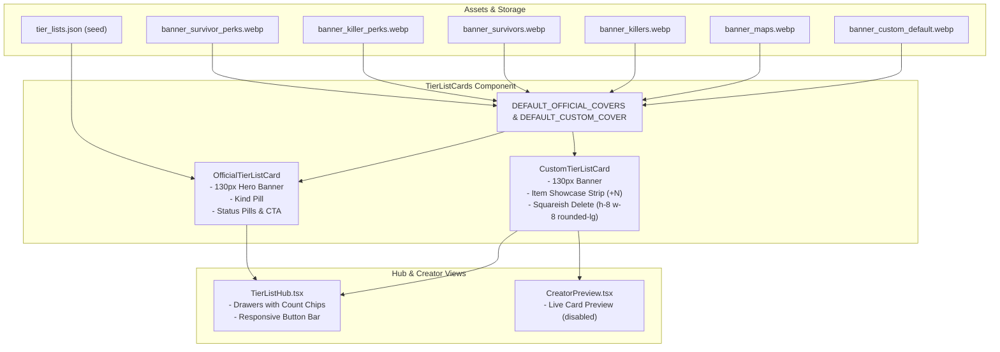

# Tier Lists Hub & Blocks Redesign Implementation Plan

> **For agentic workers:** REQUIRED SUB-SKILL: Use superpowers:subagent-driven-development to implement this plan task-by-task. Steps use checkbox (`- [ ]`) syntax for tracking.

**Goal:** Redesign the tier lists hub page (`/tier-lists`), replacing bland empty cards with rich Dead by Daylight atmospheric banners, turning the circular custom list delete button into a squareish action matching the editor toolbar, and replacing unstyled floating preview items with a structured item showcase strip.

**Architecture:**
1. Generate 6 bespoke high-resolution Dead by Daylight banners (Survivor Perks, Killer Perks, Survivors, Killers, Maps, Custom Default) stored statically in `frontend/public/images/tier-lists/` and mapped in `backend/app/seeds/data/content/tier_lists.json`.
2. Introduce a frontend fallback map `DEFAULT_OFFICIAL_COVERS` and `DEFAULT_CUSTOM_COVER` in `TierListCards.tsx` to guarantee every card always displays atmospheric DBD artwork even before database re-seed.
3. Rebuild `OfficialTierListCard` and `CustomTierListCard` with 130px hero banner headers, cinematic vignette gradient scrims, `h-8 w-8 rounded-lg` squareish delete actions, and an item thumbnail showcase strip with ladder pips.
4. Polish drawer headers in `TierListHub.tsx` with count badge chips and responsive layout alignment.

**Architecture Diagram:**



**Tech Stack:** Next.js 16 (App Router), React 19, Tailwind CSS v4 (@utility tokens, `lore-ash-card`), Lucide React icons, Node test runner (`node:test`, `node:assert/strict`).

## Global Constraints
- Typography must strictly use `type-*` roles from `globals.css` (checked by `scripts/check-typography.ts`).
- No hardcoded inline colors; use theme tokens (`accent-red`, `border-color`, `bg-surface`, `text-muted`).
- Breakpoints must follow mobile-first conventions and avoid unconstrained `wide` shadowing.
- Delete button on custom tier list cards must be squareish (`rounded-lg`, `h-8 w-8`), never circular (`rounded-xl` or `rounded-full`).
- All tests must pass: `npx tsx --test src/__tests__/unit/tierListsResponsiveAndSkeletons.test.ts`.

---

### Task 1: Generate & Deliver 6 Thematic Dead by Daylight Banners

**Files:**
- Create: `frontend/public/images/tier-lists/banner_survivor_perks.webp`
- Create: `frontend/public/images/tier-lists/banner_killer_perks.webp`
- Create: `frontend/public/images/tier-lists/banner_survivors.webp`
- Create: `frontend/public/images/tier-lists/banner_killers.webp`
- Create: `frontend/public/images/tier-lists/banner_maps.webp`
- Create: `frontend/public/images/tier-lists/banner_custom_default.webp`
- Modify: `backend/app/seeds/data/content/tier_lists.json:8-148`

**Interfaces:**
- Produces: 6 WebP banner assets in `frontend/public/images/tier-lists/` with 16:9 aspect ratio and dark cinematic Dead by Daylight aesthetic.
- Consumes: `image-generator` subagent for high-resolution asset creation.

- [ ] **Step 1: Write verification test for banner assets**

In `frontend/src/__tests__/unit/tierListsResponsiveAndSkeletons.test.ts`, add a test verifying banner files exist:
```ts
describe('Tier lists: banner assets', () => {
  it('all 6 official and default custom banner graphics exist in public/images/tier-lists/', () => {
    const banners = [
      'banner_survivor_perks.webp',
      'banner_killer_perks.webp',
      'banner_survivors.webp',
      'banner_killers.webp',
      'banner_maps.webp',
      'banner_custom_default.webp',
    ];
    const bannerDir = path.resolve(__dirname, '../../../public/images/tier-lists');
    for (const file of banners) {
      const fullPath = path.join(bannerDir, file);
      assert.ok(fs.existsSync(fullPath), `Missing banner: ${file}`);
      const stats = fs.statSync(fullPath);
      assert.ok(stats.size > 1024, `Banner too small: ${file} (${stats.size} bytes)`);
    }
  });
});
```

- [ ] **Step 2: Run test to verify it fails**

Run: `npx tsx --test src/__tests__/unit/tierListsResponsiveAndSkeletons.test.ts` in `frontend/`
Expected: FAIL with "Missing banner"

- [ ] **Step 3: Generate the 6 banners using image-generator and save to public directory**

Create directory `frontend/public/images/tier-lists/` and invoke `image-generator` with explicit prompts:
1. `banner_survivor_perks.webp`: Ethereal glowing survivor perk diamond frames in dark teal and cyan mist, ancient trial stone textures, subtle blue spirit wisps, cinematic 16:9 banner.
2. `banner_killer_perks.webp`: Glowing crimson killer perk diamond frames surrounded by dark entity spider limbs, fiery ember sparks, black ash, cinematic 16:9 banner.
3. `banner_survivors.webp`: Misty campfire in dark pine woods, silhouetted survivors warming hands by embers, cold fog background, cinematic 16:9 banner.
4. `banner_killers.webp`: Menacing Entity claws descending through dense red fog, dark silhouettes of slasher killers with ominous red stain aura, cinematic 16:9 banner.
5. `banner_maps.webp`: Haunted desolate realm landscape with abandoned structures, twisted dead trees, eerie pale moonlight through heavy fog, cinematic 16:9 banner.
6. `banner_custom_default.webp`: Dark trial drafting table blueprint, ancient Entity glyph markings, parchment textures, faint campfire embers, cinematic 16:9 banner.

- [ ] **Step 4: Update backend seeds `tier_lists.json` with banner cover URLs**

In `backend/app/seeds/data/content/tier_lists.json`, add `"cover_image_url"` to each official tier list:
- `survivor-perks`: `"/images/tier-lists/banner_survivor_perks.webp"`
- `killer-perks`: `"/images/tier-lists/banner_killer_perks.webp"`
- `survivors`: `"/images/tier-lists/banner_survivors.webp"`
- `killers`: `"/images/tier-lists/banner_killers.webp"`
- `maps`: `"/images/tier-lists/banner_maps.webp"`

- [ ] **Step 5: Run test to verify it passes**

Run: `npx tsx --test src/__tests__/unit/tierListsResponsiveAndSkeletons.test.ts` in `frontend/`
Expected: PASS

---

### Task 2: Redesign Official Tier List Card in `TierListCards.tsx`

**Files:**
- Modify: `frontend/src/components/tier-lists/TierListCards.tsx:17-78`
- Test: `frontend/src/__tests__/unit/tierListsResponsiveAndSkeletons.test.ts`

**Interfaces:**
- Produces: `OfficialTierListCard` with 130px hero banner header, category badge, crown badge, and status pills.
- Consumes: `TierListSummary`, `DEFAULT_OFFICIAL_COVERS` mapping.

- [ ] **Step 1: Write test for OfficialTierListCard redesign**

In `frontend/src/__tests__/unit/tierListsResponsiveAndSkeletons.test.ts`:
```ts
describe('Tier lists: OfficialTierListCard', () => {
  it('falls back to DEFAULT_OFFICIAL_COVERS when cover_image_url is empty', () => {
    const html = renderWithDictionary(
      React.createElement(OfficialTierListCard, {
        list: {
          slug: 'survivor-perks',
          kind: 'survivor_perks',
          title: 'Survivor Perks',
          description: 'Rank survivor perks',
          item_count: 240,
          has_default_placements: true,
          cover_image_url: '',
        },
        rankedCount: 15,
        locale: 'en',
      })
    );
    assert.ok(html.includes('/images/tier-lists/banner_survivor_perks.webp'));
    assert.ok(html.includes('Survivor Perks'));
    assert.ok(html.includes('15 ranked'));
  });
});
```

- [ ] **Step 2: Run test to verify it fails**

Run: `npx tsx --test src/__tests__/unit/tierListsResponsiveAndSkeletons.test.ts` in `frontend/`
Expected: FAIL

- [ ] **Step 3: Implement OfficialTierListCard with hero banner header and fallback map**

In `frontend/src/components/tier-lists/TierListCards.tsx`:
1. Define `DEFAULT_OFFICIAL_COVERS: Record<string, string>`.
2. Compute effective cover: `coverSrc(list.cover_image_url) ?? DEFAULT_OFFICIAL_COVERS[list.slug] ?? null`.
3. Wrap banner in top 130px hero container with gradient scrim:
   ```tsx
   <div className="relative -mx-5 -mt-5 mb-2 h-32 w-[calc(100%+2.5rem)] max-w-none overflow-hidden bg-bg-elevated">
     
     <div className="absolute inset-0 bg-gradient-to-t from-bg-surface via-bg-surface/50 to-transparent" />
     {showKindBadge && (
       <span className="absolute top-3 left-3 rounded-md bg-bg-surface/85 backdrop-blur-md px-2 py-0.5 type-label-2xs text-text-muted border border-border-color/60">
         {kindName}
       </span>
     )}
   </div>
   ```
4. Update card container with `lore-ash-card` edge styling and hover lifts.
5. Render title, description snippet, crown badge, items count, and animated ranking CTA.

- [ ] **Step 4: Run test to verify it passes**

Run: `npx tsx --test src/__tests__/unit/tierListsResponsiveAndSkeletons.test.ts` in `frontend/`
Expected: PASS

---

### Task 3: Redesign Custom Tier List Card with Squareish Delete & Item Showcase Strip

**Files:**
- Modify: `frontend/src/components/tier-lists/TierListCards.tsx:80-189`
- Test: `frontend/src/__tests__/unit/tierListsResponsiveAndSkeletons.test.ts`

**Interfaces:**
- Produces: `CustomTierListCard` with squareish `h-8 w-8 rounded-lg` delete button, 130px banner header, and `h-10 w-10` item showcase strip.
- Consumes: `StoredCustomList`, `DEFAULT_CUSTOM_COVER`.

- [ ] **Step 1: Write test for CustomTierListCard squareish delete button and item showcase**

In `frontend/src/__tests__/unit/tierListsResponsiveAndSkeletons.test.ts`:
```ts
describe('Tier lists: CustomTierListCard', () => {
  it('renders a squareish delete button (rounded-lg, not rounded-xl) and item showcase with overflow badge', () => {
    const customList: StoredCustomList = {
      id: 'test-custom',
      title: 'My Custom Tier List',
      description: 'Custom description',
      tiers: [
        { id: 's', label: 'S', color: 'tier-s' },
        { id: 'a', label: 'A', color: 'tier-a' },
      ],
      items: [
        { id: '1', name: 'Item 1', image: '/static/icons/1.png' },
        { id: '2', name: 'Item 2', image: '/static/icons/2.png' },
        { id: '3', name: 'Item 3', image: '/static/icons/3.png' },
        { id: '4', name: 'Item 4', image: '/static/icons/4.png' },
        { id: '5', name: 'Item 5', image: '/static/icons/5.png' },
      ],
      placements: { s: ['1', '2'] },
      createdAt: 1000,
      updatedAt: 2000,
    };
    const html = renderWithDictionary(
      React.createElement(CustomTierListCard, {
        list: customList,
        locale: 'en',
        onDelete: () => {},
      })
    );
    // Squareish delete button verification
    assert.ok(html.includes('h-8 w-8 rounded-lg'), 'Delete button must be squareish (rounded-lg)');
    assert.ok(!html.includes('p-1.5 rounded-xl'), 'Must not use circular rounded-xl on delete button');
    // Item showcase strip verification
    assert.ok(html.includes('+1'), 'Must render +1 overflow badge for 5th item');
    assert.ok(html.includes('banner_custom_default.webp'), 'Must fallback to default custom banner');
  });
});
```

- [ ] **Step 2: Run test to verify it fails**

Run: `npx tsx --test src/__tests__/unit/tierListsResponsiveAndSkeletons.test.ts` in `frontend/`
Expected: FAIL

- [ ] **Step 3: Implement CustomTierListCard redesign**

In `frontend/src/components/tier-lists/TierListCards.tsx`:
1. Define `DEFAULT_CUSTOM_COVER = '/images/tier-lists/banner_custom_default.webp'`.
2. Compute `effectiveBackground = background ?? DEFAULT_CUSTOM_COVER`.
3. Add top 130px hero banner container with gradient scrim:
   ```tsx
   <div className="relative -mx-5 -mt-5 mb-2 h-32 w-[calc(100%+2.5rem)] max-w-none overflow-hidden bg-bg-elevated">
     
     <div className="absolute inset-0 bg-gradient-to-t from-bg-surface via-bg-surface/50 to-transparent" />
     <span className="absolute top-3 left-3 rounded-md bg-bg-surface/85 backdrop-blur-md px-2 py-0.5 type-label-2xs text-text-muted border border-border-color/60">
       {t.kinds.custom}
     </span>
   </div>
   ```
4. Replace loose floating circular icons with structured **Item Showcase Strip**:
   - Render first 4 item thumbnails in `h-10 w-10 rounded-lg border border-border-color bg-bg-elevated object-cover shadow-xs`.
   - If `list.items.length > 4`, render `+${list.items.length - 4}` badge (`h-10 w-10 rounded-lg border border-dashed border-border-color bg-bg-surface/80 flex items-center justify-center type-strong-xs text-text-muted`).
   - If list has tiers, render mini tier color pips.
5. Replace circular delete button with squareish button:
   ```tsx
   <button
     type="button"
     onClick={(e) => {
       e.preventDefault();
       e.stopPropagation();
       onDelete(list.id, customTitle);
     }}
     {...tip(t.deleteList, undefined, 'action')}
     aria-label={`${t.deleteList} ${customTitle}`}
     className="h-8 w-8 rounded-lg border border-border-color bg-bg-surface text-text-muted hover:text-accent-red hover:border-accent-red/40 hover:bg-accent-red/15 transition-all flex items-center justify-center cursor-pointer shadow-xs"
   >
     <Trash2 className="h-4 w-4" aria-hidden="true" />
   </button>
   ```

- [ ] **Step 4: Run test to verify it passes**

Run: `npx tsx --test src/__tests__/unit/tierListsResponsiveAndSkeletons.test.ts` in `frontend/`
Expected: PASS

---

### Task 4: Polish Hub Drawers & Section Headers in `TierListHub.tsx`

**Files:**
- Modify: `frontend/src/components/tier-lists/TierListHub.tsx:112-299`
- Test: `frontend/src/__tests__/unit/tierListsResponsiveAndSkeletons.test.ts`

**Interfaces:**
- Produces: Section drawers with count badge chips (`5 Official Lists`, `{customCount} Custom Lists`), responsive action buttons, and polished empty states.

- [ ] **Step 1: Write test for Hub drawer counters**

In `frontend/src/__tests__/unit/tierListsResponsiveAndSkeletons.test.ts`:
```ts
describe('Tier lists: Hub drawer counts', () => {
  it('Hub contains count badges for official and custom sections', () => {
    const source = read('components/tier-lists/TierListHub.tsx');
    assert.match(source, /officialCount|lists\.length/);
    assert.match(source, /customCount/);
  });
});
```

- [ ] **Step 2: Run test to verify it fails**

Run: `npx tsx --test src/__tests__/unit/tierListsResponsiveAndSkeletons.test.ts` in `frontend/`
Expected: FAIL

- [ ] **Step 3: Implement count badges and header styling in `TierListHub.tsx`**

In `frontend/src/components/tier-lists/TierListHub.tsx`:
1. In Official section header: add `<span className="rounded-full bg-accent-red/10 border border-accent-red/30 px-2.5 py-0.5 type-strong-xs text-accent-red">{lists.length}</span>`.
2. In Custom section header: add `<span className="rounded-full bg-accent-red/10 border border-accent-red/30 px-2.5 py-0.5 type-strong-xs text-accent-red">{customCount}</span>`.
3. Enhance empty state for custom lists with a clear call-to-action button to create a new list.

- [ ] **Step 4: Run test to verify it passes**

Run: `npx tsx --test src/__tests__/unit/tierListsResponsiveAndSkeletons.test.ts` in `frontend/`
Expected: PASS

---

### Task 5: End-to-End Verification & Live Preview Compatibility Check

**Files:**
- Test: `frontend/src/__tests__/unit/tierListsResponsiveAndSkeletons.test.ts`
- Verify: `frontend/src/components/tier-lists/creator/CreatorPreview.tsx`

- [ ] **Step 1: Run complete tier lists unit test suite**

Run: `npx tsx --test src/__tests__/unit/tierListsResponsiveAndSkeletons.test.ts` in `frontend/`
Expected: All tests pass with 0 failures.

- [ ] **Step 2: Run typography verification**

Run: `npx tsx scripts/check-typography.ts` in `frontend/`
Expected: "All typography comes from globals.css tokens" (exit code 0).

- [ ] **Step 3: Run global styles verification**

Run: `npx tsx scripts/check-global-styles.ts` in `frontend/`
Expected: "No unscoped global styles found" (exit code 0).

- [ ] **Step 4: Run full TypeScript type check**

Run: `npx tsc --noEmit` in `frontend/`
Expected: Clean exit code 0 with zero errors.

- [ ] **Step 5: Visual and live preview check**

Verify `CreatorPreview.tsx` continues to render `CustomTierListCard` in disabled preview mode without console errors or layout jumping.
