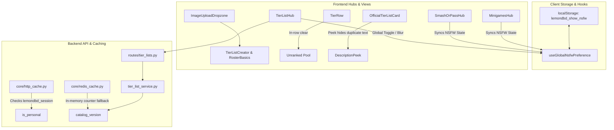

# Tier Lists, Smash or Pass & Minigames Polish & Enhancements Implementation Plan

> **For agentic workers:** REQUIRED SUB-SKILL: Use superpowers:subagent-driven-development to implement this plan task-by-task. Steps use checkbox (`- [ ]`) syntax for tracking.

**Goal:** Implement drag-and-drop cover/background upload, clean up official tier list labels, add draft/publish lifecycle and admin deletion, fix HTTP/Redis caching bugs causing stale NSFW badges, relocate the tier clear button to the tier row, provide unified global NSFW blurring across all modes, and hide duplicate descriptions during peek.

**Architecture:**
- Backend: Update `http_cache.py` to recognize `lemondbd_session` in `_is_personal()`, introduce an in-memory version counter fallback in `redis_cache.py` for development without Redis, add `is_active` support and `DELETE` endpoints for official tier lists, smash rosters, and minigames.
- Frontend Core: Centralize global NSFW preference in `localStorage` under `lemondbd_show_nsfw` with a reactive `useGlobalNsfwPreference()` hook. Provide an accessible, token-compliant `ImageUploadDropzone` in `components/common/`.
- Frontend Features: Add row-level clear action in `TierRow.tsx`, hide "Custom" badges on official lists, add draft toggle and admin deletion dialogs, blur NSFW cards with single-click global unblur, and hide card body text while `DescriptionPeek` is active.

**Architecture Diagram:**



**Tech Stack:** Next.js 14 App Router, React 18, TypeScript, Tailwind CSS, Lucide icons, Python 3.11, Flask, SQLAlchemy, Pydantic v2, Redis.

## Global Constraints

- Follow [docs/style-sources.md](file:///c:/Users/bezie/Desktop/proje/LemonDBD/docs/style-sources.md) strictly: use components and tokens (`rounded-chip`, `rounded-card`, `border-border-color`, `Button`, `Surface`, `Badge`). No raw `#hex` or `rgb()` styling.
- Maximum class string duplication: 45+ character strings may appear at most twice across the codebase (`duplicationGuards.test.ts`).
- Image payload cap: inline `data:` images must not exceed `TIER_LIST_LIMITS.maxDataImageChars` (131,072 characters / ~96KB).
- Always verify changes with `npm run check` in `frontend/`.

---

### Task 1: Backend Cache, Invalidation, and Personal Session Cookie Fix

**Files:**
- Modify: `backend/app/core/http_cache.py:55-70`
- Modify: `backend/app/core/redis_cache.py:40-65, 100-150`
- Test: `backend/tests/unit/test_catalog_cache_invalidation.py`

**Interfaces:**
- Consumes: `SESSION_COOKIE_NAME` from `app.core.security`.
- Produces: `_is_personal()` recognizing `lemondbd_session`, and `bump_catalog_version()` incrementing `_local_catalog_version` in memory when Redis is unavailable.

- [ ] **Step 1: Write the failing unit test for cache invalidation and personal cookie detection**

```python
# backend/tests/unit/test_catalog_cache_invalidation.py
import pytest
from flask import Flask, jsonify
from app.core.http_cache import cache_catalog, _is_personal
from app.core.redis_cache import bump_catalog_version, catalog_version
from app.core.security import SESSION_COOKIE_NAME

def test_is_personal_detects_lemondbd_session():
    app = Flask(__name__)
    with app.test_request_context("/", headers={"Cookie": f"{SESSION_COOKIE_NAME}=xyz123"}):
        assert _is_personal() is True

def test_bump_catalog_version_increments_when_redis_none(monkeypatch):
    from app.core import redis_cache
    monkeypatch.setattr(redis_cache, "get_client", lambda: None)
    v1 = catalog_version()
    bump_catalog_version()
    v2 = catalog_version()
    assert v2 > v1
```

- [ ] **Step 2: Run test to verify it fails**

Run: `pytest backend/tests/unit/test_catalog_cache_invalidation.py -v`
Expected: FAIL (`AssertionError: assert _is_personal() is False`, `assert v2 > v1`)

- [ ] **Step 3: Implement minimal code changes in `http_cache.py` and `redis_cache.py`**

In `backend/app/core/http_cache.py`:
Import `SESSION_COOKIE_NAME` from `app.core.security` and include it in `_is_personal()`:
```python
def _is_personal() -> bool:
    if request.args.get("user_id"):
        return True
    if request.headers.get("Authorization"):
        return True
    for cookie in ("access_token", "token", "session", SESSION_COOKIE_NAME):
        if request.cookies.get(cookie):
            return True
    return False
```

In `backend/app/core/redis_cache.py`:
Add a module-level `_local_catalog_version: int = 1`.
In `catalog_version()`, return `_local_catalog_version` when `client is None`.
In `bump_catalog_version()`, increment `_local_catalog_version += 1` when `client is None` and return it.

- [ ] **Step 4: Run test to verify it passes**

Run: `pytest backend/tests/unit/test_catalog_cache_invalidation.py -v`
Expected: PASS

- [ ] **Step 5: Commit**

```bash
git add backend/app/core/http_cache.py backend/app/core/redis_cache.py backend/tests/unit/test_catalog_cache_invalidation.py
git commit -m "fix(cache): recognize lemondbd_session and fallback version bump without redis"
```

---

### Task 2: Backend Draft State (`is_active`) and Admin Deletion for Tier Lists, Smash or Pass, and Minigames

**Files:**
- Modify: `backend/app/schemas/tier_list.py:35-55`
- Modify: `backend/app/services/tier_list_service.py:55-150, 180-250`
- Modify: `backend/app/routes/tier_lists.py:15-120`
- Modify: `backend/app/services/smash_or_pass/roster_admin.py:30-100`
- Modify: `backend/app/routes/smash_or_pass.py:80-140`
- Modify: `backend/app/routes/minigames.py:130-190`
- Test: `backend/tests/unit/api/test_tier_list_admin_lifecycle.py`

**Interfaces:**
- Consumes: `TierListAdminCreate`, `TierListAdminUpdate` with `is_active`.
- Produces:
  - `DELETE /api/v1/tier-lists/<slug>`
  - `DELETE /api/v1/smash-or-pass/admin/rosters/<slug>`
  - `DELETE /api/v1/minigames/official/<challenge_id>`
  - `include_inactive` filtering on list and get routes when admin.

- [ ] **Step 1: Write the failing unit tests for draft state and admin deletion**

```python
# backend/tests/unit/api/test_tier_list_admin_lifecycle.py
import pytest
from app.models.tier_list import TierList
from app.services import tier_list_service

def test_tier_list_service_draft_and_deletion(app, db_session, admin_user):
    # Test draft creation
    tl = tier_list_service.create_tier_list(
        title="Draft Test List",
        description="Draft description",
        cover_image_url=None,
        tiers=[{"id": "s", "label": "S", "color": "s"}],
        custom_items=[{"id": "i1", "name": "Item 1"}],
        is_nsfw=False,
        is_active=False,
    )
    assert tl.is_active is False
    slug = tl.slug

    # Anonymous list should not include draft
    public_lists = tier_list_service.list_tier_lists()
    assert not any(l["slug"] == slug for l in public_lists)

    # Admin list includes draft
    admin_lists = tier_list_service.list_tier_lists(include_inactive=True)
    assert any(l["slug"] == slug for l in admin_lists)

    # Deletion
    deleted = tier_list_service.delete_tier_list(slug)
    assert deleted is True
    assert tier_list_service.get_tier_list(slug, include_inactive=True) is None
```

- [ ] **Step 2: Run test to verify it fails**

Run: `pytest backend/tests/unit/api/test_tier_list_admin_lifecycle.py -v`
Expected: FAIL (`unexpected keyword argument 'is_active'`, `has no attribute 'delete_tier_list'`)

- [ ] **Step 3: Implement draft and delete in `tier_list_service.py`, `schemas/tier_list.py`, and `routes/tier_lists.py`**

- In `TierListAdminCreate`, add `is_active: bool = True`.
- In `TierListAdminUpdate`, add `is_active: bool | None = None`.
- In `tier_list_service.py`:
  - `create_tier_list`: accept `is_active: bool = True`, pass to `TierList(..., is_active=bool(is_active))`.
  - `update_tier_list`: accept `is_active: bool | None = _UNSET`; update `row.is_active = bool(is_active)`.
  - `delete_tier_list(slug: str) -> bool`: select row, `db.session.delete(row)`, `db.session.commit()`, `bump_catalog_version()`, `_rewrite_seed_file()`.
  - `list_tier_lists(lang: str | None = None, include_inactive: bool = False)`: if not `include_inactive`, filter `TierList.is_active.is_(True)`. Include `is_active` in summary dict.
  - `get_tier_list(slug: str, lang: str | None = None, include_inactive: bool = False)`: allow inactive when requested.
- In `routes/tier_lists.py`:
  - In `list_tier_lists`: check if `get_current_user()` is admin; if so, pass `include_inactive=True`.
  - In `get_tier_list`: pass `include_inactive=True` if current user is admin.
  - In `create_tier_list`: pass `payload.is_active` to `create_tier_list`.
  - In `update_tier_list`: pass `payload.is_active` to `update_tier_list`.
  - Add `@tier_lists_bp.route("/<string:slug>", methods=["DELETE"])` with `@admin_required` logging `log_admin_action`.
- Add delete route and `is_active` update in `routes/smash_or_pass.py` and `routes/minigames.py`.

- [ ] **Step 4: Run test to verify it passes**

Run: `pytest backend/tests/unit/api/test_tier_list_admin_lifecycle.py -v`
Expected: PASS

- [ ] **Step 5: Commit**

```bash
git add backend/app/schemas/tier_list.py backend/app/services/tier_list_service.py backend/app/routes/tier_lists.py backend/app/services/smash_or_pass/roster_admin.py backend/app/routes/smash_or_pass.py backend/app/routes/minigames.py backend/tests/unit/api/test_tier_list_admin_lifecycle.py
git commit -m "feat(api): add draft lifecycle and admin deletion for official tier lists and games"
```

---

### Task 3: Frontend API & Global NSFW Preference State Synchronization

**Files:**
- Modify: `frontend/src/utils/nsfwAck.ts`
- Modify: `frontend/src/services/tierListApi.ts`
- Modify: `frontend/src/services/smashApi.ts`
- Modify: `frontend/src/services/minigameApi.ts`
- Test: `frontend/src/__tests__/unit/globalNsfwPreference.test.ts`

**Interfaces:**
- Consumes: `localStorage`, `window.dispatchEvent`.
- Produces:
  - `getGlobalNsfwPreference(): boolean`
  - `setGlobalNsfwPreference(enabled: boolean): void`
  - `useGlobalNsfwPreference(): [boolean, (enabled: boolean) => void]`
  - `deleteOfficialTierList(slug: string, token?: string | null)`

- [ ] **Step 1: Write the failing unit test for global NSFW preference synchronization**

```typescript
// frontend/src/__tests__/unit/globalNsfwPreference.test.ts
import { describe, it, beforeEach } from 'node:test';
import assert from 'node:assert/strict';
import { getGlobalNsfwPreference, setGlobalNsfwPreference } from '../../utils/nsfwAck';

describe('Global NSFW Preference', () => {
  beforeEach(() => {
    localStorage.clear();
  });

  it('defaults to false when unset', () => {
    assert.equal(getGlobalNsfwPreference(), false);
  });

  it('updates and persists when setGlobalNsfwPreference is called', () => {
    setGlobalNsfwPreference(true);
    assert.equal(getGlobalNsfwPreference(), true);
    assert.equal(localStorage.getItem('lemondbd_show_nsfw'), 'true');
  });
});
```

- [ ] **Step 2: Run test to verify it fails**

Run: `node --test frontend/src/__tests__/unit/globalNsfwPreference.test.ts`
Expected: FAIL (`getGlobalNsfwPreference is not a function`)

- [ ] **Step 3: Implement `useGlobalNsfwPreference` and frontend API methods**

In `frontend/src/utils/nsfwAck.ts`:
- Define `GLOBAL_NSFW_KEY = 'lemondbd_show_nsfw'`.
- Implement `getGlobalNsfwPreference(): boolean`.
- Implement `setGlobalNsfwPreference(enabled: boolean): void` emitting `window.dispatchEvent(new CustomEvent('nsfw-pref-change', { detail: enabled }))`.
- Implement `useGlobalNsfwPreference(): [boolean, (val: boolean) => void]`.
In `frontend/src/services/tierListApi.ts`:
- Update `OfficialTierListCreatePayload` and `OfficialTierListUpdatePayload` to include `is_active?: boolean`.
- Implement `deleteOfficialTierList(slug: string, token?: string | null): Promise<void>`.
- In `updateOfficialTierList` and `deleteOfficialTierList`: invalidate both `tierListCacheKey(slug, lang)` and `catalogKey('tier-lists')`.

- [ ] **Step 4: Run test to verify it passes**

Run: `node --test frontend/src/__tests__/unit/globalNsfwPreference.test.ts`
Expected: PASS

- [ ] **Step 5: Commit**

```bash
git add frontend/src/utils/nsfwAck.ts frontend/src/services/tierListApi.ts frontend/src/services/smashApi.ts frontend/src/services/minigameApi.ts frontend/src/__tests__/unit/globalNsfwPreference.test.ts
git commit -m "feat(frontend): add global nsfw preference and admin delete API methods"
```

---

### Task 4: Frontend Reusable `ImageUploadDropzone` Component

**Files:**
- Create: `frontend/src/components/common/ImageUploadDropzone.tsx`
- Modify: `frontend/src/components/tier-lists/creator/TierListCreator.tsx:430-455`
- Modify: `frontend/src/components/smash-or-pass/creator/RosterBasicsSection.tsx:88-105`
- Test: `frontend/src/__tests__/unit/imageUploadDropzone.test.ts`

**Interfaces:**
- Consumes: `docs/style-sources.md` tokens, `Button`, `Input`, `Surface`.
- Produces: `<ImageUploadDropzone value={imageUrl} onChange={onImageChange} label={label} hint={hint} />`.

- [ ] **Step 1: Write unit test verifying ImageUploadDropzone export, token usage, and character safety**

```typescript
// frontend/src/__tests__/unit/imageUploadDropzone.test.ts
import { describe, it } from 'node:test';
import assert from 'node:assert/strict';
import fs from 'node:fs';
import path from 'node:path';

describe('ImageUploadDropzone Style Compliance', () => {
  it('does not contain hardcoded hex colors or forbidden radii', () => {
    const file = path.resolve('frontend/src/components/common/ImageUploadDropzone.tsx');
    assert.ok(fs.existsSync(file), 'ImageUploadDropzone.tsx must exist');
    const content = fs.readFileSync(file, 'utf-8');
    assert.ok(!/#([0-9a-f]{3}|[0-9a-f]{6})\b/i.test(content), 'No hex colors allowed');
    assert.ok(!/rounded-(xl|2xl|3xl)/.test(content), 'Must use semantic radii (rounded-card, rounded-chip)');
  });
});
```

- [ ] **Step 2: Run test to verify it fails**

Run: `node --test frontend/src/__tests__/unit/imageUploadDropzone.test.ts`
Expected: FAIL (`ImageUploadDropzone.tsx must exist`)

- [ ] **Step 3: Implement `ImageUploadDropzone.tsx` and integrate in creators**

- Create `frontend/src/components/common/ImageUploadDropzone.tsx`:
  - Prop interface: `value?: string`, `onChange: (val: string) => void`, `label?: string`, `hint?: string`, `aspectRatio?: 'banner' | 'square'`.
  - Drag and drop handlers with visual state toggle (`isDragging`).
  - File picker `<input type="file" accept="image/*">`.
  - Helper to process file into safe data URL (resized to 1200px max edge, quality 0.85, adhering to `maxDataImageChars`).
  - Preview card with `<Button variant="overlay" size="xs" icon pill>` delete action.
  - Optional expander to paste direct `https://` image link.
- In `TierListCreator.tsx`:
  - Replace `<label className="md:col-span-2">` background URL input with `<ImageUploadDropzone value={draft.backgroundImage} onChange={(val) => patch({ backgroundImage: val })} />`.
- In `RosterBasicsSection.tsx`:
  - Replace/augment cover image input with `<ImageUploadDropzone value={draft.cover_image_url} onChange={(val) => patch({ cover_image_url: val })} />`.

- [ ] **Step 4: Run test to verify it passes**

Run: `node --test frontend/src/__tests__/unit/imageUploadDropzone.test.ts`
Expected: PASS

- [ ] **Step 5: Run style check**

Run: `npm --prefix frontend run check:styles`
Expected: PASS

- [ ] **Step 6: Commit**

```bash
git add frontend/src/components/common/ImageUploadDropzone.tsx frontend/src/components/tier-lists/creator/TierListCreator.tsx frontend/src/components/smash-or-pass/creator/RosterBasicsSection.tsx frontend/src/__tests__/unit/imageUploadDropzone.test.ts
git commit -m "feat(ui): add ImageUploadDropzone component for tier lists and smash or pass"
```

---

### Task 5: Tier Row Clear Button & Chrome Polish ("Custom" Removal & Description Duplicate Suppression)

**Files:**
- Modify: `frontend/src/components/tier-lists/TierRow.tsx`
- Modify: `frontend/src/components/tier-lists/TierEditModal.tsx`
- Modify: `frontend/src/components/tier-lists/TierListEditor.tsx`
- Modify: `frontend/src/components/tier-lists/OfficialTierListView.tsx`
- Modify: `frontend/src/components/tier-lists/TierListCards.tsx`
- Test: `frontend/src/__tests__/unit/tierRowAndChromePolish.test.ts`

**Interfaces:**
- Consumes: `keys.length`, `onClear(tierId)`.
- Produces: In-row clear button on `TierRow`, suppressed "Custom" banner on official custom tier lists, and hidden `<p ref={descRef}>` during `DescriptionPeek`.

- [ ] **Step 1: Write unit tests for row clear button presence, "Custom" suppression, and description duplicate suppression**

```typescript
// frontend/src/__tests__/unit/tierRowAndChromePolish.test.ts
import { describe, it } from 'node:test';
import assert from 'node:assert/strict';
import fs from 'node:fs';
import path from 'node:path';

describe('Tier Row & Chrome Polish', () => {
  it('TierRow contains onClear handler and in-row action', () => {
    const content = fs.readFileSync(path.resolve('frontend/src/components/tier-lists/TierRow.tsx'), 'utf-8');
    assert.match(content, /onClear/);
  });

  it('TierEditModal no longer contains onClear button', () => {
    const content = fs.readFileSync(path.resolve('frontend/src/components/tier-lists/TierEditModal.tsx'), 'utf-8');
    assert.doesNotMatch(content, /clearTier/);
  });

  it('OfficialTierListView does not pass "Custom" kindLabel', () => {
    const content = fs.readFileSync(path.resolve('frontend/src/components/tier-lists/OfficialTierListView.tsx'), 'utf-8');
    assert.match(content, /template\.kind === 'custom' \? undefined : /);
  });
});
```

- [ ] **Step 2: Run test to verify it fails**

Run: `node --test frontend/src/__tests__/unit/tierRowAndChromePolish.test.ts`
Expected: FAIL

- [ ] **Step 3: Implement code changes in `TierRow.tsx`, `TierEditModal.tsx`, `OfficialTierListView.tsx`, and `TierListCards.tsx`**

- In `TierRow.tsx`:
  - Add `onClear: (tierId: string) => void` prop.
  - On the right end of the droppable row, when `keys.length > 0`, render:
    ```tsx
    <div className="ml-auto self-center p-1">
      <Button
        variant="ghost"
        size="xs"
        icon
        pill
        aria-label={t.clearTier}
        {...tip(t.clearTier, undefined, 'action')}
        onClick={(e) => {
          e.stopPropagation();
          onClear(tier.id);
        }}
      >
        <Eraser className="h-4 w-4 text-text-muted hover:text-accent-red" aria-hidden="true" />
      </Button>
    </div>
    ```
- In `TierEditModal.tsx`:
  - Remove `onClear` prop and the `{t.clearTier}` button.
- In `TierListEditor.tsx`:
  - Wire `onClear` from ladder state down to `TierRow`.
- In `OfficialTierListView.tsx`:
  - Set `kindLabel={template.kind === 'custom' ? undefined : t.kinds[template.kind]}`.
- In `TierListCards.tsx`:
  - In `OfficialTierListCard`, hide `kindBadge` when `list.kind === 'custom'`.
  - In `DescriptionPeek`: pass `onOpenChange` or add a hover state in `OfficialTierListCard` and `CustomTierListCard`:
    When `DescriptionPeek` is open, add `opacity-0 pointer-events-none transition-opacity duration-200` to `<p ref={descRef}>`.

- [ ] **Step 4: Run test to verify it passes**

Run: `node --test frontend/src/__tests__/unit/tierRowAndChromePolish.test.ts`
Expected: PASS

- [ ] **Step 5: Commit**

```bash
git add frontend/src/components/tier-lists/TierRow.tsx frontend/src/components/tier-lists/TierEditModal.tsx frontend/src/components/tier-lists/TierListEditor.tsx frontend/src/components/tier-lists/OfficialTierListView.tsx frontend/src/components/tier-lists/TierListCards.tsx frontend/src/__tests__/unit/tierRowAndChromePolish.test.ts
git commit -m "feat(tier-lists): add in-row clear button, remove custom badge, and hide duplicate description"
```

---

### Task 6: Unified Hub NSFW Blurring & Admin Draft/Delete UX (Tier Lists, Smash or Pass, Minigames)

**Files:**
- Modify: `frontend/src/components/tier-lists/TierListHub.tsx`
- Modify: `frontend/src/components/tier-lists/TierListCards.tsx`
- Modify: `frontend/src/components/tier-lists/OfficialTierListView.tsx`
- Modify: `frontend/src/components/tier-lists/creator/TierListCreator.tsx`
- Modify: `frontend/src/components/smash-or-pass/SmashOrPassHub.tsx`
- Modify: `frontend/src/components/smash-or-pass/roster-select/RosterCarouselCard.tsx`
- Modify: `frontend/src/components/minigames/MinigamesHub.tsx`
- Test: `frontend/src/__tests__/unit/hubNsfwAndDrafts.test.ts`

**Interfaces:**
- Consumes: `useGlobalNsfwPreference()`, `useAuth().isAdmin`, `deleteOfficialTierList()`.
- Produces: Hub NSFW blurring with instant global reveal, Draft badges, admin deletion modals.

- [ ] **Step 1: Write unit tests verifying hub NSFW blurring and draft rendering**

```typescript
// frontend/src/__tests__/unit/hubNsfwAndDrafts.test.ts
import { describe, it } from 'node:test';
import assert from 'node:assert/strict';
import fs from 'node:fs';
import path from 'node:path';

describe('Hub NSFW & Draft Rendering', () => {
  it('TierListHub imports and uses useGlobalNsfwPreference', () => {
    const hub = fs.readFileSync(path.resolve('frontend/src/components/tier-lists/TierListHub.tsx'), 'utf-8');
    assert.match(hub, /useGlobalNsfwPreference/);
  });

  it('OfficialTierListCard renders blur overlay when is_nsfw and showNsfw is false', () => {
    const cards = fs.readFileSync(path.resolve('frontend/src/components/tier-lists/TierListCards.tsx'), 'utf-8');
    assert.match(cards, /blur-md/);
  });
});
```

- [ ] **Step 2: Run test to verify it fails**

Run: `node --test frontend/src/__tests__/unit/hubNsfwAndDrafts.test.ts`
Expected: FAIL

- [ ] **Step 3: Implement global NSFW blurring and Draft / Deletion UX**

- In `TierListHub.tsx`:
  - Hook `const [showNsfw, setShowNsfw] = useGlobalNsfwPreference()`.
  - Add `<NsfwSwitch checked={showNsfw} onChange={setShowNsfw} label={t.nsfw.toggleLabel} hint={t.nsfw.toggleHint} />` in the header bar.
  - Pass `showNsfw` and `onRevealNsfw={() => setShowNsfw(true)}` to `OfficialTierListCard` and `CustomTierListCard`.
- In `TierListCards.tsx`:
  - For `is_nsfw: true`: when `!showNsfw`, apply `filter blur-md` on the banner ``. Render an overlay with `<NsfwBadge>` and `<Button variant="overlay" size="sm" onClick={(e) => { e.preventDefault(); e.stopPropagation(); onRevealNsfw(); }}>{t.nsfw.reveal}</Button>`.
  - For `is_active === false`: if user is admin, render `<Badge tone="amber" size="sm">{t.draft}</Badge>`.
- In `TierListCreator.tsx`:
  - If `isAdmin`, add a Switch in the basics section: "Published" / "Draft" (`is_active`). Pass `is_active` in payload to `createOfficialTierList` and `updateOfficialTierList`.
- In `OfficialTierListView.tsx`:
  - If `isAdmin`, render `<Button variant="danger" size="sm" icon onClick={() => setDeleteConfirmOpen(true)}>` on the toolbar.
  - Connect `<ConfirmModal>` to call `deleteOfficialTierList(slug, token)`.
- In `SmashOrPassHub.tsx` & `RosterCarouselCard.tsx`:
  - Connect to `useGlobalNsfwPreference()`. Apply blur to NSFW roster in carousel when `!showNsfw`.
- In `MinigamesHub.tsx`:
  - Connect to `useGlobalNsfwPreference()`. Apply blur to NSFW custom trials when `!showNsfw`.

- [ ] **Step 4: Run test to verify it passes**

Run: `node --test frontend/src/__tests__/unit/hubNsfwAndDrafts.test.ts`
Expected: PASS

- [ ] **Step 5: Commit**

```bash
git add frontend/src/components/tier-lists/TierListHub.tsx frontend/src/components/tier-lists/TierListCards.tsx frontend/src/components/tier-lists/OfficialTierListView.tsx frontend/src/components/tier-lists/creator/TierListCreator.tsx frontend/src/components/smash-or-pass/SmashOrPassHub.tsx frontend/src/components/smash-or-pass/roster-select/RosterCarouselCard.tsx frontend/src/components/minigames/MinigamesHub.tsx frontend/src/__tests__/unit/hubNsfwAndDrafts.test.ts
git commit -m "feat(hub): add unified nsfw blurring, draft badges, and admin deletion"
```

---

### Task 7: Full System Verification, Linting, Style Checks & Translations

**Files:**
- Modify: `frontend/src/locales/en/tierLists.ts`, `frontend/src/locales/pl/tierLists.ts`, `frontend/src/locales/de/tierLists.ts`, `frontend/src/locales/es/tierLists.ts`
- Run: Full checks across frontend and backend.

- [ ] **Step 1: Add required locale keys**

Ensure keys for `t.nsfw.reveal`, `t.nsfw.toggleLabel`, `t.nsfw.toggleHint`, `t.draft`, `t.deleteOfficialConfirmTitle`, `t.deleteOfficialConfirmDesc` exist in all supported locales (`en`, `pl`, `de`, `es`, `ja`).

- [ ] **Step 2: Run frontend type-check, lint, style-check, and duplication guards**

Run: `npm --prefix frontend run check`
Expected: PASS (0 errors, 0 lint warnings, 0 duplication violations).

- [ ] **Step 3: Run frontend unit test suite**

Run: `npm --prefix frontend run test:unit`
Expected: ALL PASS.

- [ ] **Step 4: Run backend unit test suite**

Run: `pytest backend/tests/unit/api/test_tier_list_routes.py backend/tests/unit/api/test_tier_list_admin_lifecycle.py backend/tests/unit/test_catalog_cache_invalidation.py`
Expected: ALL PASS.

- [ ] **Step 5: Commit**

```bash
git add frontend/src/locales/
git commit -m "chore: add localization strings and pass all verification checks"
```
