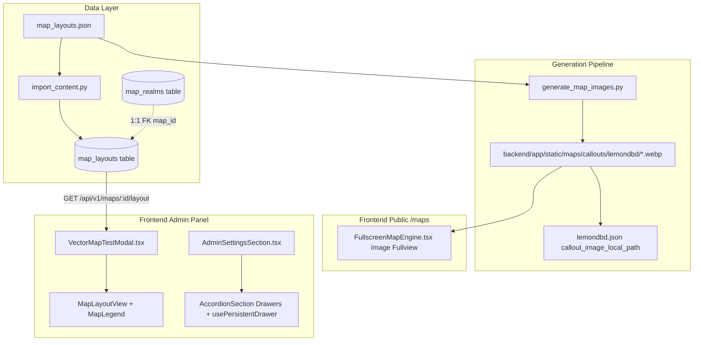

# Map Layout Extraction, WebP Generator, Admin Vector Test & Admin Settings Drawers Implementation Plan

> **For agentic workers:** REQUIRED SUB-SKILL: Use superpowers:subagent-driven-development to implement this plan task-by-task. Steps use checkbox (`- [ ]`) syntax for tracking.

**Goal:** Decouple vector layout footprints into a separate database table (`map_layouts`) and seed file, generate standalone `.webp` map images with baked-in clock numbers and grid tiles, make public maps view these `.webp` images uniformly, move the live vector layout engine to an admin test modal, and convert Admin Settings into collapsible drawers.

**Architecture:**
- **Database**: Add `MapLayout` model (`map_layouts` table with FK `map_id` referencing `map_realms.id`, unique, indexed, cascade delete). Alembic migration `0031_extract_map_layouts.py` migrates existing data and drops `map_realms.layout`.
- **Seed Data**: Decouple `layout` objects from `lemondbd.json` into `backend/app/seeds/data/content/map_layouts.json`. Update `import_content.py` and `export_writer.py`.
- **Image Generation**: Python script `backend/scripts/generate_map_images.py` uses Pillow to render outline, 8m grid, 16m tiles, 1–12 clock callouts, and landmarks into `.webp` images under `backend/app/static/maps/callouts/lemondbd/<realm_slug>/<map_slug>.webp`.
- **Public & Admin UI**:
  - Public maps `/maps` uses `.webp` images for pan/zoom across both sources.
  - Admin panel Tools tab -> Tests gets an "Open Test" button for the Vector Map Layout Engine modal (`VectorMapTestModal.tsx`), fetching layout on-demand via `GET /api/v1/maps/{id}/layout`.
  - Admin panel Settings tab wraps all 10 groups into collapsible `AccordionSection` drawers using `usePersistentDrawer` with unsaved change badges.

**Architecture Diagram:**



**Tech Stack:**
- Backend: Python 3.12+, FastAPI, SQLAlchemy 2.0, Alembic, Pillow (`PIL` 12.3.0), SQLite / PostgreSQL
- Frontend: Next.js 15 (App Router), React 19, TypeScript, Tailwind CSS, Lucide icons
- Testing: `pytest`, Node.js native test runner (`tsx --test`), ESLint / Oxlint

## Global Constraints

- Preserve full 5-locale parity across `en`, `de`, `es`, `ja`, and `pl`.
- Never use unstyled native DOM `title` attributes (use `tip()` or omit).
- Never use arbitrary Tailwind classes (e.g., `max-h-[...]`, raw `font-mono`); strictly use design tokens.
- No layout payload in public `/api/v1/maps` responses to keep payload small.
- All code changes must pass linting (`npm run lint`), type checking (`npm run typecheck`), style guards (`npm run check:styles`, `npm run check:typography`), and unit tests.

---

### Task 1: Database Model & Alembic Migration for `MapLayout`

**Files:**
- Create: `backend/app/models/map_layout.py`
- Modify: `backend/app/models/map.py:1-25`, `backend/app/models/map.py:110-135`, `backend/app/models/__init__.py:1-30`
- Create: `backend/migrations/versions/0031_extract_map_layouts.py`
- Test: `backend/tests/unit/test_map_layout_model.py`

**Interfaces:**
- Produces: `MapLayout` SQLAlchemy model on table `map_layouts` with columns:
  - `id`: `Mapped[int] = mapped_column(primary_key=True)`
  - `map_id`: `Mapped[int] = mapped_column(ForeignKey("map_realms.id", ondelete="CASCADE"), unique=True, index=True, nullable=False)`
  - `version`: `Mapped[int] = mapped_column(Integer, nullable=False, default=1)`
  - `layout_data`: `Mapped[dict[str, Any]] = mapped_column(JSONB().with_variant(JSON(), "sqlite"), nullable=False)`
  - `created_at`: `Mapped[datetime] = mapped_column(DateTime(timezone=True), default=utcnow, nullable=False)`
- Consumes: `MapRealm` in `backend/app/models/map.py` (relates to `MapLayout` via `layout_record`).

- [ ] **Step 1: Write the failing unit test for `MapLayout` model**

Create `backend/tests/unit/test_map_layout_model.py`:
```python
# backend/tests/unit/test_map_layout_model.py
import pytest
from sqlalchemy import select
from app.core.extensions import db
from app.models.map import Realm, MapSource, MapRealm
from app.models.map_layout import MapLayout


@pytest.mark.unit
def test_map_layout_creation_and_cascade_delete(db_session) -> None:
    realm = Realm(name="Autohaven Test Realm")
    source = MapSource(code="test_source", label="Test Source")
    db_session.add_all([realm, source])
    db_session.flush()

    map_obj = MapRealm(
        name="Azarov Test Map",
        realm_id=realm.id,
        source_id=source.id,
    )
    db_session.add(map_obj)
    db_session.flush()

    layout = MapLayout(
        map_id=map_obj.id,
        version=1,
        layout_data={"cell_m": 8, "width_m": 128, "height_m": 128, "floors": []},
    )
    db_session.add(layout)
    db_session.commit()

    fetched = db_session.scalar(select(MapLayout).where(MapLayout.map_id == map_obj.id))
    assert fetched is not None
    assert fetched.layout_data["width_m"] == 128
    assert map_obj.layout_record.id == fetched.id

    # Test cascade delete
    db_session.delete(map_obj)
    db_session.commit()

    orphaned = db_session.scalar(select(MapLayout).where(MapLayout.id == fetched.id))
    assert orphaned is None
```

- [ ] **Step 2: Run test to verify it fails**

Run: `.\.venv\Scripts\pytest backend/tests/unit/test_map_layout_model.py`
Expected: FAIL with `ModuleNotFoundError: No module named 'app.models.map_layout'`.

- [ ] **Step 3: Implement `MapLayout` model, update `MapRealm`, and register in `__init__.py`**

Create `backend/app/models/map_layout.py`:
```python
# backend/app/models/map_layout.py
from datetime import datetime
from typing import TYPE_CHECKING, Any

from sqlalchemy import DateTime, ForeignKey, Integer, JSON
from sqlalchemy.dialects.postgresql import JSONB
from sqlalchemy.orm import Mapped, mapped_column, relationship

from app.core.extensions import Base
from app.models.base import TranslatableModelMixin, utcnow

if TYPE_CHECKING:
    from app.models.map import MapRealm


class MapLayout(Base):
    """The scalable vector footprint of a map, decoupled from core map metadata."""

    __tablename__ = "map_layouts"

    id: Mapped[int] = mapped_column(primary_key=True)
    map_id: Mapped[int] = mapped_column(
        ForeignKey("map_realms.id", ondelete="CASCADE"),
        unique=True,
        index=True,
        nullable=False,
    )
    version: Mapped[int] = mapped_column(Integer, nullable=False, default=1)
    layout_data: Mapped[dict[str, Any]] = mapped_column(
        JSONB().with_variant(JSON(), "sqlite"), nullable=False
    )
    created_at: Mapped[datetime] = mapped_column(
        DateTime(timezone=True), default=utcnow, nullable=False
    )

    map: Mapped["MapRealm"] = relationship(back_populates="layout_record")

    def to_dict(self) -> dict[str, Any]:
        return {
            "id": self.id,
            "map_id": self.map_id,
            "version": self.version,
            "layout": self.layout_data,
        }
```

In `backend/app/models/map.py`:
- Add `from typing import TYPE_CHECKING` and import `MapLayout` if `TYPE_CHECKING`.
- Remove `layout: Mapped[dict[str, Any] | None]` column from `MapRealm`.
- Add `layout_record: Mapped["MapLayout | None"] = relationship("MapLayout", back_populates="map", uselist=False, cascade="all, delete-orphan")`.
- Update `MapRealm.to_dict()`: remove `"layout": self.layout`.

Update `backend/app/models/__init__.py`:
- Import and export `MapLayout`.

- [ ] **Step 4: Create Alembic migration `0031_extract_map_layouts.py`**

Create `backend/migrations/versions/0031_extract_map_layouts.py`:
```python
# backend/migrations/versions/0031_extract_map_layouts.py
"""extract map_layouts into separate table

Revision ID: 0031_extract_map_layouts
Revises: 0030_map_layouts
Create Date: 2026-10-25
"""
import sqlalchemy as sa
from alembic import op
from sqlalchemy.dialects import postgresql

revision = "0031_extract_map_layouts"
down_revision = "0030_map_layouts"
branch_labels = None
depends_on = None


def upgrade() -> None:
    bind = op.get_bind()
    inspector = sa.inspect(bind)
    tables = inspector.get_table_names()

    if "map_layouts" not in tables:
        op.create_table(
            "map_layouts",
            sa.Column("id", sa.Integer(), primary_key=True),
            sa.Column(
                "map_id",
                sa.Integer(),
                sa.ForeignKey("map_realms.id", ondelete="CASCADE"),
                unique=True,
                nullable=False,
            ),
            sa.Column("version", sa.Integer(), nullable=False, server_default="1"),
            sa.Column(
                "layout_data",
                sa.JSON().with_variant(postgresql.JSONB(), "postgresql"),
                nullable=False,
            ),
            sa.Column(
                "created_at",
                sa.DateTime(timezone=True),
                server_default=sa.func.now(),
                nullable=False,
            ),
        )
        op.create_index("ix_map_layouts_map_id", "map_layouts", ["map_id"])

    columns = {col["name"] for col in inspector.get_columns("map_realms")}
    if "layout" in columns:
        # Migrate data if present
        conn = op.get_bind()
        conn.execute(
            sa.text(
                "INSERT INTO map_layouts (map_id, version, layout_data, created_at) "
                "SELECT id, 1, layout, CURRENT_TIMESTAMP FROM map_realms "
                "WHERE layout IS NOT NULL "
                "ON CONFLICT (map_id) DO NOTHING"
                if bind.dialect.name == "postgresql"
                else "INSERT OR IGNORE INTO map_layouts (map_id, version, layout_data, created_at) "
                     "SELECT id, 1, layout, CURRENT_TIMESTAMP FROM map_realms WHERE layout IS NOT NULL"
            )
        )
        op.drop_column("map_realms", "layout")


def downgrade() -> None:
    bind = op.get_bind()
    inspector = sa.inspect(bind)
    columns = {col["name"] for col in inspector.get_columns("map_realms")}
    if "layout" not in columns:
        op.add_column(
            "map_realms",
            sa.Column("layout", sa.JSON().with_variant(postgresql.JSONB(), "postgresql"), nullable=True),
        )
    tables = inspector.get_table_names()
    if "map_layouts" in tables:
        op.drop_index("ix_map_layouts_map_id", "map_layouts")
        op.drop_table("map_layouts")
```

- [ ] **Step 5: Run unit test to verify it passes**

Run: `.\.venv\Scripts\pytest backend/tests/unit/test_map_layout_model.py`
Expected: PASS.

- [ ] **Step 6: Commit changes**

```bash
git add backend/app/models/map_layout.py backend/app/models/map.py backend/app/models/__init__.py backend/migrations/versions/0031_extract_map_layouts.py backend/tests/unit/test_map_layout_model.py
git commit -m "feat(maps): add MapLayout model and 0031_extract_map_layouts migration"
```

---

### Task 2: Decouple Seed Data, Content Import/Export & On-Demand Layout API

**Files:**
- Create: `backend/app/seeds/data/content/map_layouts.json`
- Modify: `backend/app/seeds/data/content/maps/lemondbd.json`
- Modify: `backend/app/services/db/import_content.py:270-340`
- Modify: `backend/app/services/db/export_writer.py:136-160`
- Modify: `backend/app/schemas/map.py:65-94`
- Modify: `backend/app/api/v1/maps.py:1-60`
- Modify: `backend/tests/unit/test_map_layouts_seed.py`
- Create: `backend/tests/unit/test_map_layout_api.py`

**Interfaces:**
- Produces:
  - `GET /api/v1/maps/{map_id}/layout` returning `{"map_id": int, "layout": dict}` (or 404 if not found).
  - Seed file `backend/app/seeds/data/content/map_layouts.json`.
  - Lean `lemondbd.json` without `layout` property.
  - `import_content()` imports `map_layouts.json` into table `map_layouts`.
  - `export_writer.py` exports `map_layouts`.

- [ ] **Step 1: Write script or extract `layout` from `lemondbd.json` into `map_layouts.json`**

Create `backend/app/seeds/data/content/map_layouts.json` containing:
```json
{
  "map_layouts": [
    {
      "map_id": 1,
      "version": 1,
      "layout_data": { ... }
    },
    ...
  ]
}
```
And remove `"layout"` key from all maps in `backend/app/seeds/data/content/maps/lemondbd.json`.

- [ ] **Step 2: Update `backend/tests/unit/test_map_layouts_seed.py`**

Update `test_map_layouts_seed.py` to read `map_layouts.json` and verify:
- All 58 LemonDBD maps in `lemondbd.json` have a matching layout in `map_layouts.json`.
- Layout dimensions match map sizes.
- Outline areas and approximate flags are valid.

Run: `.\.venv\Scripts\pytest backend/tests/unit/test_map_layouts_seed.py`
Expected: PASS.

- [ ] **Step 3: Update `import_content.py` and `export_writer.py`**

In `backend/app/services/db/import_content.py`:
- In `_import_maps`, remove `"layout"` from the update fields on `map_obj`.
- Add `_import_map_layouts`:
```python
def _import_map_layouts(
    data: dict[str, Any],
    target_keys: set[str],
    summary: dict[str, dict[str, int]],
) -> None:
    """Map vector layouts, keyed by map_id."""
    if "map_layouts" in target_keys and "map_layouts" in data:
        created = updated = 0
        for ldata in data["map_layouts"]:
            map_id = ldata.get("map_id")
            if not isinstance(map_id, int):
                continue
            layout_obj = db.session.scalar(
                select(MapLayout).where(MapLayout.map_id == map_id)
            )
            if not layout_obj:
                layout_obj = MapLayout(
                    map_id=map_id,
                    version=ldata.get("version", 1),
                    layout_data=ldata.get("layout_data", {}),
                )
                db.session.add(layout_obj)
                created += 1
            else:
                layout_obj.version = ldata.get("version", 1)
                layout_obj.layout_data = ldata.get("layout_data", {})
                updated += 1
        db.session.flush()
        summary["map_layouts"] = {"created": created, "updated": updated}
```
- Call `_import_map_layouts` in `import_content()`.

In `backend/app/services/db/export_writer.py`:
- Add `_export_map_layouts(export_data, counts)` exporting rows from `map_layouts`.
- In `_export_maps`, omit `"layout"`.

- [ ] **Step 4: Add `GET /api/v1/maps/{map_id}/layout` endpoint in `backend/app/api/v1/maps.py`**

In `backend/app/schemas/map.py`:
```python
class MapLayoutDetailResponse(BaseModel):
    map_id: int
    version: int
    layout: dict[str, Any]

    model_config = ConfigDict(from_attributes=True)
```

In `backend/app/api/v1/maps.py`:
```python
@router.get("/{map_id}/layout", response_model=MapLayoutDetailResponse)
def get_map_layout(
    map_id: int,
    db_session: Session = Depends(get_db),
) -> MapLayoutDetailResponse:
    """Fetch vector layout footprint for a single map on demand."""
    layout = db_session.scalar(select(MapLayout).where(MapLayout.map_id == map_id))
    if not layout:
        raise HTTPException(status_code=404, detail="Map layout not found")
    return MapLayoutDetailResponse(
        map_id=layout.map_id,
        version=layout.version,
        layout=layout.layout_data,
    )
```

- [ ] **Step 5: Write unit test for the on-demand layout API**

Create `backend/tests/unit/test_map_layout_api.py`:
```python
# backend/tests/unit/test_map_layout_api.py
import pytest
from app.models.map import Realm, MapSource, MapRealm
from app.models.map_layout import MapLayout


@pytest.mark.unit
def test_get_map_layout_endpoint(client, db_session) -> None:
    realm = Realm(name="Test Realm")
    source = MapSource(code="lemondbd", label="LemonDBD")
    db_session.add_all([realm, source])
    db_session.flush()

    m = MapRealm(name="Azarov Test", realm_id=realm.id, source_id=source.id)
    db_session.add(m)
    db_session.flush()

    layout = MapLayout(
        map_id=m.id,
        version=1,
        layout_data={"width_m": 128, "height_m": 128, "floors": []},
    )
    db_session.add(layout)
    db_session.commit()

    resp = client.get(f"/api/v1/maps/{m.id}/layout")
    assert resp.status_code == 200
    data = resp.json()
    assert data["map_id"] == m.id
    assert data["layout"]["width_m"] == 128

    resp_404 = client.get("/api/v1/maps/99999/layout")
    assert resp_404.status_code == 404
```

- [ ] **Step 6: Run tests and verify**

Run: `.\.venv\Scripts\pytest backend/tests/unit/test_map_layout_api.py backend/tests/unit/test_map_layouts_seed.py`
Expected: PASS.

- [ ] **Step 7: Commit changes**

```bash
git add backend/app/seeds/data/content/map_layouts.json backend/app/seeds/data/content/maps/lemondbd.json backend/app/services/db/import_content.py backend/app/services/db/export_writer.py backend/app/schemas/map.py backend/app/api/v1/maps.py backend/tests/unit/test_map_layout_api.py backend/tests/unit/test_map_layouts_seed.py
git commit -m "feat(maps): extract map_layouts seed, add import/export and on-demand layout API"
```

---

### Task 3: Pre-rendered WebP Map Generator Script

**Files:**
- Create: `backend/scripts/generate_map_images.py`
- Test: `backend/tests/unit/test_generate_map_images.py`
- Modify: `backend/app/seeds/data/content/maps/lemondbd.json` (set `callout_image_local_path`)

**Interfaces:**
- Produces:
  - CLI script runnable with `python backend/scripts/generate_map_images.py [--all] [--map-id ID]`.
  - Standalone `.webp` images at `backend/app/static/maps/callouts/lemondbd/<realm_slug>/<map_slug>.webp`.
  - Images contain:
    - 8m grid squares and 16m tiles.
    - Floor perimeter outline.
    - 1–12 clock callouts rendered along perimeter.
    - Landmark badges ("SHACK", "MAIN", landmark labels).

- [ ] **Step 1: Write test for the map image generator**

Create `backend/tests/unit/test_generate_map_images.py`:
```python
# backend/tests/unit/test_generate_map_images.py
import pytest
from PIL import Image
from scripts.generate_map_images import render_map_layout_to_image


@pytest.mark.unit
def test_render_map_layout_to_image() -> None:
    layout = {
        "cell_m": 8,
        "width_m": 128,
        "height_m": 128,
        "floors": [
            {
                "name": "Ground",
                "outline": [
                    [[16, 16], [112, 16], [112, 112], [16, 112]],
                ],
                "landmarks": [
                    {"code": "C|H", "x": 64, "y": 64, "label": "Center Hill"},
                    {"code": "SHACK", "x": 32, "y": 32, "label": "Killer Shack"},
                ],
            }
        ],
    }

    img = render_map_layout_to_image(layout, canvas_size=1024)
    assert isinstance(img, Image.Image)
    assert img.size == (1024, 1024)
    assert img.format in (None, "WEBP")  # In-memory image before save or format set
```

- [ ] **Step 2: Run test to verify it fails**

Run: `.\.venv\Scripts\pytest backend/tests/unit/test_generate_map_images.py`
Expected: FAIL with `ModuleNotFoundError: No module named 'scripts.generate_map_images'`.

- [ ] **Step 3: Implement `backend/scripts/generate_map_images.py`**

Implement:
- `render_map_layout_to_image(layout, canvas_size=1024) -> Image.Image`:
  - Calculate scale factor and offsets to center layout within canvas margins.
  - Draw background `#0f1117`.
  - Draw 8m grid squares and 16m major tile lines.
  - Draw polygon outline and blocked zones.
  - Calculate 12 clock positions at distance around the center `(cx, cy)`:
    - For hour $h \in [1..12]$, angle $\theta = (h \times 30 - 90)^\circ$.
    - Draw tactical badge with number $h$.
  - Draw landmark callout pins with contrast badges (Shack `#ef4444`, Main `#3b82f6`, Landmarks `#f59e0b`).
- `main()` CLI:
  - Iterates over `backend/app/seeds/data/content/map_layouts.json`.
  - Cross-references `backend/app/seeds/data/content/maps/lemondbd.json` and realms to resolve slugs.
  - Saves `.webp` file using `img.save(path, format="WEBP", quality=90)`.

- [ ] **Step 4: Run test to verify it passes**

Run: `.\.venv\Scripts\pytest backend/tests/unit/test_generate_map_images.py`
Expected: PASS.

- [ ] **Step 5: Execute generator to render all LemonDBD WebP images and update `lemondbd.json`**

Run: `.\.venv\Scripts\python backend/scripts/generate_map_images.py --all`
Verify: Files exist in `backend/app/static/maps/callouts/lemondbd/` and `callout_image_local_path` is updated in `lemondbd.json`.

- [ ] **Step 6: Commit changes**

```bash
git add backend/scripts/generate_map_images.py backend/tests/unit/test_generate_map_images.py backend/app/static/maps/callouts/lemondbd/ backend/app/seeds/data/content/maps/lemondbd.json
git commit -m "feat(maps): implement WebP map image generator and generate LemonDBD maps"
```

---

### Task 4: Public Map Viewer (WebP Fullview for LemonDBD and Hens)

**Files:**
- Modify: `frontend/src/types/map.ts:1-50`
- Modify: `frontend/src/utils/mapUtils.ts:1-40`
- Modify: `frontend/src/components/maps/MapCard.tsx:1-55`
- Modify: `frontend/src/components/maps/FullscreenMapEngine.tsx:40-90`, `frontend/src/components/maps/FullscreenMapEngine.tsx:240-360`
- Test: `frontend/src/__tests__/unit/publicMapViewer.test.ts`

**Interfaces:**
- Consumes: `map.callout_image_local_path` or `map.image_url`.
- Produces: Public `/maps` view where all maps (Hens and LemonDBD) use the unified `.webp` image pan/zoom viewer. No heavy live SVG layouts on the public view.

- [ ] **Step 1: Write test for public map image source resolution**

Create `frontend/src/__tests__/unit/publicMapViewer.test.ts`:
```typescript
import test from 'node:test';
import assert from 'node:assert/strict';
import { getMapImageSrc } from '@/utils/mapUtils';
import type { MapRealm } from '@/types/map';

test('getMapImageSrc returns the static callout WebP image path regardless of layout presence', () => {
  const map: MapRealm = {
    id: 1,
    name: "Azarov's Resting Place",
    realm: 'Autohaven Wreckers',
    callout_image_local_path: 'maps/callouts/lemondbd/autohaven_wreckers/azarovs_resting_place.webp',
    layout_type: 'Outdoor',
  };

  const src = getMapImageSrc(map);
  assert.equal(src, '/api/static/maps/callouts/lemondbd/autohaven_wreckers/azarovs_resting_place.webp');
});
```

- [ ] **Step 2: Update `getMapImageSrc` in `frontend/src/utils/mapUtils.ts`**

In `frontend/src/utils/mapUtils.ts`:
```diff
 export function getMapImageSrc(map?: MapRealm | null): string {
-  if (map?.layout) return layoutPictureDataUri(map.layout);
   const path = map?.callout_image_local_path || map?.image_url;
   if (!path) return '/images/maps/fallback.webp';
   return path.startsWith('http') || path.startsWith('/') ? path : `/api/static/${path}`;
 }
```

- [ ] **Step 3: Update `MapCard.tsx`**

In `frontend/src/components/maps/MapCard.tsx`:
Remove `<MapLayoutView>` thumbnail; render standard `` with `imageSrc` for all maps, ensuring instant loading and uniform appearance.

- [ ] **Step 4: Update `FullscreenMapEngine.tsx`**

In `frontend/src/components/maps/FullscreenMapEngine.tsx`:
- Render the pan/zoom `` with `imageSrc` for all maps.
- Retain zoom controls, fullscreen toggle, reset, and map details sidebar.
- Run `npm run check:styles` and `npm run check:typography`.

- [ ] **Step 5: Run tests**

Run: `npx tsx --test frontend/src/__tests__/unit/publicMapViewer.test.ts`
Expected: PASS.

- [ ] **Step 6: Commit changes**

```bash
git add frontend/src/types/map.ts frontend/src/utils/mapUtils.ts frontend/src/components/maps/MapCard.tsx frontend/src/components/maps/FullscreenMapEngine.tsx frontend/src/__tests__/unit/publicMapViewer.test.ts
git commit -m "feat(maps): unify public map view on pre-rendered WebP images"
```

---

### Task 5: Admin Vector Map Engine Test Modal

**Files:**
- Create: `frontend/src/components/admin/VectorMapTestModal.tsx`
- Modify: `frontend/src/components/admin/AdminToolsSection.tsx:255-288`
- Modify: `frontend/src/locales/en/admin.ts`, `frontend/src/locales/de/admin.ts`, `frontend/src/locales/es/admin.ts`, `frontend/src/locales/ja/admin.ts`, `frontend/src/locales/pl/admin.ts`
- Test: `frontend/src/__tests__/unit/adminVectorMapTest.test.ts`

**Interfaces:**
- Produces: Admin modal under `ToolCard id="testing"` allowing admins to inspect live vector layouts, test floor switching, and view the landmark legend.

- [ ] **Step 1: Add i18n keys across all 5 locales**

Add to `frontend/src/locales/{en,de,es,ja,pl}/admin.ts`:
- `vectorMapTest`: "Vector Map Layout Engine"
- `vectorMapTestDesc`: "Inspect interactive SVG vector layouts, multi-floor plans, and landmark legends."
- `vectorMapSelect`: "Select map"
- `vectorMapLoading`: "Loading layout..."
- `vectorMapNoLayout`: "No vector layout footprint available for this map."

- [ ] **Step 2: Create `frontend/src/components/admin/VectorMapTestModal.tsx`**

Implement `VectorMapTestModal`:
- Props: `isOpen: boolean`, `onClose: () => void`.
- Fetches all maps via `/api/v1/maps?source=lemondbd`.
- Has a `<Select>` dropdown for map selection.
- When map is selected, queries `GET /api/v1/maps/{id}/layout`.
- Renders `MapLayoutView`, floor switcher buttons (if floors > 1), and `MapLegend`.
- Uses `Modal` component. Follows strict style guards (no raw `font-mono`, no arbitrary `max-h-[...]`).

- [ ] **Step 3: Add Vector Test Row in `AdminToolsSection.tsx`**

Under `ToolCard id="testing"`:
```tsx
<ToolRow title={t.vectorMapTest} description={t.vectorMapTestDesc}>
  <Button size="sm" leftIcon={<MapPin className="icon-sm" aria-hidden="true" />} onClick={() => setVectorMapOpen(true)}>
    {t.openTest}
  </Button>
</ToolRow>
```
And mount `<VectorMapTestModal isOpen={vectorMapOpen} onClose={() => setVectorMapOpen(false)} />`.

- [ ] **Step 4: Write test verifying VectorMapTestModal rendering and admin tool row**

Create `frontend/src/__tests__/unit/adminVectorMapTest.test.ts`:
Verify that `AdminToolsSection` contains the vector map tool row and that `VectorMapTestModal` correctly handles loading state and layout rendering.

- [ ] **Step 5: Run tests and linters**

Run:
- `npx tsx --test frontend/src/__tests__/unit/adminVectorMapTest.test.ts`
- `npm run lint`
- `npm run check:styles`
- `npm run check:typography`
- `npm run typecheck`

- [ ] **Step 6: Commit changes**

```bash
git add frontend/src/components/admin/VectorMapTestModal.tsx frontend/src/components/admin/AdminToolsSection.tsx frontend/src/locales/*/admin.ts frontend/src/__tests__/unit/adminVectorMapTest.test.ts
git commit -m "feat(admin): add Vector Map Layout Engine test tool in Admin Tools"
```

---

### Task 6: Admin Settings Collapsible Drawers with Unsaved Badges

**Files:**
- Modify: `frontend/src/components/admin/AdminSettingsSection.tsx:300-395`
- Test: `frontend/src/__tests__/unit/adminSettingsDrawers.test.ts`

**Interfaces:**
- Produces: Collapsible `AccordionSection` drawers for each of the 10 setting groups (`SETTING_GROUP_ORDER`), persisting their open state via `usePersistentDrawer('admin_settings_' + group, true)`, displaying an amber badge with count of unsaved changes.

- [ ] **Step 1: Write test for Admin Settings drawers**

Create `frontend/src/__tests__/unit/adminSettingsDrawers.test.ts`:
Verify that all 10 setting groups are rendered as `AccordionSection` with persistent keys, and that an unsaved draft increments the group's dirty count and displays the badge.

- [ ] **Step 2: Refactor `AdminSettingsSection.tsx` to use `AccordionSection` and `usePersistentDrawer`**

In `frontend/src/components/admin/AdminSettingsSection.tsx`:
- Create a subcomponent `SettingGroupCard`:
```tsx
function SettingGroupCard({
  group,
  rows,
  t,
  text,
  renderControl,
  draftFor,
  isDraftDirty,
  draftProblem,
  problemText,
  defaultLabel,
  send,
  setRiskyReset,
  saving,
  bannerText,
  bannerLevelRow,
}: SettingGroupCardProps) {
  const [open, toggle] = usePersistentDrawer(`admin_settings_${group}`, true);
  const Icon = GROUP_ICONS[group];
  const dirtyCount = rows.filter((row) => isDraftDirty(row, draftFor(row))).length;

  return (
    <AccordionSection
      as="section"
      title={
        <div className="flex items-center gap-3">
          <IconTile size="xs" tone="neutral">
            <Icon className="icon-md" aria-hidden="true" />
          </IconTile>
          <div className="min-w-0">
            <h2 className="type-label-sm text-text-primary">{text(`configGroup_${group}`)}</h2>
            <p className="mt-0.5 type-caption text-text-muted">{text(`configGroupDesc_${group}`)}</p>
          </div>
        </div>
      }
      open={open}
      onToggle={toggle}
      headerAction={
        dirtyCount > 0 ? (
          <Badge tone="amber" size="xs">
            {formatMessage(t.configUnsaved, { count: dirtyCount })}
          </Badge>
        ) : null
      }
      className="rounded-card border border-border-color bg-bg-surface"
      bodyClassName="p-0"
    >
      {/* Group settings controls */}
      ...
    </AccordionSection>
  );
}
```
- In `SettingsPanel`, replace the flat section mapping with `SettingGroupCard` instances separated by spacing (`space-y-4`).

- [ ] **Step 3: Run frontend tests, linters, and style checkers**

Run:
- `npx tsx --test frontend/src/__tests__/unit/adminSettingsDrawers.test.ts`
- `npm run lint`
- `npm run check:styles`
- `npm run check:typography`
- `npm run typecheck`

- [ ] **Step 4: Commit changes**

```bash
git add frontend/src/components/admin/AdminSettingsSection.tsx frontend/src/__tests__/unit/adminSettingsDrawers.test.ts
git commit -m "feat(admin): refactor settings section into collapsible accordion drawers"
```

---

### Task 7: Full System Verification & Regression Testing

**Files:**
- Run full backend test suite: `.\.venv\Scripts\pytest backend/tests/`
- Run full frontend test suite: `npm run test:unit`, `npm run lint`, `npm run typecheck`, `npm run check:styles`, `npm run check:typography`

- [ ] **Step 1: Execute full backend test suite**
Run: `.\.venv\Scripts\pytest backend/tests/`
Expected: 100% pass across all unit and API tests.

- [ ] **Step 2: Execute full frontend verification**
Run:
- `npm run lint`
- `npm run check:styles`
- `npm run check:typography`
- `npm run typecheck`
- `npm run test:unit`
Expected: Zero errors, zero style violations.

- [ ] **Step 3: Final commit & status check**
Verify `git status` is clean on `feature/search`.
