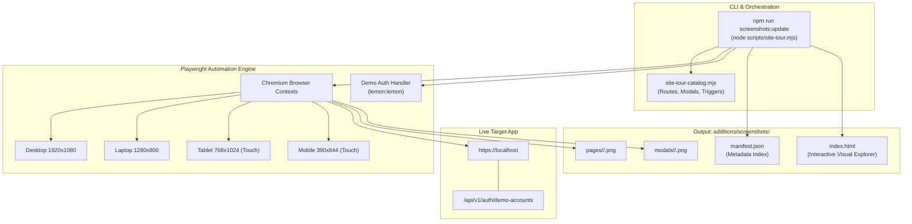

# Playwright Comprehensive Site Tour Implementation Plan

> **For agentic workers:** REQUIRED SUB-SKILL: Use superpowers:subagent-driven-development to implement this plan task-by-task. Steps use checkbox (`- [ ]`) syntax for tracking.

**Goal:** Build a robust, permanent Playwright screenshot automation suite that captures every navigation route and popup modal across 4 screen sizes (Desktop, Laptop, Tablet, Mobile) into an organized `additions/screenshots/` folder with an interactive visual gallery and easy update CLI commands.

**Architecture:** A modular runner script (`frontend/scripts/site-tour.mjs`) consumes a declarative route and modal catalog (`frontend/scripts/site-tour-catalog.mjs`), connects to the running local application (`https://localhost`), handles both guest and authenticated states (via demo accounts), takes pixel-perfect responsive screenshots with deterministic wait states, generates `manifest.json`, and outputs an interactive HTML visual explorer (`additions/screenshots/index.html`).

**Architecture Diagram:**



**Tech Stack:** Node.js ES Modules, Playwright (`playwright`), Next.js 16 / React 19 front end on Docker/nginx (`https://localhost`), HTML5/CSS/JavaScript for the offline viewer.

## Global Constraints

- **Execution Context:** Run via Node.js using existing project dependencies in `frontend/package.json` (`playwright` is installed).
- **Output Target:** Single dedicated directory at `additions/screenshots/` (relative to project root).
- **Target URL:** Default to `https://localhost` (or overridden by `PLAYWRIGHT_BASE_URL`), bypassing self-signed TLS errors (`ignoreHTTPSErrors: true`).
- **Responsive Viewports:**
  - `desktop`: 1920 × 1080, `isMobile: false`, `hasTouch: false`
  - `laptop`: 1280 × 800, `isMobile: false`, `hasTouch: false`
  - `tablet`: 768 × 1024, `isMobile: true`, `hasTouch: true`
  - `mobile`: 390 × 844, `isMobile: true`, `hasTouch: true`, iPhone viewport emulation
- **Code Standards:** Clean, modular ES modules with strict error handling, non-destructive file updates, and descriptive terminal logging.

---

### Task 1: Create the Declarative Route & Modal Catalog

**Files:**
- Create: `frontend/scripts/site-tour-catalog.mjs`
- Test: `frontend/scripts/test-catalog.mjs`

**Interfaces:**
- Consumes: Nothing (pure declarative catalog).
- Produces: `VIEWPORTS`, `PAGE_ROUTES`, `MODAL_TARGETS`, `CATEGORY_METADATA` exports used by `site-tour.mjs`.

- [ ] **Step 1: Write a test verifying the catalog exports and definitions**

```javascript
// frontend/scripts/test-catalog.mjs
import assert from 'node:assert/strict';
import { VIEWPORTS, PAGE_ROUTES, MODAL_TARGETS, CATEGORIES } from './site-tour-catalog.mjs';

assert.ok(Array.isArray(VIEWPORTS), 'VIEWPORTS must be an array');
assert.strictEqual(VIEWPORTS.length, 4, 'Must have 4 target viewports');
assert.ok(VIEWPORTS.some((v) => v.id === 'desktop' && v.width === 1920 && v.height === 1080));
assert.ok(VIEWPORTS.some((v) => v.id === 'laptop' && v.width === 1280 && v.height === 800));
assert.ok(VIEWPORTS.some((v) => v.id === 'tablet' && v.width === 768 && v.height === 1024));
assert.ok(VIEWPORTS.some((v) => v.id === 'mobile' && v.width === 390 && v.height === 844));

assert.ok(Array.isArray(PAGE_ROUTES) && PAGE_ROUTES.length >= 15, 'Must have all main page routes');
assert.ok(PAGE_ROUTES.some((p) => p.id === 'perks' && p.route === '/en/perks'));
assert.ok(PAGE_ROUTES.some((p) => p.id === 'admin' && p.requiresAuth === 'admin'));

assert.ok(Array.isArray(MODAL_TARGETS) && MODAL_TARGETS.length >= 15, 'Must define all target modals');
assert.ok(MODAL_TARGETS.some((m) => m.id === 'perk-detail'));
assert.ok(MODAL_TARGETS.some((m) => m.id === 'auth-login'));

console.log('Catalog validation passed successfully.');
```

- [ ] **Step 2: Run test to verify it fails before creation**

Run: `node frontend/scripts/test-catalog.mjs`  
Expected: Error: Cannot find module `./site-tour-catalog.mjs`

- [ ] **Step 3: Create `frontend/scripts/site-tour-catalog.mjs`**

Implement complete catalog with viewports, categories, page routes, and modal triggers (including selectors, wait conditions, and setup actions).

- [ ] **Step 4: Run test to verify it passes**

Run: `node frontend/scripts/test-catalog.mjs`  
Expected: `Catalog validation passed successfully.`

- [ ] **Step 5: Clean up test file and commit**

```bash
git add frontend/scripts/site-tour-catalog.mjs
git commit -m "feat(scripts): add declarative site tour routes and modals catalog"
```

---

### Task 2: Create the Interactive HTML Visual Explorer & Manifest Generator

**Files:**
- Create: `additions/screenshots/index.html`
- Create: `frontend/scripts/site-tour-gallery.mjs`
- Test: `frontend/scripts/test-gallery.mjs`

**Interfaces:**
- Consumes: `manifest.json` data structure.
- Produces: `index.html` that visualizes `manifest.json` with filtering, side-by-side comparison, search, and lightbox.

- [ ] **Step 1: Write test verifying HTML template and manifest schema**

```javascript
// frontend/scripts/test-gallery.mjs
import assert from 'node:assert/strict';
import fs from 'node:fs';
import path from 'node:path';
import { generateGalleryHtml } from './site-tour-gallery.mjs';

const mockManifest = {
  generatedAt: new Date().toISOString(),
  summary: { totalPages: 1, totalModals: 1, viewports: ['desktop', 'mobile'], totalScreenshots: 2 },
  items: [
    { id: 'perks-base', name: 'Perks', category: 'perks', type: 'page', viewport: 'desktop', path: 'pages/02-perks/desktop.png' },
    { id: 'perks-modal', name: 'Perk Modal', category: 'perks', type: 'modal', viewport: 'mobile', path: 'modals/perk-detail/mobile.png' }
  ]
};

const html = generateGalleryHtml(mockManifest);
assert.ok(html.includes('<!DOCTYPE html>'));
assert.ok(html.includes('LemonDBD Site Tour Gallery'));
assert.ok(html.includes('id="gallery"'));
console.log('Gallery generation test passed.');
```

- [ ] **Step 2: Run test to verify failure**

Run: `node frontend/scripts/test-gallery.mjs`  
Expected: Error: Cannot find module `./site-tour-gallery.mjs`

- [ ] **Step 3: Create `frontend/scripts/site-tour-gallery.mjs` and initial `additions/screenshots/index.html`**

Implement full-featured responsive HTML/CSS/JS gallery supporting:
- Device view toggles (`All`, `Desktop 1920`, `Laptop 1280`, `Tablet 768`, `Mobile 390`).
- Category tabs (Perks, Streaks, Minigames, Characters, Tier Lists, Smash or Pass, etc.).
- Mode toggle: Grid View vs Side-by-Side Comparison View (Desktop vs Mobile).
- Live search filter and image lightbox modal with keyboard shortcuts (`Esc`, Arrow keys).

- [ ] **Step 4: Run test to verify it passes**

Run: `node frontend/scripts/test-gallery.mjs`  
Expected: `Gallery generation test passed.`

- [ ] **Step 5: Clean up test file and commit**

```bash
git add frontend/scripts/site-tour-gallery.mjs additions/screenshots/index.html
git commit -m "feat(scripts): add visual gallery viewer and generator for site tour"
```

---

### Task 3: Implement the Main Playwright Automation Runner

**Files:**
- Create: `frontend/scripts/site-tour.mjs`
- Modify: `frontend/package.json`

**Interfaces:**
- Consumes: `site-tour-catalog.mjs`, `site-tour-gallery.mjs`.
- Produces: Screenshots in `additions/screenshots/pages/` & `additions/screenshots/modals/`, and `additions/screenshots/manifest.json`.

- [ ] **Step 1: Add screenshot commands to `frontend/package.json`**

```json
"screenshots": "node scripts/site-tour.mjs",
"screenshots:update": "node scripts/site-tour.mjs --update",
"screenshots:quick": "node scripts/site-tour.mjs --viewports=desktop,mobile"
```

- [ ] **Step 2: Implement CLI argument parsing and execution orchestration in `site-tour.mjs`**

Include:
- Flags: `--update`, `--page=<id>`, `--category=<name>`, `--modals-only`, `--pages-only`, `--viewports=<comma-list>`, `--base-url=<url>`.
- Browser lifecycle: launch Chromium with `--ignore-certificate-errors`.
- Emulate `prefers-reduced-motion` and disable CSS transitions to prevent visual tearing.
- Demo authentication logic: logs into `https://localhost` using `/api/v1/auth/demo-accounts` admin account `lemon:lemon` to capture authenticated routes `/user` and `/admin`.
- Folder management: creates `additions/screenshots/pages/<category>/` and `additions/screenshots/modals/<name>/`.

- [ ] **Step 3: Implement page capture loop**

Navigates to each route across the specified viewports, waits for content stabilization, scrolls to top, and writes `desktop-1920x1080.png`, `laptop-1280x800.png`, `tablet-768x1024.png`, `mobile-390x844.png`.

- [ ] **Step 4: Implement modal capture loop**

Opens the target route, performs the modal trigger action (e.g. clicking a perk card, opening hamburger and clicking bug report, clicking rules button, clearing local storage for Smash prompt), asserts modal visibility, takes screenshot, and closes the modal or reloads.

- [ ] **Step 5: Manifest writing and gallery synchronization**

Writes `additions/screenshots/manifest.json` and renders/updates `additions/screenshots/index.html`.

- [ ] **Step 6: Commit runner script**

```bash
git add frontend/scripts/site-tour.mjs frontend/package.json
git commit -m "feat(scripts): implement comprehensive site tour Playwright runner"
```

---

### Task 4: Execute Full Automation Run & Verify All Artifacts

**Files:**
- Generate: `additions/screenshots/manifest.json`
- Generate: `additions/screenshots/pages/**/*`
- Generate: `additions/screenshots/modals/**/*`
- Generate: `additions/screenshots/index.html`

- [ ] **Step 1: Run the Playwright site tour suite**

Run: `node frontend/scripts/site-tour.mjs --update`  
Expected: Script executes against `https://localhost`, reports progress for each page and modal across all 4 viewports, and outputs completion summary.

- [ ] **Step 2: Verify screenshots and directory structure**

Check that:
- Every folder in `additions/screenshots/pages/` has 4 viewports.
- Every folder in `additions/screenshots/modals/` has the expected captures.
- No files are 0 bytes.

- [ ] **Step 3: Test selective update CLI flag**

Run: `node frontend/scripts/site-tour.mjs --page=perks --update`  
Expected: Captures only perks page and its modals, successfully updating `manifest.json` without destroying other entries.

- [ ] **Step 4: Commit generated suite and artifacts**

```bash
git add additions/screenshots/
git commit -m "chore: generate comprehensive site tour screenshots and visual gallery"
```
