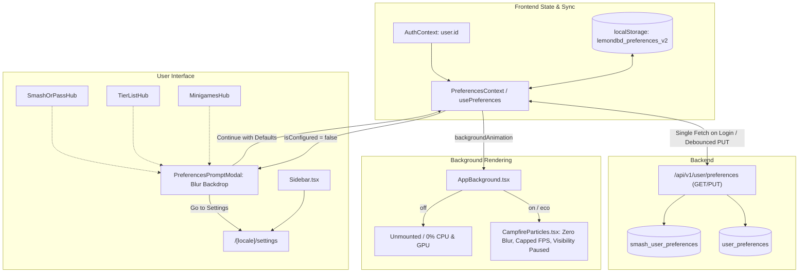

# Preferences Settings Page, Global Hooks & Campfire Optimization Implementation Plan

> **For agentic workers:** REQUIRED SUB-SKILL: Use superpowers:subagent-driven-development to implement this plan task-by-task. Steps use checkbox (`- [ ]`) syntax for tracking.

**Goal:** Create a dedicated `/settings` page for user preferences, provide a unified `PreferencesContext` and `usePreferences` hook with database synchronization for authenticated users (single fetch on login, database precedence), replace intrusive popups on Smash or Pass, Tier Lists, and Minigames with a blurred backdrop `<Modal>` prompt, and optimize the background campfire particles with configurable `Full`, `Eco`, and `Off` modes.

**Architecture:**
- **Backend**: Add `UserPreference` model (`user_preferences` table with FK `user_id` referencing `users.id`, cascade delete). Alembic migration `0032_user_preferences.py`. Implement `GET` & `PUT` `/api/v1/user/preferences` routes with dual-write to `smash_user_preferences` so all existing legacy tests pass.
- **Frontend State**: Central `PreferencesContext` and `usePreferences` hook handling `sounds`, `music`, `effects`, `nsfw`, and `backgroundAnimation` (`on` | `eco` | `off`). Tracks `isConfigured`. On login, fetches database preferences exactly once per session; database values override localStorage; if user had local preferences but account has null, syncs up to DB.
- **Campfire Optimization**: Remove expensive `ctx.shadowBlur` from `CampfireParticles.tsx` canvas loop, implement `visibilitychange` listener to pause loop when tab is backgrounded, cap FPS (30 FPS for Eco, 60 FPS for Full), cut particle count in half for Eco, and completely unmount canvas in `AppBackground.tsx` when mode is `Off`.
- **UI & Modal**:
  - `PreferencesPromptModal` using shared `<Modal backdrop="blur">` when visiting Smash or Pass, Tier Lists, or Minigames if `!isConfigured`.
  - Dedicated `app/[locale]/settings/page.tsx` and `loading.tsx` with Audio, Visuals/Motion, Content, and Sync Status cards.
  - Route registered in `ROUTE_BACKGROUND_EFFECTS` and `ROUTE_SHELLS`. Settings link added to `Sidebar.tsx`.
  - All 5 locale files (`en`, `pl`, `es`, `de`, `ja`) updated with full translation keys.

**Architecture Diagram:**



**Tech Stack:**
- Backend: Python 3.12+, Flask, SQLAlchemy 2.0, Alembic, PostgreSQL / SQLite
- Frontend: Next.js 16 (App Router), React 19, TypeScript, Tailwind CSS 4, Framer Motion, Lucide icons
- Testing: `pytest`, Node.js test runner (`tsx --test`), Oxlint

## Global Constraints

- Preserve 5-locale parity across `en`, `de`, `es`, `ja`, and `pl`.
- Never use raw color literals (#hex, rgb) outside `tokens.css`; use theme tokens (`bg-bg-surface`, `text-text-primary`, etc.).
- Modals must use the shared `<Modal>` component with title-only header (no icons/subtitles).
- No file longer than 600 lines.
- All code changes must pass `npm run test:guards`, `npm run typecheck`, and `npm run lint`.

---

### Task 1: Backend Database Model & Alembic Migration for `UserPreference`

**Files:**
- Create: `backend/app/models/user_preference.py`
- Modify: `backend/app/models/__init__.py`
- Create: `backend/migrations/versions/0032_user_preferences.py`
- Test: `backend/tests/unit/test_user_preference_model.py`

**Interfaces:**
- Produces: `UserPreference` model with columns `user_id`, `effects_enabled`, `sounds_enabled`, `music_enabled`, `nsfw_enabled`, `background_animation`, `chosen_at`, `updated_at`.

- [ ] **Step 1: Write the failing test for `UserPreference` model**

```python
# backend/tests/unit/test_user_preference_model.py
import pytest
from sqlalchemy.orm import Session
from app.models import UserPreference
from tests.unit.smash_api_support import create_user

@pytest.mark.unit
def test_user_preference_crud(db_session: Session) -> None:
    user = create_user(db_session)
    pref = UserPreference(
        user_id=user.id,
        effects_enabled=True,
        sounds_enabled=True,
        music_enabled=False,
        nsfw_enabled=True,
        background_animation="eco",
        chosen_at=123456789,
    )
    db_session.add(pref)
    db_session.commit()

    loaded = db_session.get(UserPreference, user.id)
    assert loaded is not None
    assert loaded.music_enabled is False
    assert loaded.nsfw_enabled is True
    assert loaded.background_animation == "eco"
    d = loaded.to_dict()
    assert d["effects"] is True
    assert d["background_animation"] == "eco"
```

- [ ] **Step 2: Run test to verify it fails**

Run: `pytest backend/tests/unit/test_user_preference_model.py -v`
Expected: FAIL with `ImportError: cannot import name 'UserPreference'`

- [ ] **Step 3: Implement `UserPreference` model and register in `backend/app/models/__init__.py`**

```python
# backend/app/models/user_preference.py
from datetime import datetime
from typing import Any
from sqlalchemy import BigInteger, Boolean, DateTime, ForeignKey, Integer, String
from sqlalchemy.orm import Mapped, mapped_column
from app.core.database import Base
from app.core.time import utcnow

class UserPreference(Base):
    __tablename__ = "user_preferences"

    user_id: Mapped[int] = mapped_column(
        Integer, ForeignKey("users.id", ondelete="CASCADE"), primary_key=True
    )
    effects_enabled: Mapped[bool] = mapped_column(Boolean, default=True, nullable=False)
    sounds_enabled: Mapped[bool] = mapped_column(Boolean, default=True, nullable=False)
    music_enabled: Mapped[bool] = mapped_column(Boolean, default=True, nullable=False)
    nsfw_enabled: Mapped[bool] = mapped_column(Boolean, default=False, nullable=False)
    background_animation: Mapped[str] = mapped_column(String(16), default="on", nullable=False)
    chosen_at: Mapped[int] = mapped_column(BigInteger, nullable=False)
    updated_at: Mapped[datetime] = mapped_column(
        DateTime(timezone=True), default=utcnow, onupdate=utcnow, nullable=False
    )

    def to_dict(self) -> dict[str, Any]:
        return {
            "effects": self.effects_enabled,
            "sounds": self.sounds_enabled,
            "music": self.music_enabled,
            "nsfw": self.nsfw_enabled,
            "background_animation": self.background_animation,
            "chosen_at": self.chosen_at,
        }
```

- [ ] **Step 4: Create migration `backend/migrations/versions/0032_user_preferences.py`**

```python
# backend/migrations/versions/0032_user_preferences.py
"""create user_preferences table

Revision ID: 0032_user_preferences
Revises: 0031_extract_map_layouts
Create Date: 2026-10-25
"""
import sqlalchemy as sa
from alembic import op

revision = "0032_user_preferences"
down_revision = "0031_extract_map_layouts"
branch_labels = None
depends_on = None

def upgrade() -> None:
    bind = op.get_bind()
    inspector = sa.inspect(bind)
    tables = inspector.get_table_names()

    if "user_preferences" not in tables:
        op.create_table(
            "user_preferences",
            sa.Column("user_id", sa.Integer(), sa.ForeignKey("users.id", ondelete="CASCADE"), primary_key=True),
            sa.Column("effects_enabled", sa.Boolean(), server_default=sa.true(), nullable=False),
            sa.Column("sounds_enabled", sa.Boolean(), server_default=sa.true(), nullable=False),
            sa.Column("music_enabled", sa.Boolean(), server_default=sa.true(), nullable=False),
            sa.Column("nsfw_enabled", sa.Boolean(), server_default=sa.false(), nullable=False),
            sa.Column("background_animation", sa.String(16), server_default="on", nullable=False),
            sa.Column("chosen_at", sa.BigInteger(), nullable=False),
            sa.Column("updated_at", sa.DateTime(timezone=True), server_default=sa.func.now(), nullable=False),
        )

def downgrade() -> None:
    op.drop_table("user_preferences")
```

- [ ] **Step 5: Run tests and commit**

Run: `pytest backend/tests/unit/test_user_preference_model.py -v`
Expected: PASS
Commit: `git add backend/app/models/user_preference.py backend/app/models/__init__.py backend/migrations/versions/0032_user_preferences.py backend/tests/unit/test_user_preference_model.py && git commit -m "feat(backend): add UserPreference model and migration"`

---

### Task 2: Backend Services & API Endpoints for `/api/v1/user/preferences`

**Files:**
- Create: `backend/app/schemas/user_preference.py`
- Create: `backend/app/services/user/preferences.py`
- Create: `backend/app/routes/user_preferences.py`
- Modify: `backend/app/features/__init__.py` or route registrations in `backend/app/__init__.py`
- Modify: `backend/app/services/smash_or_pass/preferences.py` (ensure sync)
- Test: `backend/tests/unit/test_user_preferences_api.py`

**Interfaces:**
- Consumes: `UserPreference` model, `SmashUserPreference` model
- Produces: `GET /api/v1/user/preferences`, `PUT /api/v1/user/preferences`

- [ ] **Step 1: Write the failing tests for user preferences API**

```python
# backend/tests/unit/test_user_preferences_api.py
import pytest
from flask import Flask
from sqlalchemy.orm import Session
from app.core.security import generate_token
from tests.unit.smash_api_support import create_user, setup_smash_data  # noqa: F401

URL = "/api/v1/user/preferences"

def _headers(user_id: int) -> dict[str, str]:
    return {"Authorization": f"Bearer {generate_token(user_id, role='user')}"}

@pytest.mark.unit
class TestUserPreferencesApi:
    def test_requires_auth(self, app: Flask) -> None:
        client = app.test_client()
        assert client.get(URL).status_code == 401
        assert client.put(URL, json={"effects": True, "chosen_at": 1}).status_code == 401

    def test_initial_read_is_null(self, app: Flask, db_session: Session) -> None:
        user = create_user(db_session)
        res = app.test_client().get(URL, headers=_headers(user.id))
        assert res.status_code == 200
        assert res.get_json() == {"data": None}

    def test_save_and_read_back(self, app: Flask, db_session: Session) -> None:
        user = create_user(db_session)
        client = app.test_client()
        payload = {
            "effects": False,
            "sounds": True,
            "music": False,
            "nsfw": True,
            "background_animation": "eco",
            "chosen_at": 1000,
        }
        put_res = client.put(URL, headers=_headers(user.id), json=payload)
        assert put_res.status_code == 200
        assert put_res.get_json()["data"] == payload

        get_res = client.get(URL, headers=_headers(user.id))
        assert get_res.status_code == 200
        assert get_res.get_json()["data"] == payload
```

- [ ] **Step 2: Run test to verify it fails**

Run: `pytest backend/tests/unit/test_user_preferences_api.py -v`
Expected: FAIL 404 Not Found

- [ ] **Step 3: Implement Schema, Service, and Route**

```python
# backend/app/schemas/user_preference.py
from typing import Literal
from pydantic import BaseModel, Field

class UserPreferenceIn(BaseModel):
    effects: bool = True
    sounds: bool = True
    music: bool = True
    nsfw: bool = False
    background_animation: Literal["on", "eco", "off"] = "on"
    chosen_at: int = Field(ge=0)
```

```python
# backend/app/services/user/preferences.py
import time
from typing import Any
from app.core.extensions import db
from app.models.user_preference import UserPreference
from app.models.smash_or_pass import SmashUserPreference

def get_user_preferences(user_id: int) -> dict[str, Any] | None:
    row = db.session.get(UserPreference, user_id)
    if row:
        return row.to_dict()
    # Fallback to smash preferences if user had older saved prefs
    smash_row = db.session.get(SmashUserPreference, user_id)
    if smash_row:
        return {
            "effects": smash_row.effects_enabled,
            "sounds": smash_row.sounds_enabled,
            "music": smash_row.music_enabled,
            "nsfw": False,
            "background_animation": "on",
            "chosen_at": smash_row.chosen_at,
        }
    return None

def save_user_preferences(
    user_id: int,
    effects: bool,
    sounds: bool,
    music: bool,
    nsfw: bool,
    background_animation: str,
    chosen_at: int,
) -> dict[str, Any]:
    chosen_at = min(chosen_at, int(time.time() * 1000))
    row = db.session.get(UserPreference, user_id)
    if row is None:
        row = UserPreference(user_id=user_id)
        db.session.add(row)
    row.effects_enabled = effects
    row.sounds_enabled = sounds
    row.music_enabled = music
    row.nsfw_enabled = nsfw
    row.background_animation = background_animation
    row.chosen_at = chosen_at

    # Dual-write to smash_user_preferences to maintain legacy backward compatibility
    smash_row = db.session.get(SmashUserPreference, user_id)
    if smash_row is None:
        smash_row = SmashUserPreference(user_id=user_id)
        db.session.add(smash_row)
    smash_row.effects_enabled = effects
    smash_row.sounds_enabled = sounds
    smash_row.music_enabled = music
    smash_row.chosen_at = chosen_at

    db.session.commit()
    return row.to_dict()
```

```python
# backend/app/routes/user_preferences.py
from flask import Blueprint, g, jsonify, request
from pydantic import ValidationError
from app.core.security import login_required
from app.schemas.user_preference import UserPreferenceIn
from app.services.user.preferences import get_user_preferences, save_user_preferences

user_preferences_bp = Blueprint("user_preferences", __name__, url_prefix="/api/v1/user/preferences")

@user_preferences_bp.route("", methods=["GET"])
@login_required
def read_preferences():
    return jsonify({"data": get_user_preferences(g.current_user.id)}), 200

@user_preferences_bp.route("", methods=["PUT"])
@login_required
def write_preferences():
    try:
        payload = UserPreferenceIn(**(request.get_json(silent=True) or {}))
    except ValidationError as err:
        return jsonify({"error": "Invalid preferences", "details": err.errors(include_url=False, include_context=False)}), 400

    data = save_user_preferences(
        g.current_user.id,
        payload.effects,
        payload.sounds,
        payload.music,
        payload.nsfw,
        payload.background_animation,
        payload.chosen_at,
    )
    return jsonify({"data": data}), 200
```

Register `user_preferences_bp` in `backend/app/routes/__init__.py` and the Flask application factory.

- [ ] **Step 4: Run tests and commit**

Run: `pytest backend/tests/unit/test_user_preferences_api.py backend/tests/unit/test_smash_preferences.py -v`
Expected: ALL PASS
Commit: `git add backend/app/schemas/user_preference.py backend/app/services/user/preferences.py backend/app/routes/user_preferences.py backend/tests/unit/test_user_preferences_api.py && git commit -m "feat(backend): add /api/v1/user/preferences endpoint"`

---

### Task 3: Campfire Background Particle Optimization & Modes

**Files:**
- Modify: `frontend/src/components/common/CampfireParticles.tsx`
- Modify: `frontend/src/components/layout/AppBackground.tsx`
- Test: `frontend/src/__tests__/unit/campfireOptimization.test.ts`

**Interfaces:**
- Consumes: `mode?: 'on' | 'eco' | 'off'`
- Produces: Optimized particle rendering without `ctx.shadowBlur`, with visibility pausing and frame rate throttling.

- [ ] **Step 1: Write unit tests verifying optimization invariants**

```typescript
// frontend/src/__tests__/unit/campfireOptimization.test.ts
import { describe, it } from 'node:test';
import assert from 'node:assert/strict';
import fs from 'node:fs';
import path from 'node:path';

describe('CampfireParticles optimization & guardrails', () => {
  const componentPath = path.resolve(__dirname, '../../components/common/CampfireParticles.tsx');
  const source = fs.readFileSync(componentPath, 'utf8');

  it('never uses ctx.shadowBlur or ctx.shadowColor in render loop', () => {
    assert.ok(!source.includes('ctx.shadowBlur'), 'shadowBlur is too expensive on canvas loop');
    assert.ok(!source.includes('ctx.shadowColor'), 'shadowColor must be removed');
  });

  it('subscribes to document visibilitychange to halt loop in background', () => {
    assert.ok(source.includes('visibilitychange'), 'must listen for visibilitychange');
    assert.ok(source.includes('document.hidden'), 'must check document.hidden');
  });

  it('supports eco mode with reduced particles and frame throttling', () => {
    assert.ok(source.includes("mode === 'eco'"), 'must check eco mode');
  });
});
```

- [ ] **Step 2: Run test to verify it fails initially**

Run: `cd frontend; npx tsx --test src/__tests__/unit/campfireOptimization.test.ts`
Expected: FAIL (shadowBlur found in file)

- [ ] **Step 3: Refactor `CampfireParticles.tsx` to eliminate `shadowBlur`, add visibility pausing and Eco mode**

Optimize `CampfireParticles.tsx`:
- Add `mode?: 'on' | 'eco'` prop.
- Remove `ctx.shadowBlur` and `ctx.shadowColor`.
- Draw soft particles cleanly using standard fill and alpha.
- In `eco` mode:
  - Halve particle count (e.g. 16 on mobile, 30 on desktop).
  - Target 30 FPS (`fpsInterval = 1000 / 30`).
- Add `document.addEventListener('visibilitychange', onVisibilityChange)`:
  - If `document.hidden`, cancel RAF and set running = false.
  - When visible, restart loop.

- [ ] **Step 4: Update `AppBackground.tsx` to respect `backgroundAnimation`**

In `AppBackground.tsx`:
- Read `backgroundAnimation` from preferences (`'on' | 'eco' | 'off'`).
- If `'off'`, return `<div className="pointer-events-none fixed inset-0 -z-10 overflow-hidden" aria-hidden="true" />` without mounting `<CampfireParticles />`.
- If `'on'` or `'eco'`, pass `mode={backgroundAnimation}` to `CampfireParticles`.

- [ ] **Step 5: Run test and commit**

Run: `cd frontend; npx tsx --test src/__tests__/unit/campfireOptimization.test.ts`
Expected: PASS
Commit: `git add frontend/src/components/common/CampfireParticles.tsx frontend/src/components/layout/AppBackground.tsx frontend/src/__tests__/unit/campfireOptimization.test.ts && git commit -m "perf: optimize CampfireParticles and add eco/off modes"`

---

### Task 4: Frontend Global Preferences State & Synchronization

**Files:**
- Create: `frontend/src/services/userPreferencesApi.ts`
- Create: `frontend/src/context/PreferencesContext.tsx`
- Create: `frontend/src/hooks/usePreferences.ts`
- Modify: `frontend/src/app/[locale]/layout.tsx` (mount `PreferencesProvider`)
- Modify: `frontend/src/components/smash-or-pass/prefs/smashPrefs.ts` (delegate/sync)
- Modify: `frontend/src/utils/nsfwAck.ts` (delegate/sync)
- Test: `frontend/src/__tests__/unit/preferencesSync.test.ts`

**Interfaces:**
- Produces: `usePreferences()` hook exposing:
  `{ preferences, updatePreferences, isConfigured, markConfigured, isSyncing }`

- [ ] **Step 1: Write failing unit tests for preferences synchronization logic**

```typescript
// frontend/src/__tests__/unit/preferencesSync.test.ts
import { describe, it } from 'node:test';
import assert from 'node:assert/strict';
import { defaultPreferences, reconcileWithDatabase } from '@/context/PreferencesContext';

describe('Preferences synchronization and database precedence', () => {
  const local = {
    effects: true,
    sounds: false,
    music: true,
    nsfw: false,
    backgroundAnimation: 'on' as const,
    chosenAt: 1000,
  };

  const remote = {
    effects: false,
    sounds: true,
    music: false,
    nsfw: true,
    backgroundAnimation: 'eco' as const,
    chosenAt: 2000,
  };

  it('database preferences override local preferences on login', () => {
    const result = reconcileWithDatabase(local, remote);
    assert.deepEqual(result.preferences, remote);
    assert.equal(result.pushToAccount, false);
  });

  it('pushes local preferences to database if account has no saved preferences', () => {
    const result = reconcileWithDatabase(local, null);
    assert.deepEqual(result.preferences, local);
    assert.equal(result.pushToAccount, true);
  });
});
```

- [ ] **Step 2: Run test to verify it fails**

Run: `cd frontend; npx tsx --test src/__tests__/unit/preferencesSync.test.ts`
Expected: FAIL (module not found)

- [ ] **Step 3: Implement `userPreferencesApi.ts` and `PreferencesContext.tsx`**

`PreferencesContext.tsx`:
- Tracks `SitePreferences`: `{ effects, sounds, music, nsfw, backgroundAnimation, chosenAt }`.
- Tracks `isConfigured`: boolean (true if user saved preferences or dismissed prompt).
- Sync on login:
  - Uses `useRef<number | null>(null)` for `syncedUserIdRef`.
  - When `isAuthenticated && user?.id`:
    - If `syncedUserIdRef.current === user.id`, do nothing (single fetch guaranteed).
    - Otherwise set `syncedUserIdRef.current = user.id`, call `fetchUserPreferences()`.
    - If remote data: DB takes precedence -> update state + localStorage.
    - If null: push local preferences to DB via `saveUserPreferences()`.
- Expose helper `reconcileWithDatabase` for pure testing.
- Mount `PreferencesProvider` inside `app/[locale]/layout.tsx` (under `AuthProvider`).

- [ ] **Step 4: Update `smashPrefs.ts` and `nsfwAck.ts` to sync with unified preferences**

Ensure `useSmashPrefs` and `useGlobalNsfwPreference` update the unified preferences and read from them without breaking any existing test.

- [ ] **Step 5: Run tests and commit**

Run: `cd frontend; npx tsx --test src/__tests__/unit/preferencesSync.test.ts`
Expected: PASS
Commit: `git add frontend/src/services/userPreferencesApi.ts frontend/src/context/PreferencesContext.tsx frontend/src/hooks/usePreferences.ts frontend/src/app/[locale]/layout.tsx frontend/src/__tests__/unit/preferencesSync.test.ts && git commit -m "feat: add global PreferencesContext with smart single-fetch db sync"`

---

### Task 5: Notice Prompt Modal & Hub Integration

**Files:**
- Create: `frontend/src/components/common/PreferencesPromptModal.tsx`
- Modify: `frontend/src/components/smash-or-pass/SmashOrPassHub.tsx`
- Modify: `frontend/src/components/tier-lists/TierListHub.tsx`
- Modify: `frontend/src/components/minigames/MinigamesHub.tsx`
- Test: `frontend/src/__tests__/unit/preferencesPromptModal.test.ts`

**Interfaces:**
- Consumes: `<Modal backdrop="blur">`, `usePreferences()`
- Produces: `PreferencesPromptModal` that triggers when `!isConfigured`.

- [ ] **Step 1: Write unit tests for modal invariants and hub cleanup**

```typescript
// frontend/src/__tests__/unit/preferencesPromptModal.test.ts
import { describe, it } from 'node:test';
import assert from 'node:assert/strict';
import fs from 'node:fs';
import path from 'node:path';

describe('PreferencesPromptModal & Hub Cleanup', () => {
  const modalPath = path.resolve(__dirname, '../../components/common/PreferencesPromptModal.tsx');
  const smashPath = path.resolve(__dirname, '../../components/smash-or-pass/SmashOrPassHub.tsx');
  const tierPath = path.resolve(__dirname, '../../components/tier-lists/TierListHub.tsx');
  const miniPath = path.resolve(__dirname, '../../components/minigames/MinigamesHub.tsx');

  it('PreferencesPromptModal uses shared Modal with backdrop="blur"', () => {
    const src = fs.readFileSync(modalPath, 'utf8');
    assert.ok(src.includes('backdrop="blur"'), 'must use blur backdrop');
    assert.ok(src.includes('/settings'), 'must link to /settings');
  });

  it('Hubs link directly to /settings and do not mount multi-switch onboarding modals directly', () => {
    const smashSrc = fs.readFileSync(smashPath, 'utf8');
    const tierSrc = fs.readFileSync(tierPath, 'utf8');
    const miniSrc = fs.readFileSync(miniPath, 'utf8');

    assert.ok(!tierSrc.includes('<NsfwOnboardingModal'), 'TierListHub must remove NsfwOnboardingModal');
    assert.ok(!miniSrc.includes('<NsfwOnboardingModal'), 'MinigamesHub must remove NsfwOnboardingModal');
  });
});
```

- [ ] **Step 2: Run test to verify it fails**

Run: `cd frontend; npx tsx --test src/__tests__/unit/preferencesPromptModal.test.ts`
Expected: FAIL

- [ ] **Step 3: Implement `PreferencesPromptModal.tsx`**

`PreferencesPromptModal.tsx`:
- Uses `<Modal isOpen={isOpen} onClose={handleContinueDefaults} backdrop="blur" size="md">`.
- Body: Informs visitor about audio, animation, and content preferences.
- Footer:
  - "Go to Settings" (`variant="primary"`): routes to `/${locale}/settings`.
  - "Continue with Defaults" (`variant="secondary"`): calls `markConfigured()`.

- [ ] **Step 4: Update `SmashOrPassHub`, `TierListHub`, and `MinigamesHub`**

- Remove automatic popups of `EffectsPreferenceModal` and `NsfwOnboardingModal`.
- Mount `PreferencesPromptModal` when `!isConfigured`.
- Toolbar settings buttons on hubs link to `/${locale}/settings`.

- [ ] **Step 5: Run tests and commit**

Run: `cd frontend; npx tsx --test src/__tests__/unit/preferencesPromptModal.test.ts`
Expected: PASS
Commit: `git add frontend/src/components/common/PreferencesPromptModal.tsx frontend/src/components/smash-or-pass/SmashOrPassHub.tsx frontend/src/components/tier-lists/TierListHub.tsx frontend/src/components/minigames/MinigamesHub.tsx frontend/src/__tests__/unit/preferencesPromptModal.test.ts && git commit -m "feat: replace page popups with PreferencesPromptModal linking to settings"`

---

### Task 6: Dedicated Settings Page & Sidebar Navigation

**Files:**
- Create: `frontend/src/app/[locale]/settings/page.tsx`
- Create: `frontend/src/app/[locale]/settings/loading.tsx`
- Modify: `frontend/src/components/layout/backgroundEffects.ts`
- Modify: `frontend/src/components/layout/shellRoutes.ts`
- Modify: `frontend/src/components/Sidebar.tsx`
- Modify: `frontend/src/locales/en/settings.ts` (and `de`, `es`, `ja`, `pl`)
- Modify: `frontend/src/locales/en/index.ts` (and `de`, `es`, `ja`, `pl`)
- Test: `frontend/src/__tests__/unit/settingsPage.test.ts`

**Interfaces:**
- Produces: `/settings` route with full 5-locale support, shell and background effect mapping.

- [ ] **Step 1: Write test for settings page route compliance**

```typescript
// frontend/src/__tests__/unit/settingsPage.test.ts
import { describe, it } from 'node:test';
import assert from 'node:assert/strict';
import { ROUTE_BACKGROUND_EFFECTS } from '@/components/layout/backgroundEffects';
import { ROUTE_SHELLS } from '@/components/layout/shellRoutes';

describe('Settings page route compliance', () => {
  it('has an entry in ROUTE_BACKGROUND_EFFECTS', () => {
    const listed = new Set(ROUTE_BACKGROUND_EFFECTS.map((r) => r.prefix.join('/')));
    assert.ok(listed.has('settings'), '/settings must have ROUTE_BACKGROUND_EFFECTS entry');
  });

  it('has an entry in ROUTE_SHELLS', () => {
    const listed = new Set(ROUTE_SHELLS.map((r) => r.prefix.join('/')));
    assert.ok(listed.has('settings'), '/settings must have ROUTE_SHELLS entry');
  });
});
```

- [ ] **Step 2: Add route entries in `backgroundEffects.ts` and `shellRoutes.ts`**

In `backgroundEffects.ts`:
`{ prefix: ['settings'], effect: 'campfire' }`

In `shellRoutes.ts`:
`{ prefix: ['settings'], shell: { padding: 'spacious', mainClassName: 'relative overflow-y-auto max-w-4xl mx-auto w-full' } }`

- [ ] **Step 3: Add localized strings in `locales/{en,de,es,ja,pl}`**

Add `settings.ts` to `locales/en/`, `locales/de/`, `locales/es/`, `locales/ja/`, `locales/pl/` with:
- `title`, `description`
- `audioSection`, `soundEffectsLabel`, `soundEffectsDesc`, `musicLabel`, `musicDesc`
- `visualsSection`, `animationsLabel`, `animationsDesc`, `campfireLabel`, `campfireDesc`, `campfireFull`, `campfireEco`, `campfireOff`
- `contentSection`, `nsfwLabel`, `nsfwDesc`
- `statusSynced`, `statusLocal`

- [ ] **Step 4: Implement `app/[locale]/settings/page.tsx` and `loading.tsx`**

Build clean, card-based UI using `Surface`, `Switch`, `Button`, `Badge` components.
Read & write with `usePreferences()`.
Export `generateMetadata = pageMetadata('/settings', ...)` for SEO and i18n compliance.

- [ ] **Step 5: Add Settings link in `Sidebar.tsx`**

Add `Settings` icon nav link in `Sidebar.tsx`.

- [ ] **Step 6: Run tests and commit**

Run: `cd frontend; npx tsx --test src/__tests__/unit/settingsPage.test.ts`
Expected: PASS
Commit: `git add frontend/src/app/[locale]/settings/ frontend/src/components/layout/backgroundEffects.ts frontend/src/components/layout/shellRoutes.ts frontend/src/components/Sidebar.tsx frontend/src/locales/ frontend/src/__tests__/unit/settingsPage.test.ts && git commit -m "feat: add dedicated Settings page and sidebar navigation"`

---

### Task 7: Comprehensive Verification & Guard Suite

**Files:**
- Check: All modified and created files

- [ ] **Step 1: Run Guard Test Suite**

Run: `cd frontend; npm run test:guards`
Expected: 100% PASS (background effects, i18n hygiene, file length <= 600 lines, no `any`, no `console.log`).

- [ ] **Step 2: Run Typecheck and Lint**

Run: `cd frontend; npm run typecheck`
Run: `cd frontend; npm run lint`
Expected: Clean exit code 0.

- [ ] **Step 3: Run Backend Tests**

Run: `pytest backend/tests/unit -v`
Expected: 100% PASS.

- [ ] **Step 4: Final verification commit**

Commit: `git commit --allow-empty -m "chore: verify all guards, tests, and types pass"`
