# Advanced Hierarchical Categorization, Interactive Modes & Viewport Fold Markers Implementation Plan

> **For agentic workers:** REQUIRED SUB-SKILL: Use superpowers:subagent-driven-development to implement this plan task-by-task. Steps use checkbox (`- [ ]`) syntax for tracking.

**Goal:** Upgrade the LemonDBD Site Tour suite to support deep subcategory organization with dynamic pill filters, capture all interactive Perk Randomizer modes, fix route inaccuracies across Streaks, Tier Lists, and Smash or Pass, re-categorize Admin OCR tools into Account/Admin, and inject visual viewport fold lines on full-page screenshots to clearly delineate above-the-fold entry content from below-the-fold scrolled content.

**Architecture:** `site-tour-catalog.mjs` attaches structured `subcategory` metadata to every target and fixes route paths (e.g. `/tier-lists/new`, `/streaks/killer/gauntlet-streak`, `/streaks/killer/history-streak`). `site-tour.mjs` injects an initial viewport fold line marker at `y = vp.height` on long pages before taking `fullPage` screenshots, and handles interactive stage state switching for Randomizer modes. The offline gallery in `gallery/` dynamically exposes a secondary subcategory pill carousel when a category is selected.

**Architecture Diagram:**

```mermaid
graph TD
    subgraph "Catalog & Metadata"
        A["site-tour-catalog.mjs"] -->|Category & Subcategory| B["PAGE_ROUTES (Corrected & Expanded)"]
        A -->|Category & Subcategory| C["MODAL_TARGETS (Drawers & Modals)"]
    end

    subgraph "Capture Runner Engine"
        D["site-tour.mjs"] -->|Evaluate Document Height| E{"Needs Scrolling?"}
        E -->|Yes: docHeight > vp.height + 30| F["Inject Fold Line at vp.height"]
        E -->|No| G["No Marker Needed"]
        F & G --> H["page.screenshot(fullPage: true)"]
        H --> I["Remove Fold Line Marker"]
    end

    subgraph "Visual Explorer (gallery/)"
        J["galleryMarkup.mjs (#subcategory-pills)"] --> K["galleryClientCore.mjs"]
        K -->|Filter by Category| L["Dynamic Subcategory Carousel"]
        L -->|Filter by Subcategory| M["Filtered Screenshot Grid"]
    end
```



**Tech Stack:** Playwright Chromium, Node.js 26 ESM, TypeScript / tsx test runner, HTML5/CSS3 zero-dependency offline explorer.

## Global Constraints

- **File Length Limit:** Every file in `frontend/` must remain strictly under 600 lines (`fileLengthGuard.test.ts`).
- **Code Quality:** Zero ESLint / Oxlint errors or warnings (`npm run lint`).
- **Repository Guards:** All 92 repo guards must pass (`npm run test:guards`).
- **Git Cleanliness:** `additions/` directory remains untracked in git (`.gitignore`).
- **Offline Zero-Dependency Gallery:** `index.html` must remain fully offline capable with embedded manifest data.

---

### Task 1: Catalog Accuracy, Randomizer Modes & Subcategory Schema

**Files:**
- Modify: `frontend/scripts/site-tour-catalog.mjs`
- Test: `frontend/src/__tests__/unit/siteTourRunner.test.ts`

**Interfaces:**
- Consumes: Target lists in `site-tour-catalog.mjs`.
- Produces: Corrected routes, 5 randomizer modes, 2 streak drawers/modals, `streaks-scoreboard` in `account`, and `subcategory` property on all targets.

- [ ] **Step 1: Write the failing unit tests for subcategory schema and route corrections**

In `siteTourRunner.test.ts`, write assertions verifying:
1. All items in `PAGE_ROUTES` and `MODAL_TARGETS` have non-empty `subcategory` strings.
2. `streaks-scoreboard` has `category: 'account'`.
3. `tier-lists-creator` has route `/en/tier-lists/new` with `requiresAuth: 'user'`.
4. `randomizer-instant`, `randomizer-wheel-stage`, `randomizer-slot`, `randomizer-tarot`, and `randomizer-crate` exist in `PAGE_ROUTES` under `category: 'randomizer'`.
5. No page route points to `/en/streaks/history`.

- [ ] **Step 2: Run test to confirm it fails**

Run `powershell -Command "cd frontend; npx tsx --test src/__tests__/unit/siteTourRunner.test.ts"`.

- [ ] **Step 3: Update `site-tour-catalog.mjs`**

1. Add `subcategory` to every page route and modal target.
2. Add the 5 randomizer mode routes (`randomizer-instant`, `randomizer-wheel-stage`, `randomizer-slot`, `randomizer-tarot`, `randomizer-crate`).
3. Correct `tier-lists-creator` to `/en/tier-lists/new` (`requiresAuth: 'user'`) and add `tier-lists-creator-guest`.
4. Correct `streaks-gauntlet` to `/en/streaks/killer/gauntlet-streak`.
5. Replace `/en/streaks/history` with `streaks-history-streak` (`/en/streaks/killer/history-streak`, `requiresAuth: 'user'`).
6. Add `streaks-stats-drawer` to `MODAL_TARGETS` (`/en/streaks/killer/chaos-streak`, `requiresAuth: 'user'`).
7. Move `streaks-scoreboard` to `category: 'account'`.
8. Ensure `(Get-Content frontend/scripts/site-tour-catalog.mjs).Count < 600`.

- [ ] **Step 4: Run test to confirm it passes**

Run `powershell -Command "cd frontend; npx tsx --test src/__tests__/unit/siteTourRunner.test.ts"`.

- [ ] **Step 5: Verify line count and lint**

Run `npm --prefix frontend run lint`.

- [ ] **Step 6: Commit Task 1**

Commit with message: `feat(scripts): correct catalog routes, add randomizer modes and subcategory schema`

---

### Task 2: Viewport Fold Guide Line Overlay & Runner State Enhancements

**Files:**
- Modify: `frontend/scripts/site-tour.mjs`
- Test: `frontend/src/__tests__/unit/siteTourRunner.test.ts`

**Interfaces:**
- Consumes: `parseArgs`, `runTour` in `site-tour.mjs`.
- Produces: CLI argument `--no-fold-line`, fold guide line injection on full-page screenshots, setup handlers for randomizer modes, and recording `subcategory` in manifest.

- [ ] **Step 1: Write failing unit tests for `--no-fold-line` CLI option and `matchesFilter` subcategory**

In `siteTourRunner.test.ts`:
1. Test `parseArgs(['--no-fold-line'])` sets `noFoldLine: true` (default `false`).
2. Test `matchesFilter(item, { subcategory: 'creator' })` filters accurately.

- [ ] **Step 2: Run test to confirm it fails**

Run `powershell -Command "cd frontend; npx tsx --test src/__tests__/unit/siteTourRunner.test.ts"`.

- [ ] **Step 3: Update `site-tour.mjs`**

1. In `parseArgs`: add `noFoldLine: false`, parse `--no-fold-line` and `--fold-line=false`.
2. In `matchesFilter`: support `config.subcategory`.
3. In `recordItem`: record `subcategory: target.subcategory || 'general'`.
4. Add setup handlers for randomizer modes:
   ```javascript
   if (target.setup?.startsWith('setRandomizerMode')) {
     const mode = target.setup.replace('setRandomizerMode', '').toLowerCase();
     await page.evaluate((m) => {
       try { localStorage.setItem('lemon_dbd_generator_v9', JSON.stringify({ genMode: m, role: 'Survivor' })); } catch (_e) {}
     }, mode).catch(() => {});
     await page.reload({ waitUntil: 'domcontentloaded', timeout: config.timeout });
   }
   ```
5. In page screenshot capture:
   Inject fold marker if `!config.noFoldLine && !config.noFullPage`:
   ```javascript
   const hasFold = await page.evaluate((vh) => {
     if (document.documentElement.scrollHeight <= vh + 30) return false;
     const el = document.createElement('div');
     el.id = '__tour_fold_marker__';
     el.style.cssText = `position:absolute;left:0;right:0;top:${vh}px;width:100%;height:0;border-top:2px dashed rgba(239,68,68,0.85);z-index:2147483647;pointer-events:none;`;
     el.innerHTML = `<span style="position:absolute;right:12px;bottom:4px;background:rgba(15,23,42,0.9);border:1px solid rgba(239,68,68,0.5);border-radius:4px;padding:2px 8px;font-family:ui-monospace,monospace;font-size:11px;font-weight:700;color:#f87171;letter-spacing:0.05em;text-transform:uppercase;">Initial Viewport Fold (${vh}px) &uarr;</span>`;
     document.body.appendChild(el);
     return true;
   }, vp.height).catch(() => false);
   await page.screenshot({ path: filePath, fullPage: !config.noFullPage });
   if (hasFold) {
     await page.evaluate(() => document.getElementById('__tour_fold_marker__')?.remove()).catch(() => {});
   }
   ```
6. Compact code to keep `site-tour.mjs` strictly under 585 lines.

- [ ] **Step 4: Run tests to confirm they pass**

Run `powershell -Command "cd frontend; npx tsx --test src/__tests__/unit/siteTourRunner.test.ts"`.

- [ ] **Step 5: Verify line count and lint**

Confirm `(Get-Content frontend/scripts/site-tour.mjs).Count < 600`.
Run `npm --prefix frontend run lint`.

- [ ] **Step 6: Commit Task 2**

Commit with message: `feat(scripts): implement viewport fold guide line overlay and randomizer mode capture`

---

### Task 3: Hierarchical Subcategory Navigation in Visual Explorer

**Files:**
- Modify: `frontend/scripts/gallery/galleryMarkup.mjs`
- Modify: `frontend/scripts/gallery/galleryBaseCss.mjs`
- Modify: `frontend/scripts/gallery/galleryComponentCss.mjs`
- Modify: `frontend/scripts/gallery/galleryClientCore.mjs`
- Modify: `frontend/scripts/gallery/galleryClientInteractions.mjs`

**Interfaces:**
- Consumes: `subcategory` field on manifest items.
- Produces: Secondary subcategory pills row `#subcategory-pills`, responsive badge counts, reactive subcategory filtering, and reset handling.

- [ ] **Step 1: Update `galleryMarkup.mjs`**

Add `#subcategory-pills` container below `#category-pills`:
```html
<div class="category-scroll hidden" id="subcategory-pills" role="group" aria-label="Filter by Subcategory"></div>
```

- [ ] **Step 2: Update `galleryBaseCss.mjs` / `galleryComponentCss.mjs`**

Style subcategory pills (`.pill-btn-sub`) with subtle indigo/slate theme and badge count to visually differentiate from main category pills.

- [ ] **Step 3: Update `galleryClientCore.mjs`**

1. Add `subcategory: 'all'` to `state.filters`.
2. In `applyFilters`: filter by `itemSubcat !== subcategory` when `subcategory !== 'all'`.
3. Add `renderSubcategoryPills(category)` function:
   Derive unique subcategories and counts for the active category from manifest items. If `category === 'all'`, hide container; otherwise show pills.
4. Display subcategory badge on card items in `renderGrid()`.

- [ ] **Step 4: Update `galleryClientInteractions.mjs`**

1. Wire up click delegation for `[data-subcategory]` pills.
2. In category click handler: call `renderSubcategoryPills(category)` and reset `state.filters.subcategory = 'all'`.
3. In reset filters button: reset `subcategory: 'all'` and hide subcategory container.

- [ ] **Step 5: Verify lint and offline generation**

Run `node frontend/scripts/site-tour-gallery.mjs`.
Run `npm --prefix frontend run lint`.

- [ ] **Step 6: Commit Task 3**

Commit with message: `feat(gallery): add hierarchical subcategory navigation and dynamic pills carousel`

---

### Task 4: Execute Automated Capture & Gallery Synchronization

**Files:**
- Output: `additions/screenshots/`
- Output: `additions/screenshots/manifest.json`
- Output: `additions/screenshots/index.html`

- [ ] **Step 1: Capture randomizer modes**

Run `node frontend/scripts/site-tour.mjs --category=randomizer --update`.

- [ ] **Step 2: Capture corrected streak, tier list, and smash pages**

Run `node frontend/scripts/site-tour.mjs --page=tier-lists-creator --update`.
Run `node frontend/scripts/site-tour.mjs --page=tier-lists-creator-guest --update`.
Run `node frontend/scripts/site-tour.mjs --page=smash-create --update`.
Run `node frontend/scripts/site-tour.mjs --category=streaks --update`.
Run `node frontend/scripts/site-tour.mjs --page=streaks-scoreboard --update`.

- [ ] **Step 3: Run full cache synchronization and verify fold lines**

Run `node frontend/scripts/site-tour.mjs`.
Verify fold line appears at `vp.height` on long pages.
Verify `manifest.json` contains all items with `subcategory` populated.

- [ ] **Step 4: Regenerate index.html and verify offline explorer**

Run `node frontend/scripts/site-tour-gallery.mjs`.
Verify gallery renders subcategory pills correctly.

---

### Task 5: Repository Guards, Lint, and Final Verification

- [ ] **Step 1: Run frontend linter**

Run `npm --prefix frontend run lint`. Must exit 0 with 0 errors and 0 warnings.

- [ ] **Step 2: Run repository guards**

Run `npm --prefix frontend run test:guards`. All 92 guards must pass.

- [ ] **Step 3: Run unit tests**

Run `powershell -Command "cd frontend; npx tsx --test src/__tests__/unit/siteTourRunner.test.ts"`. All tests must pass.

- [ ] **Step 4: Verify git cleanliness**

Run `git status`. Ensure `additions/` is untracked and all code changes are cleanly committed.
