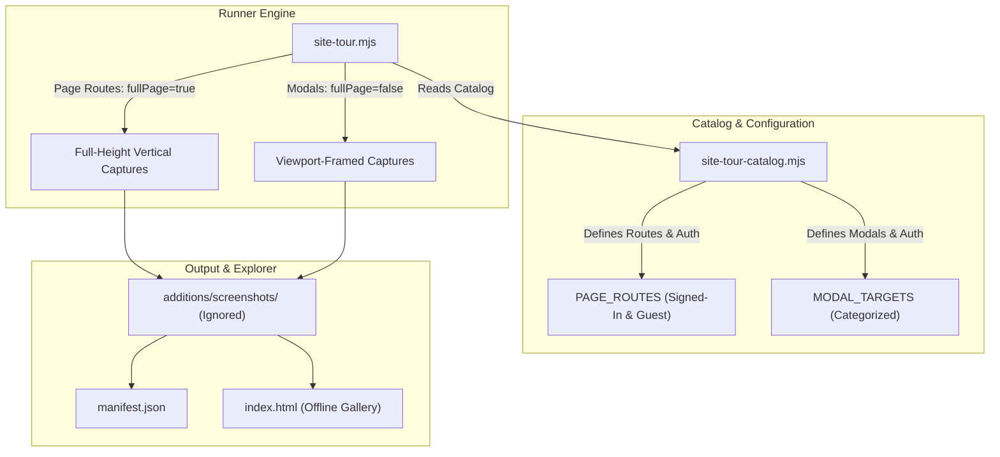

# Logged-In Streaks Suite & Full-Page Screenshot Capture Implementation Plan

> **For agentic workers:** REQUIRED SUB-SKILL: Use superpowers:subagent-driven-development to implement this plan task-by-task. Steps use checkbox (`- [ ]`) syntax for tracking.

**Goal:** Expand the LemonDBD Site Tour suite to capture all authenticated Streaks challenge pages (Killer & Survivor hubs, Chaos, Win Streak, Match History, and Page Streak) alongside guest gating views, and implement full-height vertical document capture (`fullPage: true`) for all page routes across Desktop, Laptop, Tablet, and Mobile.

**Architecture:** The route catalog in `site-tour-catalog.mjs` will define dedicated signed-in challenge routes with `requiresAuth: 'user'` and guest gating routes with `auth: 'guest'`. The runner in `site-tour.mjs` will capture full-page document height screenshots (`fullPage: true`) for page routes and viewport-framed screenshots (`fullPage: false`) for modals, supporting a `--no-full-page` toggle. Generated artifacts in `additions/screenshots/` are untracked in git, while gallery and manifest are automatically synchronized.

**Architecture Diagram:**



**Tech Stack:** Playwright Chromium, Node.js 26 ESM, TypeScript / tsx test runner, HTML5/CSS3 offline visual explorer.

## Global Constraints

- **File Length Limit:** Every file in `frontend/` must remain strictly under 600 lines (`fileLengthGuard.test.ts`).
- **Code Quality:** Zero ESLint / Oxlint errors or warnings (`npm run lint`).
- **Repository Guards:** All 92 repo guards must pass (`npm run test:guards`).
- **Git Cleanliness:** `additions/` directory must remain untracked in git (`.gitignore`).
- **Offline Zero-Dependency Gallery:** `index.html` must remain fully offline capable with embedded manifest data.

---

### Task 1: Expand Streaks Catalog with Signed-In & Guest Routes

**Files:**
- Modify: `frontend/scripts/site-tour-catalog.mjs`
- Test: `frontend/src/__tests__/unit/siteTourRunner.test.ts`

**Interfaces:**
- Consumes: `VIEWPORTS`, `PAGE_ROUTES`, `MODAL_TARGETS` from `site-tour-catalog.mjs`.
- Produces: Expanded `PAGE_ROUTES` containing 6 signed-in streak routes (`auth: 'user'`, `requiresAuth: 'user'`) and 2 guest streak routes (`auth: 'guest'`).

- [ ] **Step 1: Write the failing unit tests for new streak routes and catalog structure**

Add unit tests in `frontend/src/__tests__/unit/siteTourRunner.test.ts` checking:
1. `streaks-hub`, `streaks-survivor`, `streaks-chaos`, `streaks-gauntlet`, `streaks-history`, and `streaks-page` exist in `PAGE_ROUTES` with `auth: 'user'` and `requiresAuth: 'user'`.
2. `streaks-hub-guest` and `streaks-chaos-guest` exist in `PAGE_ROUTES` with `auth: 'guest'` and no `requiresAuth`.

- [ ] **Step 2: Run test to confirm it fails**

Run `powershell -Command "cd frontend; npx tsx --test src/__tests__/unit/siteTourRunner.test.ts"`.

- [ ] **Step 3: Update `PAGE_ROUTES` in `site-tour-catalog.mjs`**

Implement the streak routes:
- `streaks-hub`: `/en/streaks/killer`, `folder: '04-streaks-hub'`, `auth: 'user'`, `requiresAuth: 'user'`
- `streaks-survivor`: `/en/streaks/survivor`, `folder: '04-streaks-survivor'`, `auth: 'user'`, `requiresAuth: 'user'`
- `streaks-chaos`: `/en/streaks/killer/chaos-streak`, `folder: '04-streaks-chaos'`, `auth: 'user'`, `requiresAuth: 'user'`
- `streaks-gauntlet`: `/en/streaks/killer/win-streak`, `folder: '04-streaks-gauntlet'`, `auth: 'user'`, `requiresAuth: 'user'`
- `streaks-history`: `/en/streaks/history`, `folder: '04-streaks-history'`, `auth: 'user'`, `requiresAuth: 'user'`
- `streaks-page`: `/en/streaks/killer/page-streak`, `folder: '04-streaks-page'`, `auth: 'user'`, `requiresAuth: 'user'`
- `streaks-hub-guest`: `/en/streaks`, `folder: '04-streaks-hub-guest'`, `auth: 'guest'`
- `streaks-chaos-guest`: `/en/streaks/killer/chaos-streak`, `folder: '04-streaks-chaos-guest'`, `auth: 'guest'`

Compact comments to keep file length safely under 580 lines.

- [ ] **Step 4: Run test to confirm it passes**

Run `powershell -Command "cd frontend; npx tsx --test src/__tests__/unit/siteTourRunner.test.ts"`.

- [ ] **Step 5: Verify line count and lint**

Confirm `(Get-Content frontend/scripts/site-tour-catalog.mjs).Count` < 600.
Run `npm --prefix frontend run lint`.

- [ ] **Step 6: Commit Task 1**

Commit with message: `feat(scripts): add complete signed-in and guest streak challenge routes to catalog`

---

### Task 2: Upgrade Runner with Full-Page Vertical Capture Engine

**Files:**
- Modify: `frontend/scripts/site-tour.mjs`
- Test: `frontend/src/__tests__/unit/siteTourRunner.test.ts`

**Interfaces:**
- Consumes: `parseArgs`, `runTour` in `site-tour.mjs`.
- Produces: CLI option `noFullPage: boolean`, full-page screenshots for pages (`fullPage: !config.noFullPage`), viewport screenshots for modals (`fullPage: false`).

- [ ] **Step 1: Write the failing unit tests for `--no-full-page` CLI argument**

Add unit tests in `siteTourRunner.test.ts` verifying `parseArgs(['--no-full-page'])` sets `noFullPage: true`, and default is `noFullPage: false`.

- [ ] **Step 2: Run test to confirm it fails**

Run `powershell -Command "cd frontend; npx tsx --test src/__tests__/unit/siteTourRunner.test.ts"`.

- [ ] **Step 3: Update `site-tour.mjs`**

1. In `parseArgs`: add `noFullPage: false`. Parse `--no-full-page` and `--full-page=false`.
2. In `printHelp`: document `--no-full-page` option.
3. In page capture loop: use `await page.screenshot({ path: filePath, fullPage: !config.noFullPage });`.
4. In modal capture loop: keep `await page.screenshot({ path: filePath, fullPage: false });`.
5. Pre-capture scroll reset and stabilization:
   ```javascript
   await page.evaluate(() => {
     window.scrollTo(0, 0);
     const main = document.querySelector('main');
     if (main) main.scrollTop = 0;
   }).catch(() => {});
   ```
6. Compact code to keep `site-tour.mjs` strictly below 585 lines.

- [ ] **Step 4: Run tests to confirm they pass**

Run `powershell -Command "cd frontend; npx tsx --test src/__tests__/unit/siteTourRunner.test.ts"`.

- [ ] **Step 5: Verify line count and lint**

Confirm `(Get-Content frontend/scripts/site-tour.mjs).Count` < 600.
Run `npm --prefix frontend run lint`.

- [ ] **Step 6: Commit Task 2**

Commit with message: `feat(scripts): implement full-page vertical screenshot capture for page routes`

---

### Task 3: Execute Full-Page Screenshot Captures for Streaks & Pages

**Files:**
- Generated: `additions/screenshots/pages/04-streaks-*`
- Updated: `additions/screenshots/manifest.json`
- Updated: `additions/screenshots/index.html`

**Interfaces:**
- Consumes: `node frontend/scripts/site-tour.mjs`
- Produces: Full-page vertical screenshot captures across PC Desktop FHD, Laptop, Tablet, and Mobile, updated manifest and gallery.

- [ ] **Step 1: Capture the new signed-in and guest streak pages**

Run:
1. `node frontend/scripts/site-tour.mjs --category=streaks --pages-only --update`
Verify that `streaks-hub`, `streaks-survivor`, `streaks-chaos`, `streaks-gauntlet`, `streaks-history`, `streaks-page`, `streaks-hub-guest`, and `streaks-chaos-guest` are captured cleanly across all 4 viewports without errors.

- [ ] **Step 2: Update remaining page captures with full-page vertical height**

Run:
`node frontend/scripts/site-tour.mjs --pages-only --update`
Verify that long pages (perks, characters, tier lists, landing, legal, settings) are updated with full-page vertical screenshots.

- [ ] **Step 3: Synchronize manifest and gallery**

Run:
`node frontend/scripts/site-tour-gallery.mjs`
Verify total screenshots count and verify `index.html` loads offline.

- [ ] **Step 4: Verify screenshot files on disk**

Verify file sizes and dimensions using a verification script.

---

### Task 4: Run Repository Guards, Lint, and Final Verification

**Files:**
- Verify all repository integrity.

- [ ] **Step 1: Run frontend linter**

Run `npm --prefix frontend run lint`. Must exit 0 with 0 errors and 0 warnings.

- [ ] **Step 2: Run repository guards**

Run `npm --prefix frontend run test:guards`. All 92 guards must pass.

- [ ] **Step 3: Run unit tests**

Run `powershell -Command "cd frontend; npx tsx --test src/__tests__/unit/siteTourRunner.test.ts"`. All tests must pass.

- [ ] **Step 4: Check git status**

Confirm `git status` shows clean tracking (no files in `additions/` staged or untracked in git).
