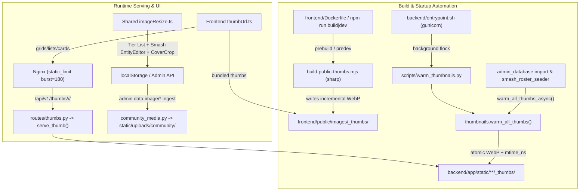

# Multimedia Thumbnails Optimization Implementation Plan

> **For agentic workers:** REQUIRED SUB-SKILL: Use superpowers:subagent-driven-development to implement this plan task-by-task. Steps use checkbox (`- [ ]`) syntax for tracking.

**Goal:** Build an automatic, end-to-end thumbnail generation and serving pipeline across backend static assets, bundled frontend images, and community uploads—wired into every UI grid/list and automatically generated during `docker compose up -d --build` and `up.ps1` / `up.sh`.

**Architecture:** Backend static raster assets (`avatars`, `maps`, `chapters`, `realms`, `icons`, `smash-or-pass`, `tier-lists`, `community`) are served through a single allow-listed `/api/v1/thumbs/<category>/<width>/<rel>` endpoint backed by `serve_thumb`, warmed non-blocking on backend container boot and post-import/seed, and rate-limited under Nginx `static_limit`. Bundled `frontend/public/images/` assets are pre-thumbnailed incrementally via `sharp` during `npm run build`/`dev` (including inside `frontend/Dockerfile`), and user-uploaded images share a unified client-side WebP downscaler plus optional admin official-asset ingestion.

**Architecture Diagram:**



**Tech Stack:** Python 3.14, Flask, Pillow, Pydantic, Next.js 16, React 19, TypeScript, `sharp` 0.35.5 (devDependency), Nginx, Docker Compose.

## Global Constraints

- `_thumbs/` directories must never be committed to Git (`.gitignore` covers `backend/app/static/**/_thumbs/` and `frontend/public/images/_thumbs/`).
- `backend/app/static` is bind-mounted at runtime (`./backend/app/static:/app/app/static`), so backend warming MUST run at container startup / post-import / on-demand, never relying solely on `docker build`.
- Frontend `dependencyGuards.test.ts` requires every `package.json` `dependencies` entry to be imported; `sharp` belongs in `devDependencies` (not `dependencies`) so it is excluded from production runtime `node_modules` and guard failures.
- Frontend `lintGuards.test.ts` restricts bare `` to `frontend/src/components/common/Img.tsx`; all other components must use `` or `<Thumb>` / `<PerkIcon>`.
- Never open-proxy arbitrary third-party `https://` URLs through `/api/v1/thumbs/`; external URLs pass through unchanged.
- Do not relax existing assertions in tests; update URL expectations in unit tests only where a helper's output URL intentionally migrated to `/api/v1/thumbs/...`.

---

### Task 1: Backend Unified Thumbnail Registry, Alpha-Safe Encoding & Warming

**Files:**
- Modify: `backend/app/utils/thumbnails.py`
- Create: `backend/app/routes/thumbs.py`
- Modify: `backend/app/routes/avatars.py`
- Modify: `backend/app/routes/maps.py`
- Modify: `backend/app/features/__init__.py`
- Test: `backend/tests/unit/core/test_static_assets_and_thumbnails.py`

**Interfaces:**
- Produces:
  - `THUMB_SPECS: dict[str, ThumbSpec]` in `backend/app/utils/thumbnails.py`
  - `serve_category_thumb(category: str, width: int, rel: str)`
  - `warm_all_thumbs(static_root: Path | None = None, prune_orphans: bool = False, workers: int = 4) -> dict[str, int]`
  - `warm_all_thumbs_async(static_root: Path | None = None) -> bool`
  - `thumbs_bp` (`/api/v1/thumbs/<category>/<int:width>/<path:rel>`)

- [ ] **Step 1: Write failing tests for unified category/width validation, palette alpha preservation, and `warm_all_thumbs`**

Add to `backend/tests/unit/core/test_static_assets_and_thumbnails.py`:

```python
def test_category_thumb_rejects_unknown_category_or_disallowed_width(tmp_path: Path) -> None:
    from app import create_app

    app = create_app("testing")
    app.static_folder = str(tmp_path / "static")
    _png(Path(app.static_folder) / "chapters" / "dlc.png", "green", (1200, 675))
    client = app.test_client()

    assert client.get("/api/v1/thumbs/unknown/480/dlc.png").status_code == 404
    assert client.get("/api/v1/thumbs/chapters/9999/dlc.png").status_code == 404
    ok = client.get("/api/v1/thumbs/chapters/480/dlc.png")
    assert ok.status_code == 200
    assert ok.mimetype == "image/webp"


def test_palette_png_with_transparency_preserves_alpha_in_webp(static_app: Flask, static_client: FlaskClient) -> None:
    from io import BytesIO

    src = Path(static_app.static_folder) / "avatars" / "pal.png"
    src.parent.mkdir(parents=True, exist_ok=True)
    rgba = Image.new("RGBA", (200, 200), (0, 0, 0, 0))
    for x in range(50, 150):
        for y in range(50, 150):
            rgba.putpixel((x, y), (255, 0, 0, 255))
    rgba.convert("P", palette=Image.Palette.ADAPTIVE).save(src, "PNG")

    res = static_client.get("/thumb/pal.png")
    assert res.status_code == 200
    out = Image.open(BytesIO(res.data))
    assert out.mode in ("RGBA", "LA")
    assert out.convert("RGBA").getpixel((0, 0))[3] == 0


def test_warm_all_thumbs_creates_missing_and_prunes_orphans(tmp_path: Path) -> None:
    static_root = tmp_path / "static"
    _png(static_root / "chapters" / "c1.png", "red", (1920, 1080))
    orphan = static_root / "chapters" / thumbnails.THUMB_ROOT / "480" / "deleted.webp"
    orphan.parent.mkdir(parents=True, exist_ok=True)
    orphan.write_bytes(b"stale")

    stats = thumbnails.warm_all_thumbs(static_root=static_root, prune_orphans=True, workers=2)
    assert stats["generated"] >= 1
    assert stats["pruned"] == 1
    assert (static_root / "chapters" / thumbnails.THUMB_ROOT / "480" / "c1.png.webp").is_file()
    assert not orphan.exists()
```

- [ ] **Step 2: Run test to verify it fails**

Run: `cd backend && ..\.venv\Scripts\python.exe -m pytest tests/unit/core/test_static_assets_and_thumbnails.py -v`
Expected: FAIL (`AttributeError: module 'app.utils.thumbnails' has no attribute 'warm_all_thumbs'`, 404 on `/api/v1/thumbs/...`).

- [ ] **Step 3: Implement `THUMB_SPECS`, alpha normalization, `serve_category_thumb`, `warm_all_thumbs`, and `thumbs_bp`**

Update `backend/app/utils/thumbnails.py`:
- Define `@dataclass(frozen=True) class ThumbSpec: subdir: str; widths: tuple[int, ...]; aspect: float = 2.0`.
- Populate `THUMB_SPECS`:
  - `"avatars": ThumbSpec("avatars", (128, 256), 2.0)`
  - `"maps": ThumbSpec("maps", (320,), 2.0)`
  - `"chapters": ThumbSpec("chapters", (480,), 1.0)`
  - `"realms": ThumbSpec("realms", (320,), 1.5)`
  - `"icons": ThumbSpec("icons", (96, 128), 1.0)`
  - `"smash-or-pass": ThumbSpec("smash-or-pass", (256, 480), 2.0)`
  - `"tier-lists": ThumbSpec("tier-lists", (480,), 1.0)`
  - `"community": ThumbSpec("uploads/community", (128, 256, 480), 2.0)`
- In `_write_thumb`: normalize `P`/`LA`/transparency images to `RGBA`, opaque modes to `RGB`, and resize with `Image.Resampling.LANCZOS`.
- Add `serve_category_thumb(category: str, width: int, rel: str)` checking `THUMB_SPECS` (404 if unknown category or width not in `spec.widths`).
- Add `warm_all_thumbs(static_root: Path | None = None, prune_orphans: bool = False, workers: int = 4) -> dict[str, int]` and `warm_all_thumbs_async(static_root: Path | None = None) -> bool` using `ThreadPoolExecutor` + `_warm_lock` so concurrent callers don't overlap.

Create `backend/app/routes/thumbs.py`:

```python
from flask import Blueprint

from app.utils.thumbnails import serve_category_thumb

thumbs_bp = Blueprint("thumbs", __name__, url_prefix="/api/v1/thumbs")


@thumbs_bp.route("/<string:category>/<int:width>/<path:rel>", methods=["GET"])
def get_thumb(category: str, width: int, rel: str):
    """Serve an allow-listed on-demand WebP thumbnail for a static asset."""
    return serve_category_thumb(category, width, rel)
```

Register `thumbs_bp` in `backend/app/features/__init__.py`. Keep `avatars.py` and `maps.py` calling `serve_thumb("avatars", rel, 256, aspect=2.0)` and `serve_thumb("maps", rel, 320)` as aliases.

- [ ] **Step 4: Run tests to verify they pass**

Run: `cd backend && ..\.venv\Scripts\python.exe -m pytest tests/unit/core/test_static_assets_and_thumbnails.py -v`
Expected: PASS (all tests green).

- [ ] **Step 5: Commit**

```bash
git add backend/app/utils/thumbnails.py backend/app/routes/thumbs.py backend/app/features/__init__.py backend/tests/unit/core/test_static_assets_and_thumbnails.py
git commit -m "feat(backend): add unified thumbnail registry, routes, and warmer"
```

---

### Task 2: Startup Auto-Warming, Import/Seeder Hooks, Nginx & `.gitignore`

**Files:**
- Create: `backend/scripts/warm_thumbnails.py`
- Modify: `backend/entrypoint.sh`
- Modify: `backend/app/routes/admin_database.py`
- Modify: `backend/app/seeds/smash_roster_seeder.py`
- Modify: `nginx/default.conf`
- Modify: `.gitignore`

**Interfaces:**
- Consumes: `warm_all_thumbs`, `warm_all_thumbs_async` from `app.utils.thumbnails`
- Produces: Automatic thumbnail warming on Docker boot, DB import, and Smash roster seed; Nginx `static_limit` on `/api/v1/thumbs/`.

- [ ] **Step 1: Write `backend/scripts/warm_thumbnails.py`**

```python
#!/usr/bin/env python3
"""Warm on-disk WebP thumbnails for all static assets under app/static."""
from __future__ import annotations

import argparse
import os
import sys
from pathlib import Path

BACKEND_ROOT = Path(__file__).resolve().parent.parent
if str(BACKEND_ROOT) not in sys.path:
    sys.path.insert(0, str(BACKEND_ROOT))

from app.utils.thumbnails import warm_all_thumbs  # noqa: E402


def _acquire_lock(lock_path: Path):
    if os.name == "nt":
        return None
    import fcntl

    fh = lock_path.open("w")
    try:
        fcntl.flock(fh.fileno(), fcntl.LOCK_EX | fcntl.LOCK_NB)
        return fh
    except OSError:
        fh.close()
        return False


def main() -> int:
    parser = argparse.ArgumentParser(description="Pre-generate static WebP thumbnails.")
    parser.add_argument("--prune", action="store_true", help="Remove orphaned files in _thumbs/")
    parser.add_argument("--quiet", action="store_true", help="Suppress summary output")
    parser.add_argument("--workers", type=int, default=4, help="Worker thread count")
    args = parser.parse_args()

    lock = _acquire_lock(Path("/tmp/lemon_warm_thumbs.lock"))
    if lock is False:
        return 0
    try:
        static_root = BACKEND_ROOT / "app" / "static"
        stats = warm_all_thumbs(static_root=static_root, prune_orphans=args.prune, workers=max(1, args.workers))
        if not args.quiet:
            print(f"[warm_thumbnails] generated={stats['generated']} skipped={stats['skipped']} pruned={stats['pruned']} failed={stats['failed']}")
        return 0
    finally:
        if lock:
            lock.close()


if __name__ == "__main__":
    raise SystemExit(main())
```

- [ ] **Step 2: Hook `entrypoint.sh`, `admin_database.py`, and `smash_roster_seeder.py`**

In `backend/entrypoint.sh`, right before `exec "$@"`, launch the background warmer ONLY when starting the web server (`gunicorn`) so `scheduler` and one-off `docker compose run` scripts don't spawn extra warmers:

```sh
case "$*" in
  *gunicorn*)
    echo "[entrypoint] Warming static thumbnails in background..."
    python3 scripts/warm_thumbnails.py --prune --quiet >/dev/null 2>&1 &
    ;;
esac
```

In `backend/app/routes/admin_database.py` (after `DatabaseExportImportService.import_database` succeeds) and `backend/app/seeds/smash_roster_seeder.py` (after `ensure_roster_assets` writes files), call `warm_all_thumbs_async(Path(current_app.static_folder))` (or `warm_all_thumbs_async(static_dir)`).

- [ ] **Step 3: Update `nginx/default.conf` and `.gitignore`**

In `nginx/default.conf` (lines 187 and 384, both HTTP and HTTPS server blocks):

```diff
-    location ~ ^/api/v1/(avatars|maps)/thumb/ {
+    location ~ ^/api/v1/(thumbs|(avatars|maps)/thumb)/ {
```

In `.gitignore`, replace `backend/app/static/avatars/_thumbs/` with:

```gitignore
backend/app/static/**/_thumbs/
frontend/public/images/_thumbs/
```

- [ ] **Step 4: Verify CLI script and backend tests**

Run:
`cd backend && ..\.venv\Scripts\python.exe scripts/warm_thumbnails.py --prune`
`cd backend && ..\.venv\Scripts\python.exe -m pytest tests/unit/core/test_static_assets_and_thumbnails.py tests/guards -v`
Expected: `warm_thumbnails.py` exits 0 and prints generated/skipped/pruned stats; pytest passes.

- [ ] **Step 5: Commit**

```bash
git add backend/scripts/warm_thumbnails.py backend/entrypoint.sh backend/app/routes/admin_database.py backend/app/seeds/smash_roster_seeder.py nginx/default.conf .gitignore
git commit -m "chore(docker,backend): auto-warm backend thumbnails on boot and import"
```

---

### Task 3: Backend Admin Community Media Ingest (`data:image/*` -> WebP File)

**Files:**
- Create: `backend/app/services/community_media.py`
- Modify: `backend/app/routes/tier_lists.py`
- Modify: `backend/app/routes/smash_or_pass.py`
- Test: `backend/tests/unit/core/test_community_media.py`

**Interfaces:**
- Produces: `ingest_community_image(value: str | None, max_side: int) -> str | None`

- [ ] **Step 1: Write failing test for `ingest_community_image`**

Create `backend/tests/unit/core/test_community_media.py` testing:
- `https://` and `/static/...` values pass through unchanged.
- Valid `data:image/png;base64,...` is decoded, resized to `<= max_side`, saved as WebP under `static/uploads/community/<sha256[:16]>.webp`, and returns `/static/uploads/community/<sha256[:16]>.webp`.
- Invalid/non-image `data:` payloads return `None`.

- [ ] **Step 2: Run test to verify it fails**

Run: `cd backend && ..\.venv\Scripts\python.exe -m pytest tests/unit/core/test_community_media.py -v`
Expected: FAIL (`ModuleNotFoundError`).

- [ ] **Step 3: Implement `backend/app/services/community_media.py` and wire into admin Tier List & Smash roster create/update**

Implement `ingest_community_image(value: str | None, max_side: int = 800) -> str | None` using Pillow (`ImageOps.exif_transpose`, `RGBA`/`RGB`, `thumbnail((max_side, max_side))`, WebP quality 85, deterministic content hash filename in `uploads/community/`). Wire it for `cover_image_url` (`max_side=800`) and custom item `image_url` / entity `media_url` (`max_side=512`) in `backend/app/routes/tier_lists.py` and `backend/app/routes/smash_or_pass.py`, then trigger `warm_all_thumbs_async()`.

- [ ] **Step 4: Run tests to verify they pass**

Run: `cd backend && ..\.venv\Scripts\python.exe -m pytest tests/unit/core/test_community_media.py tests/unit/tier_lists tests/unit/smash -v`
Expected: PASS.

- [ ] **Step 5: Commit**

```bash
git add backend/app/services/community_media.py backend/app/routes/tier_lists.py backend/app/routes/smash_or_pass.py backend/tests/unit/core/test_community_media.py
git commit -m "feat(backend): normalize admin community data-URLs into cached WebP assets"
```

---

### Task 4: Frontend Bundled Public Image Thumbnail Generator (`sharp` + `package.json`)

**Files:**
- Modify: `frontend/package.json` (`devDependencies`: `"sharp": "^0.35.4"`, `"thumbs"`, `"prebuild"`, `"predev"`)
- Create: `frontend/scripts/build-public-thumbs.mjs`
- Create: `frontend/src/utils/publicThumb.ts`
- Test: `frontend/src/__tests__/unit/shared/publicThumb.test.ts`

**Interfaces:**
- Produces: `publicImageThumb(publicPath: string): string` and automated `frontend/public/images/_thumbs/` generation during `npm run build` (Docker build) and `npm run dev`.

- [ ] **Step 1: Write failing test for `publicImageThumb`**

Create `frontend/src/__tests__/unit/shared/publicThumb.test.ts`:

```ts
import test from 'node:test';
import assert from 'node:assert/strict';
import { publicImageThumb } from '@/utils/publicThumb';

test('publicImageThumb maps bundled images with pre-generated thumbs to _thumbs', () => {
  assert.equal(publicImageThumb('/images/tarot/the-entity.webp'), '/images/_thumbs/tarot/the-entity.webp');
  assert.equal(publicImageThumb('/images/streaks/modes/chaos-hell.webp'), '/images/_thumbs/streaks/modes/chaos-hell.webp');
  assert.equal(publicImageThumb('/images/streaks/id-please/k3.webp'), '/images/_thumbs/streaks/id-please/k3.webp');
  assert.equal(publicImageThumb('/images/randomizer/crate.webp'), '/images/_thumbs/randomizer/crate.webp');
});

test('publicImageThumb leaves unthumbnailed paths and external URLs unchanged', () => {
  assert.equal(publicImageThumb('/images/addon-rarity/common.webp'), '/images/addon-rarity/common.webp');
  assert.equal(publicImageThumb('/images/banners/banner_account.webp'), '/images/banners/banner_account.webp');
  assert.equal(publicImageThumb('https://example.com/x.webp'), 'https://example.com/x.webp');
});
```

- [ ] **Step 2: Run test to verify it fails**

Run: `cd frontend && npx tsx --test src/__tests__/unit/shared/publicThumb.test.ts`
Expected: FAIL (`Cannot find module '@/utils/publicThumb'`).

- [ ] **Step 3: Implement `frontend/scripts/build-public-thumbs.mjs`, `frontend/src/utils/publicThumb.ts`, and update `frontend/package.json`**

- `build-public-thumbs.mjs`: scans `public/images/` against prefix rules (`tarot/` -> 320px, `streaks/modes/` -> 360px, `streaks/` -> 256px, `randomizer/` -> 400px), skips when `thumb.mtimeMs === source.mtimeMs`, writes atomically via temp file + `utimesSync` + `renameSync` using `sharp`, and prunes orphaned files in `public/images/_thumbs/`.
- `package.json`: add `"sharp": "^0.35.4"` to `devDependencies`, `"thumbs": "node scripts/build-public-thumbs.mjs"`, `"predev": "npm run thumbs"`, `"prebuild": "npm run thumbs && npm run lint"`.
- `publicThumb.ts`: exports `publicImageThumb(path)` matching the exact prefix rules (`tarot/`, `streaks/`, `randomizer/`).

- [ ] **Step 4: Run script + unit & guard tests**

Run:
`cd frontend && npm run thumbs && npx tsx --test src/__tests__/unit/shared/publicThumb.test.ts src/__tests__/guards/dependencyGuards.test.ts`
Expected: Generates `_thumbs/`, tests PASS, `dependencyGuards` PASS.

- [ ] **Step 5: Commit**

```bash
git add frontend/package.json frontend/scripts/build-public-thumbs.mjs frontend/src/utils/publicThumb.ts frontend/src/__tests__/unit/shared/publicThumb.test.ts
git commit -m "feat(frontend): auto-generate WebP thumbnails for bundled public/images"
```

---

### Task 5: Frontend Unified `thumbUrl` Helpers & Wire All Grid/List Views

**Files:**
- Create: `frontend/src/utils/thumbUrl.ts`
- Modify: `frontend/src/components/character-detail/types.tsx`
- Modify: `frontend/src/utils/mapUtils.ts`
- Modify: `frontend/src/utils/tierLists/items.ts`
- Modify: `frontend/src/components/tier-lists/TierListCards.tsx`
- Modify: `frontend/src/components/onboarding/wizard/ChapterCard.tsx`
- Modify: `frontend/src/components/onboarding/CharacterOnboardingWizardParts.tsx`
- Modify: `frontend/src/components/characters/hub/CharacterCard.tsx`
- Modify: `frontend/src/components/streaks/gauntlet/CharacterRosterGrid.tsx`
- Modify: `frontend/src/components/streaks/gauntlet/GauntletBoard.tsx`
- Modify: `frontend/src/components/streaks/gauntlet/ActiveTargetStageParts.tsx`
- Modify: `frontend/src/components/streaks/chaos/KillerPickerGrid.tsx`
- Modify: `frontend/src/components/streaks/chaos/ChaosPerkPoolModal.tsx`
- Modify: `frontend/src/components/streaks/history/HistoryPerkPoolPanel.tsx`
- Modify: `frontend/src/components/streaks/id-please/IdPleaseTiles.tsx`
- Modify: `frontend/src/components/streaks/page-streak/KillerRosterGrid.tsx`
- Modify: `frontend/src/components/smash-or-pass/CharacterCard.tsx`
- Modify: `frontend/src/components/smash-or-pass/CharacterStatsModal.tsx`
- Modify: `frontend/src/components/smash-or-pass/SmashLeaderboardParts.tsx`
- Modify: `frontend/src/components/smash-or-pass/persona/PersonaBreakdown.tsx`
- Modify: `frontend/src/components/user/ShowcaseCharacterModal.tsx`
- Modify: `frontend/src/components/user/PerkDiamondSlot.tsx`
- Modify: `frontend/src/components/PerkCard.tsx`
- Modify: `frontend/src/components/common/Thumb.tsx`
- Modify: `frontend/src/components/common/ImagePreloadProvider.tsx`
- Modify: `frontend/src/components/generator/modes/slot-machine/SlotReelColumnDesktop.tsx`
- Modify: `frontend/src/components/generator/modes/slot-machine/SlotReelRowMobile.tsx`
- Modify: `frontend/src/components/generator/modes/wheel/useWheelStage.ts`
- Modify: `frontend/src/components/streaks/panels.ts`, `ChaosModeModal.tsx`, `GauntletModeModal.tsx`, `HistoryModeModal.tsx`, `PageStreakModeModal.tsx`, `idPleaseAssets.ts`, `tarotCards.ts`, `LootCrateStage.tsx`, `SlotMachineIdle.tsx`, `TarotDeckStage.tsx` (wire `publicImageThumb` for grid/card previews)
- Test: `frontend/src/__tests__/unit/shared/thumbUrl.test.ts`
- Modify Test: `frontend/src/__tests__/unit/shared/avatarThumbUrl.test.ts`, `frontend/src/__tests__/unit/maps/publicMapViewer.test.ts`, `frontend/src/__tests__/unit/maps/mapCard.test.ts`

**Interfaces:**
- Produces:
  - `getThumbUrl(category, rawPathOrUrl, width, backendBase?)`
  - `avatarThumbFromPath(rawPath, width?, backendBase?)`
  - `getChapterThumbSrc(chapter, backendBase?)`
  - `getRealmThumbSrc(rawPath, backendBase?)`
  - `getIconThumbUrl(rawPathOrUrl, width?, backendBase?)`
  - `getCommunityCoverThumbUrl(url, width?, backendBase?)`

- [ ] **Step 1: Write failing tests for `thumbUrl.ts` and update expected URLs in `avatarThumbUrl.test.ts`, `publicMapViewer.test.ts`, `mapCard.test.ts`**

Create `frontend/src/__tests__/unit/shared/thumbUrl.test.ts` covering:
- `getThumbUrl` converts `/static/<cat>/<rel>` & relative `<cat>/<rel>` to `/api/v1/thumbs/<cat>/<width>/<rel>`.
- `getThumbUrl` maps `/static/uploads/community/...` to `/api/v1/thumbs/community/<width>/...`.
- `getThumbUrl` leaves `https://`, `data:`, and non-raster `.svg` untouched.
- `getChapterThumbSrc`, `getIconThumbUrl`, `getRealmThumbSrc`, `getCommunityCoverThumbUrl` produce expected URLs and fallbacks.

- [ ] **Step 2: Run tests to verify they fail**

Run: `cd frontend && npx tsx --test src/__tests__/unit/shared/thumbUrl.test.ts src/__tests__/unit/shared/avatarThumbUrl.test.ts src/__tests__/unit/maps/publicMapViewer.test.ts src/__tests__/unit/maps/mapCard.test.ts`
Expected: FAIL.

- [ ] **Step 3: Implement `frontend/src/utils/thumbUrl.ts` and wire all grid/list components**

Update `getAvatarThumbUrl` (accepting optional `width = 256`, outputting `/api/v1/thumbs/avatars/${width}/${rel}`), `getMapThumbSrc` (`/api/v1/thumbs/maps/320/${clean}`), `ChapterCard` (`480` px), `TierListCards` (`480` px cover thumb), `Thumb` (`96` px for `sm`/`md` icons), `PerkCard` / `perksToItems` / streak pools (`128` px icons), all character roster/grid/wheel/reel/smash-card/showcase views (`128` or `256` px avatars), and `publicImageThumb` for bundled mode/tile previews. Leave full-size images on detail/hero/fullscreen views (`CharacterHeroAvatar`, `Model3DModal`, `FullscreenMapEngine`, `PerkModal`, `EquipmentDetailModal`).

- [ ] **Step 4: Run affected frontend tests**

Run: `cd frontend && npm run test:changed`
Expected: PASS across all unit and guard tests.

- [ ] **Step 5: Commit**

```bash
git add frontend/src
git commit -m "feat(frontend): route all grid, card, and list views through optimized thumbnails"
```

---

### Task 6: Shared Client-Side Image Resize & Smash Entity Upload Downscaling

**Files:**
- Create: `frontend/src/utils/imageResize.ts`
- Modify: `frontend/src/utils/tierLists/imageFiles.ts`
- Modify: `frontend/src/components/common/ImageUploadDropzone.tsx`
- Modify: `frontend/src/components/smash-or-pass/creator/EntityEditor.tsx`
- Modify: `frontend/src/components/smash-or-pass/creator/CoverImageCropModal.tsx`
- Test: `frontend/src/__tests__/unit/shared/imageResize.test.ts`

**Interfaces:**
- Produces: `resizeImageToDataUrl(file: File, sizes: readonly number[], maxChars: number, quality?: number): Promise<string | null>` and `IMAGE_SIZE_PRESETS = { tile: [160, 128, 96], portrait: [512, 384, 256], banner: [800, 600, 400] }`

- [ ] **Step 1: Write failing tests for `imageResize.ts` presets and `EntityEditor` upload capability**

Test preset dimensions, GIF pass-through under cap, SVG rejection, and non-duplication between `fileToTileImage` and `processImageFile`.

- [ ] **Step 2: Run tests to verify they fail**

Run: `cd frontend && npx tsx --test src/__tests__/unit/shared/imageResize.test.ts`
Expected: FAIL (`Cannot find module '@/utils/imageResize'`).

- [ ] **Step 3: Implement `imageResize.ts` and refactor `imageFiles.ts`, `ImageUploadDropzone.tsx`, `EntityEditor.tsx`, `CoverImageCropModal.tsx`**

- Extract shared canvas resize/WebP-encode pipeline into `frontend/src/utils/imageResize.ts`.
- Refactor `fileToTileImage` (`tile` preset) and `processImageFile` (`banner` default `800` px) to delegate to `resizeImageToDataUrl` (zero duplicated canvas logic).
- Add file upload button / drop input using `portrait` (`512` px WebP) to `EntityEditor.tsx`.
- Update `CoverImageCropModal.tsx` to export WebP (falling back to JPEG) capped at `800x450` and within `maxDataImageChars`.

- [ ] **Step 4: Run frontend unit, guard, typecheck, lint, and full build checks**

Run:
`cd frontend && npm run test:changed && npm run typecheck && npm run build`
Expected: `prebuild` runs `thumbs` + `lint`, `next build` succeeds, `postbuild` (`check:built`) passes.

- [ ] **Step 5: Commit**

```bash
git add frontend/src
git commit -m "feat(frontend): unify client-side image downscaling and add Smash entity upload"
```

---

### Task 7: Full Verification Pass

**Files:**
- Modify: `docs/superpowers/plans/2026-11-11-multimedia-thumbnails-optimization.md` (if any check notes needed)

- [ ] **Step 1: Run full backend unit & guard suite**

Run: `cd backend && ..\.venv\Scripts\python.exe -m pytest tests/unit tests/guards -v`
Expected: 100% PASS.

- [ ] **Step 2: Run full frontend unit, guard, typecheck, and build suite**

Run: `cd frontend && npm test && npm run typecheck && npm run build`
Expected: 100% PASS.

- [ ] **Step 3: Verify `warm_thumbnails.py` and `build-public-thumbs.mjs` cleanly handle repeated runs and clean git working tree**

Run: `git status`
Expected: Clean working tree (no `_thumbs/` files untracked or modified because `.gitignore` ignores them).
