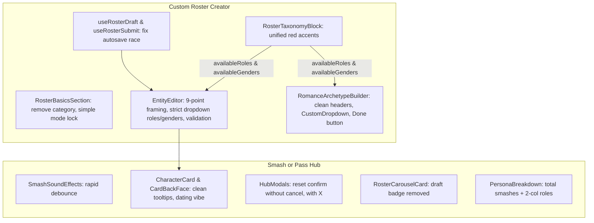

# Smash or Pass & Custom Roster Creator Polish Implementation Plan

> **For agentic workers:** REQUIRED SUB-SKILL: Use superpowers:subagent-driven-development to implement this plan task-by-task. Steps use checkbox (`- [ ]`) syntax for tracking.

**Goal:** Implement 23 polish enhancements and bug fixes across the Smash or Pass hub, romance persona modal, and custom roster creator.

**Architecture:**
- Adjust sound engine debounce thresholds in `SmashSoundEffects.ts`.
- Clean up modals, tooltips, and badges in `HubModals.tsx`, `CharacterCard.tsx`, `CardBackFace.tsx`, and `RosterCarouselCard.tsx`.
- Refactor romance persona metrics in `PersonaBreakdown.tsx` to surface total smashes and split survivor/killer stats into a clean 2-column layout.
- Eliminate autosave draft race condition in `useRosterDraft.ts` and `useRosterSubmit.ts`, and completely remove the obsolete `category` field.
- Enhance candidate editing with 9-point CSS focal framing (`media_display: { position }`), strict role/gender selection from taxonomy, mandatory markers, tagline clarity, and fixed dating vibe rendering.
- Overhaul romance archetype creation with simplified headers, danger trash buttons, unified `CustomDropdown`s, a "Done" collapse action, and candidate spam gating.

**Architecture Diagram:**

---

### Task 1: Smash or Pass Hub Audio & Modal Polish

**Files:**
- `frontend/src/components/smash-or-pass/SmashSoundEffects.ts`
- `frontend/src/components/smash-or-pass/hub/HubModals.tsx`
- `frontend/src/components/smash-or-pass/CharacterCard.tsx`
- `frontend/src/components/smash-or-pass/card/CardBackFace.tsx`
- `frontend/src/components/smash-or-pass/roster-select/RosterCarouselCard.tsx`
- `frontend/src/locales/{en,pl,de,es,ja}/smashOrPass.ts`

- [ ] **Step 1: Write test for audio timing and flip tooltip**
  Create or update `frontend/src/__tests__/unit/smash/hubAudioAndTooltips.test.ts` testing the updated flip label and rapid gap timing.
- [ ] **Step 2: Adjust audio debounce timing in `SmashSoundEffects.ts`**
  Change `RAPID_GAP_S` from `0.9` to `0.45` and `SKIP_GAP_S` from `0.35` to `0.20`.
- [ ] **Step 3: Update reset confirmation modal in `HubModals.tsx`**
  Remove `closeButton="none"` so that the default top-right "X" appears. In the footer, remove the secondary `Cancel` button, leaving the danger reset button.
- [ ] **Step 4: Update flip tooltip text in all 5 locales**
  In `frontend/src/locales/{en,pl,de,es,ja}/smashOrPass.ts`, update `flipToDatingProfile`:
  - `pl`: `'Obróć kartę'`
  - `en`: `'Flip card'`
  - `de`: `'Karte umdrehen'`
  - `es`: `'Voltear carta'`
  - `ja`: `'カードを裏返す'`
- [ ] **Step 5: Remove tooltips from Smash and Pass buttons**
  In `CharacterCard.tsx` and `CardBackFace.tsx`, remove `{...tip(rawSmashDict.pass, ...)}` and `{...tip(rawSmashDict.smash, ...)}` while keeping `aria-label`.
- [ ] **Step 6: Remove draft badge from locked rosters in `RosterCarouselCard.tsx`**
  Remove lines rendering `dict.tierLists.draft` when `r.is_active === false`, and remove `${r.is_active === false ? ... : ''}` from `rosterLabel`.
- [ ] **Step 7: Run unit tests to verify Task 1**
  Run: `cd frontend; npx tsx --test src/__tests__/unit/smash/rosterCarouselSound.test.tsx` and any new unit test.
- [ ] **Step 8: Commit Task 1**
  `git commit -am "fix(smash): tune sound timing, remove card button tooltips, and clean up hub modals"`

---

### Task 2: Romance Persona Stats & Breakdown Overhaul

**Files:**
- `frontend/src/components/smash-or-pass/persona/PersonaBreakdown.tsx`
- `frontend/src/locales/{en,pl,de,es,ja}/smashOrPass.ts`

- [ ] **Step 1: Write unit test for PersonaBreakdown layout**
  Update `frontend/src/__tests__/unit/smash/personaBreakdown.test.tsx` (or create if absent) checking for total smashes display and survivor/killer split formatting.
- [ ] **Step 2: Replace "First Smash" with "Total Smashes" in `PersonaBreakdown.tsx`**
  In the top stats grid (`grid-cols-3`):
  - Replace `persona.favoriteChar` block with a dedicated "Total Smashes" column.
  - Display `HeartIcon` (or flame/smash icon), `persona.totalSmashes ?? 0`, and the label `text.statsDetail.smashCount`.
- [ ] **Step 3: Restructure Survivors vs Killers breakdown**
  In the Role Affinity section of `PersonaBreakdown.tsx`:
  - Split into a 2-column card layout:
    - Left column: Survivors count & percentage (e.g., `{persona.smashedSurvivors ?? 0} ({persona.survivorAffinity}%)`).
    - Right column: Killers count & percentage.
  - Remove the cramped single-line string above the dual-tone progress bar.
- [ ] **Step 4: Run unit tests to verify Task 2**
  Run: `cd frontend; npx tsx --test src/__tests__/unit/smash/`
- [ ] **Step 5: Commit Task 2**
  `git commit -am "feat(smash): display total smashes and 2-column role breakdown in persona modal"`

---

### Task 3: Custom Roster Creator Core Fixes & Simplification

**Files:**
- `frontend/src/components/smash-or-pass/creator/useRosterDraft.ts`
- `frontend/src/components/smash-or-pass/creator/useRosterSubmit.ts`
- `frontend/src/components/smash-or-pass/creator/RosterBasicsSection.tsx`
- `frontend/src/components/smash-or-pass/creator/SmashRosterCreatorParts.tsx`
- `frontend/src/components/smash-or-pass/creator/RosterTaxonomyBlock.tsx`
- `frontend/src/locales/{en,pl,de,es,ja}/smashOrPass.ts`

- [ ] **Step 1: Write test for draft recovery fix & category elimination**
  Create unit test checking draft autosave suppression on submit.
- [ ] **Step 2: Fix draft autosave race condition**
  In `useRosterDraft.ts` & `useRosterSubmit.ts`:
  - Add `isSubmittingRef` to `useRosterDraft` that disables autosave when submit begins.
  - Upon successful submit, call `resetDraft()` before navigation to wipe the draft from React state and localStorage.
- [ ] **Step 3: Remove `category` field from RosterBasicsSection and types**
  - Delete `category` input from `RosterBasicsSection.tsx`.
  - Remove `category` from `Draft`, `freshDraft()`, and draft serializer/deserializer.
  - Keep fallback in `codec.ts` / `localRoster.ts` (`category: roster.category || 'Custom'`) for legacy rosters without requiring user input.
- [ ] **Step 4: Lock Simple Mode toggle when candidates exist**
  In `RosterBasicsSection.tsx`, disable the `LabeledSwitch` for `roster_mode` if `draft.entities.length > 1` or if `draft.entities[0]` has any filled fields. Show helper tooltip explaining that mode can only be chosen on an empty roster.
- [ ] **Step 5: Simplify theme color hint**
  In locales, remove "Two colours make a gradient." / "Dwa kolory tworzą gradient." so it reads cleanly: "Karty w tym rosterze otrzymają ten kolor jako obramowanie." / "Cards of this roster get this color as their edge."
- [ ] **Step 6: Update RosterTaxonomyBlock Genders section to red accent**
  In `RosterTaxonomyBlock.tsx`, replace `User text-accent-green` with `User text-accent-red`, and `Button variant="success"` with `Button variant="primary"`, matching the Roles column.
- [ ] **Step 7: Run unit tests to verify Task 3**
  Run: `cd frontend; npx tsx --test src/__tests__/unit/smash/`
- [ ] **Step 8: Commit Task 3**
  `git commit -am "fix(creator): prevent draft autosave race, drop category, lock mode switch, and style taxonomy"`

---

### Task 4: Candidate Editing Refinements

**Files:**
- `frontend/src/components/smash-or-pass/creator/EntityEditor.tsx`
- `frontend/src/components/smash-or-pass/creator/EntityEditorParts.tsx`
- `frontend/src/components/smash-or-pass/card/CardBackFace.tsx`
- `frontend/src/components/smash-or-pass/FloatingLoreScattered.tsx`
- `frontend/src/locales/{en,pl,de,es,ja}/smashOrPass.ts`

- [ ] **Step 1: Write test for strict role/gender selection and dating vibe rendering**
  Create unit test checking that `EntityEditor` validates against `availableRoles` and `CardBackFace` displays `profile.dating_vibe`.
- [ ] **Step 2: Implement 9-point image framing selector in `EntityEditor.tsx`**
  - Add focal point alignment buttons (3x3 grid: Top-Left, Top-Center, Top-Right, Center-Left, Center, Center-Right, Bottom-Left, Bottom-Center, Bottom-Right) next to portrait preview.
  - Updates `entity.media_display = { position: 'center top', fit: 'cover' }`.
- [ ] **Step 3: Restrict candidate Role and Gender to defined taxonomy**
  - Replace freeform `<Input>` with a `CustomDropdown` (or selection chips) containing only `availableRoles` and `availableGenders`.
  - Add `<RequiredMark />` next to Role and Gender labels.
- [ ] **Step 4: Rename Tagline to Subtitle / Motto**
  - Update label across all locales to "Podtytuł / Hasło postaci" / "Subtitle / Motto".
  - Add illustrative placeholder: "np. Niezłomny weteran walki o przetrwanie".
- [ ] **Step 5: Fix Dating Vibe rendering in `CardBackFace.tsx` and `FloatingLoreScattered.tsx`**
  - In `CardBackFace.tsx`, render `profile.dating_vibe || charTitle` (and label `customLabels?.dating_vibe || text.loreLabels.datingArchetype`).
  - In `FloatingLoreScattered.tsx`, render `profile.dating_vibe || charTitle`.
- [ ] **Step 6: Run unit tests to verify Task 4**
  Run: `cd frontend; npx tsx --test src/__tests__/unit/smash/`
- [ ] **Step 7: Commit Task 4**
  `git commit -am "feat(creator): add focal framing, enforce taxonomy roles/genders, and fix dating vibe rendering"`

---

### Task 5: Romance Archetypes & Rule Builder Overhaul

**Files:**
- `frontend/src/components/smash-or-pass/creator/RomanceArchetypeBuilder.tsx`
- `frontend/src/components/common/Checkbox.tsx`
- `frontend/src/locales/{en,pl,de,es,ja}/smashOrPass.ts`

- [ ] **Step 1: Write test for Archetype Builder UI updates**
  Create unit test verifying rule target dropdown options and delete button styling.
- [ ] **Step 2: Simplify archetype section header and remove info banner**
  - Change `sectionTitle` in locales to "Własne archetypy romantyczne" / "Custom Romance Archetypes".
  - Remove the `<Surface>` info banner with `<Info>` icon.
- [ ] **Step 3: Update delete buttons to `variant="danger"`**
  In `RomanceArchetypeBuilder.tsx`, change trash button variants for archetypes and rules from `variant="ghost"` to `variant="danger"`.
- [ ] **Step 4: Update archetype description label and badge appearance**
  - Update `descriptionLabel` to "Opis profilu randkowego" (*Dating Profile Description*).
  - Rename `visualBadgeLabel` to "Wygląd odznaki" (*Badge appearance*) and remove `{ab.badgeGradientColor}` subtitle.
- [ ] **Step 5: Fallback checkbox text & Checkbox text selection fix**
  - In `Checkbox.tsx`, remove `select-none` from the label wrapper (or add `select-text` on children) to allow selecting text.
  - In locales, update `markAsFallback` to: "Oznacz jako domyślny (gdy żaden warunek nie pasuje – domyślnie: Romantyk z Mgły)".
  - Remove the separate `{ab.noFallbackNote}` paragraph below the checkbox.
- [ ] **Step 6: Simplify evaluation rules title and format hint**
  - Rename `rulesTitle` to "Reguły oceny" / "Evaluation Rules".
  - In locales, reformat `rulesHint` removing "All conditions must hold" and structuring into clear paragraphs/bullets for Affinity, Count, and Priority.
- [ ] **Step 7: Replace rule role/gender inputs with `CustomDropdown`**
  In `RomanceArchetypeBuilder.tsx`, replace the `<Input list=...>` for `role_affinity`/`role_count` and `gender_affinity`/`gender_count` with `CustomDropdown<string>` options sourced from `availableRoles` and `availableGenders`.
- [ ] **Step 8: Add "Zwiń / Gotowe" button inside expanded archetype**
  Add a button with a check icon (`Button variant="secondary" onClick={() => setExpandedId(null)}`) at the bottom of the expanded archetype accordion card.
- [ ] **Step 9: Run unit tests to verify Task 5**
  Run: `cd frontend; npx tsx --test src/__tests__/unit/smash/`
- [ ] **Step 10: Commit Task 5**
  `git commit -am "feat(creator): overhaul archetype builder headers, dropdowns, and add done button"`

---

### Task 6: Candidate Spam Prevention & Validation

**Files:**
- `frontend/src/components/smash-or-pass/creator/SmashRosterCreator.tsx`
- `frontend/src/components/smash-or-pass/creator/EntityEditor.tsx`
- `frontend/src/components/smash-or-pass/creator/useRosterSubmit.ts`
- `frontend/src/locales/{en,pl,de,es,ja}/smashOrPass.ts`

- [ ] **Step 1: Write test for candidate spam prevention**
  Test that `canAdd` is false when the active candidate is incomplete, and test submit validation alert.
- [ ] **Step 2: Gate "Add Candidate" button**
  In `SmashRosterCreator.tsx`, calculate `isCurrentCandidateComplete = Boolean(activeEntity?.name.trim() && activeEntity?.role && activeEntity?.gender)`.
  Update `canAdd` condition: `canAdd = draft.entities.length < SMASH_ROSTER_LIMITS.maxEntities && isCurrentCandidateComplete`.
  If incomplete, show a tooltip/hint explaining why.
- [ ] **Step 3: Add submit validation warning for incomplete candidates**
  In `useRosterSubmit.ts`, inspect all `draft.entities`. If any candidate has partially filled data or is missing name/role/gender, show a clear validation error message rather than silently dropping them.
- [ ] **Step 4: Run unit tests to verify Task 6**
  Run: `cd frontend; npx tsx --test src/__tests__/unit/smash/`
- [ ] **Step 5: Commit Task 6**
  `git commit -am "feat(creator): gate candidate addition on completion and add submit validation"`

---

### Task 7: Comprehensive Verification & Regression Check

**Files:**
- Full codebase

- [ ] **Step 1: Run complete Smash or Pass unit test suite**
  Execute: `cd frontend; npx tsx --test src/__tests__/unit/smash/*.test.ts src/__tests__/unit/smash/*.test.tsx`
- [ ] **Step 2: Run i18n & type checks**
  Execute: `cd frontend; npm run check:i18n` and check TypeScript compilation.
- [ ] **Step 3: Commit any final test adjustments**
  `git commit -am "test(smash): verify all 23 polish items pass unit and type checks"`
