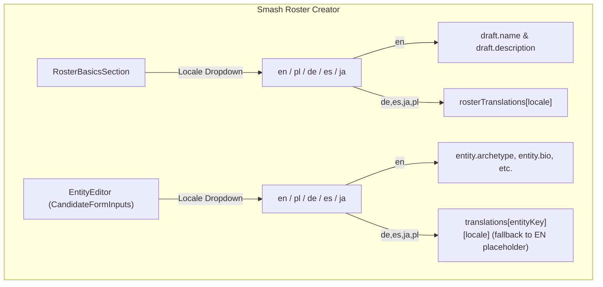

# Smash Roster Creator Translation Dropdowns Implementation Plan

> **For agentic workers:** REQUIRED SUB-SKILL: Use superpowers:subagent-driven-development to implement this plan task-by-task. Steps use checkbox (`- [ ]`) syntax for tracking.

**Goal:** Replace duplicate translation sub-panels in the Smash Roster Creator with unified, in-place language dropdowns for both Roster Basics and Candidate editing.

**Architecture:** Instead of rendering separate "TRANSLATIONS" sub-blocks with duplicate inputs, `EntityEditor` and `RosterBasicsSection` each gain an independent `CustomDropdown` for locale selection (`en`, `pl`, `de`, `es`, `ja`). When a non-English locale is active, the identical form fields display and edit that locale's translations, falling back to base English text as the input placeholder.

**Architecture Diagram:**

**Tech Stack:** Next.js (App Router), React 19, TypeScript, Tailwind CSS, LemonDBD i18n / DictionaryContext.

## Global Constraints
- Maximum file length: 600 lines per file (strictly verified by `npm run test:guards`).
- Zero TypeScript `any` or `@ts-ignore`.
- All dictionary keys must exist across all 5 locales (`en`, `pl`, `de`, `es`, `ja`).
- Use standard design tokens (no arbitrary Tailwind bracket values).

---

### Task 1: Dictionary Keys for Language Dropdowns

**Files:**
- Modify: `frontend/src/locales/en/smashOrPass.ts`
- Modify: `frontend/src/locales/pl/smashOrPass.ts`
- Modify: `frontend/src/locales/de/smashOrPass.ts`
- Modify: `frontend/src/locales/es/smashOrPass.ts`
- Modify: `frontend/src/locales/ja/smashOrPass.ts`

- [ ] Add `editingLanguageLabel`, `baseLanguageLabel`, and `sharedFieldNotice` to `dict.smashOrPass.creator` in all 5 locales.
- [ ] Verify dictionary key consistency with `npx tsc --noEmit`.

---

### Task 2: Candidate Editor Unified Language Dropdown (`EntityEditor.tsx`)

**Files:**
- Modify: `frontend/src/components/smash-or-pass/creator/EntityEditor.tsx`

- [ ] In `CandidateFormInputs`, add `activeLocale` state defaulting to `'en'`.
- [ ] In the candidate editor header, render `CustomDropdown` with language options (`en`, `pl`, `de`, `es`, `ja`).
- [ ] Bind translatable fields (`name`, `archetype`, `tagline`, `quote`, `bio`, `meme`, `turn_on`, `dealbreaker`, `dating_vibe`, `red_flags`, `green_flags`) dynamically:
  - If `activeLocale === 'en'`: edit `entity.*`.
  - If `activeLocale !== 'en'`: edit `translations[activeLocale]?.*`, with `entity.*` as placeholder.
- [ ] Remove the bottom duplicate `showTranslations` amber block with its `Tabs` and 10 duplicate fields.
- [ ] Keep file size under 600 lines (currently 484 lines, will shrink to ~390 lines).
- [ ] Verify with `npx tsc --noEmit` and `npm run lint`.

---

### Task 3: Roster Basics Unified Language Dropdown (`RosterBasicsSection.tsx` & `SmashRosterCreator.tsx`)

**Files:**
- Modify: `frontend/src/components/smash-or-pass/creator/RosterBasicsSection.tsx`
- Modify: `frontend/src/components/smash-or-pass/creator/SmashRosterCreator.tsx`

- [ ] In `RosterBasicsSection`, add `activeLocale` state defaulting to `'en'` and render `CustomDropdown` above Name/Description.
- [ ] Dynamically bind `name` and `description` to `draft.*` (for `en`) or `rosterTranslations[activeLocale].*` (for other locales), using base text as placeholder.
- [ ] In `SmashRosterCreator.tsx`, pass `rosterTranslations` and `setRosterTranslations` to `RosterBasicsSection`.
- [ ] Remove the duplicate `<RosterTranslationsPanel>` block from `SmashRosterCreator.tsx`.
- [ ] Verify file lengths under 600 lines.
- [ ] Verify with `npx tsc --noEmit` and `npm run lint`.

---

### Task 4: Unit Testing & Guard Verification

**Files:**
- Create/Modify: `frontend/src/__tests__/unit/smash/rosterLanguageDropdowns.test.tsx`

- [ ] Add unit test verifying that selecting a non-English locale in `EntityEditor` edits translations rather than base fields, and falls back to base placeholders.
- [ ] Add unit test verifying that `RosterBasicsSection` edits `rosterTranslations` when non-English locale is active.
- [ ] Run `cd frontend && npm run test:guards`
- [ ] Run `cd frontend && npm run test:unit`
- [ ] Run `cd frontend && npm run lint`
- [ ] Copy changes to `dbd_backend` / `dbd_frontend` docker containers and verify containers are healthy.
