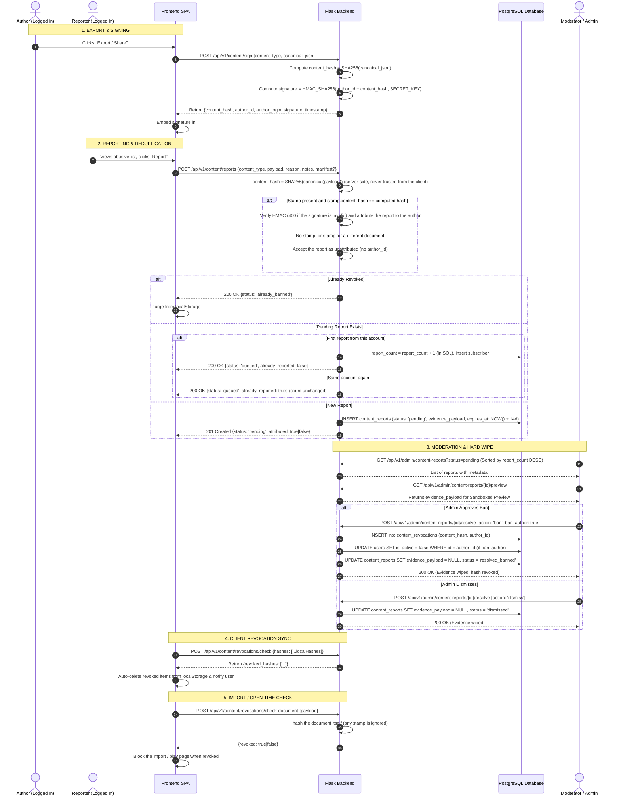

# Ephemeral Content Moderation & CAS Architecture Design

**Date:** 2026-10-14  
**Status:** IMPLEMENTED. Revised 2026-10-15 after a verification audit (see "Revision history" at the end).  
**Scope:** `backend` (Flask / SQLAlchemy models, moderation services, crypto signatures, scheduled purge, revocation endpoints) + `frontend` (Report modal, admin Reports tab with sandboxed preview, revocation sync and import/open-time ban checks)

---

## 1. Executive Summary & Problem Statement

### 1.1 The Challenge
LemonDBD allows users to create, play, and export custom user-generated content (Tier Lists, Smash or Pass rosters, Custom Minigames) entirely client-side without storing documents on the server. However, allowing untracked content sharing creates critical legal, ethical, and operational hazards:
1. **Hostile / Illegal Content Risk**: Users could create hate speech, racist rosters, or criminal content and share them via URL fragments (`#import=`) or `.json` files.
2. **Legal Safe Harbor & DSA Compliance (EU Digital Services Act)**: Under DSA Art. 14 and Art. 17, platforms cannot rely on blind bans or automated take-downs without human review, while also needing an accessible "Notice and Action" mechanism.
3. **Storage Hygiene & Toxic Retention**: Storing user reports with uploaded screenshots or persisting toxic content creates storage bloat, privacy violations (GDPR Art. 5(1)(e)), and severe criminal liability (holding prohibited images on disk).
4. **Spoofing / False Accusations**: A malicious user could edit the DOM in DevTools or modify an exported JSON file to frame an innocent user for hate speech.
5. **Report Flooding (Duplication)**: If an offensive list goes viral, dozens of users may submit identical reports, flooding the admin queue.
6. **Forking / Mutation**: A user might import a list, modify it, and re-export it. Ban decisions on the original document must not break or unjustly punish independent modifications.

### 1.2 The Solution
We introduce an **Ephemeral Content Moderation & Content-Addressable Storage (CAS)** architecture:
- **Zero-Permanent-Storage Content Model**: Custom elements continue living solely on clients (URLs and `localStorage`). The server never stores user documents in the regular database.
- **Cryptographic Author Stamp**: When a logged-in user exports or shares a custom element, a tamper-proof HMAC signature locks the `author_id` to the document's SHA-256 `content_hash`. Spoofing is mathematically impossible.
- **Deduplicated Report Queue**: Reports are grouped by `content_hash`. Each distinct reporter adds one to `report_count` and is recorded without duplicating the payload; the same account reporting the same content again changes nothing, so one person cannot inflate the count.
- **Sandboxed Safe Preview**: Administrators inspect reported content directly in a restricted, read-only UI sandbox—preventing XSS and without downloading dangerous files to disk.
- **Zero-Retention Hard Wipe**: The moment an admin approves a ban or dismisses a report, the `evidence_payload` column is immediately wiped to `NULL`. Unreviewed reports older than 14 days are wiped by a TTL cleanup that runs hourly (and once at start-up), guarded by a Postgres advisory lock so only one worker runs it.
- **Content-Addressable Revocation & Client Sync**: Banned document hashes are recorded in `content_revocations`. When clients log in or mount the app, their local storage hashes are synchronized, automatically purging banned custom items with a friendly user notification. A banned document is also refused the moment it is imported (file, paste or share link) or a minigame is opened: the server hashes the document itself, so removing the author stamp does not get around a ban.
- **Unsigned Content Is Reportable**: A report does not need an author stamp. The server hashes whatever document is submitted; if a valid stamp for that exact hash is attached the report is attributed to the author, otherwise it is queued unattributed (the content can still be revoked, but there is no account to deactivate).
- **Independent Mutation Semantics**: Because hashes are strictly content-addressable ($Hash = \text{SHA256}(\text{Document})$), edits create new distinct hashes with new author signatures. Banning a parent document does not cascade to legitimate modified forks.

---

## 2. Threat Model & Legal Architecture

### 2.1 EU Digital Services Act (DSA) Compliance
- **Art. 14 (Notice and Action Mechanisms)**: Provides authenticated users a clear "Report Content" modal with reason categories (`Hate Speech`, `Harassment`, `Explicit Content`, `Illegal Material`, `Spam`).
- **Art. 17 (Human Review & Statement of Reasons)**: Bans and revocations require an administrator to inspect the evidence payload via the Sandboxed Preview before issuing a sanction. Audit logs record the admin ID, action taken, and timestamp.

### 2.2 GDPR & Data Minimization (Art. 5(1)(c) & Art. 5(1)(e))
- **Storage Limitation**: The evidence payload (JSON of the reported list) is strictly ephemeral. It is scrubbed to `NULL` upon moderation resolution or 14-day TTL expiry.
- **Minimal Audit Trail**: Post-moderation records retain only operational metadata: `report_id`, `reporter_id`, `author_id`, `reason`, `decision`, `created_at`, `resolved_at`. No toxic text or user images persist.

### 2.3 Protection Against Criminal Liability (Anti-Hosting Safeguard)
- Storing binary image uploads (screenshots) poses severe criminal risk (e.g. if a user posts illicit imagery).
- By requiring the signed JSON document and rendering via client-side sanitizers (only trusted `/static/...` or verified HTTPS image URLs, no SVG, no data URI scripts), LemonDBD never stores prohibited media files on server storage volumes.

---

## 3. Detailed Data Flow & System Architecture



---

## 4. Database Schema Specifications

### 4.1 Table: `content_reports`
Stores reports and ephemeral evidence payloads during investigation.

```sql
CREATE TABLE content_reports (
    id SERIAL PRIMARY KEY,
    content_type VARCHAR(32) NOT NULL,            -- 'tier_list', 'smash_roster', 'minigame'
    content_hash VARCHAR(64) NOT NULL INDEX,       -- SHA-256 of canonical document, computed by the server
    author_id INTEGER REFERENCES users(id) ON DELETE SET NULL INDEX,  -- NULL when the report is unattributed
    author_login VARCHAR(50) NOT NULL,             -- '' when the report is unattributed
    first_reporter_id INTEGER REFERENCES users(id) ON DELETE SET NULL,
    report_count INTEGER NOT NULL DEFAULT 1,       -- Deduplication counter
    primary_reason VARCHAR(64) NOT NULL,           -- 'hate_speech', 'harassment', 'illegal', etc.
    status VARCHAR(32) NOT NULL DEFAULT 'pending', -- 'pending', 'resolved_banned', 'dismissed', 'expired'
    evidence_payload TEXT NULL,                    -- Raw canonical JSON, WIPED TO NULL UPON RESOLUTION
    admin_notes TEXT NULL,
    resolved_by_id INTEGER REFERENCES users(id) ON DELETE SET NULL,
    resolved_at TIMESTAMP WITH TIME ZONE NULL,
    expires_at TIMESTAMP WITH TIME ZONE NOT NULL,  -- NOW() + 14 days
    created_at TIMESTAMP WITH TIME ZONE NOT NULL DEFAULT NOW(),
    updated_at TIMESTAMP WITH TIME ZONE NOT NULL DEFAULT NOW()
);

-- At most one pending report per content hash: the database enforces the dedup rule, so two
-- reporters racing on the same new document cannot both create a row.
CREATE UNIQUE INDEX uq_content_reports_pending_hash ON content_reports(content_hash) WHERE status = 'pending';
-- Serves the admin queue (filter by status, order by report_count).
CREATE INDEX idx_content_reports_status_count ON content_reports(status, report_count);
```

Both indexes come from migration `0015_content_report_indexes`, which first folds any duplicate pending rows into one so the unique index can be built on an existing database.

### 4.2 Table: `content_report_subscribers`
Tracks individual reporters for deduplicated reports (prevents double-reporting by the same user and enables granular metrics).

```sql
CREATE TABLE content_report_subscribers (
    id SERIAL PRIMARY KEY,
    report_id INTEGER NOT NULL REFERENCES content_reports(id) ON DELETE CASCADE INDEX,
    reporter_id INTEGER NOT NULL REFERENCES users(id) ON DELETE CASCADE INDEX,
    reason VARCHAR(64) NOT NULL,
    notes VARCHAR(500) NULL,
    created_at TIMESTAMP WITH TIME ZONE NOT NULL DEFAULT NOW(),
    CONSTRAINT uq_report_reporter UNIQUE (report_id, reporter_id)
);
```

### 4.3 Table: `content_revocations`
Permanent index of blocked content hashes. Very lean table for sub-millisecond lookup by the unique `content_hash` index (no separate cache layer).

```sql
CREATE TABLE content_revocations (
    id SERIAL PRIMARY KEY,
    content_hash VARCHAR(64) NOT NULL UNIQUE INDEX,
    content_type VARCHAR(32) NOT NULL,
    author_id INTEGER REFERENCES users(id) ON DELETE SET NULL INDEX,
    reason VARCHAR(64) NOT NULL,
    revoked_by_id INTEGER REFERENCES users(id) ON DELETE SET NULL,
    created_at TIMESTAMP WITH TIME ZONE NOT NULL DEFAULT NOW()
);
```

---

## 5. Backend Architecture & Clean Architecture Components

### 5.1 Crypto & Signature Service (`app/services/content_crypto.py`)
- `canonicalize_json(data: dict) -> str`: Produces a deterministic string representation (sorted keys, compact separators `separators=(',', ':')`, `ensure_ascii=False`, `allow_nan=False` so `NaN`/`Infinity` are rejected instead of producing a non-JSON hash input).
- `compute_content_hash(canonical_str: str) -> str`: Computes SHA-256 hexdigest.
- `sign_content(user_id: int, content_hash: str) -> str`: Generates HMAC-SHA256 signature using `settings.SECRET_KEY`.
- `verify_signature(user_id: int, content_hash: str, signature: str) -> bool`: Constant-time comparison `hmac.compare_digest`.

### 5.2 Content Moderation Service (`app/services/content_moderation_service.py`)
- `report_content(reporter, data, secret_key) -> (response, status)`:
  1. Validates `content_type` and `reason` against allow-lists (`spam` is accepted by the API although the report dialog does not offer it) and that `payload` is a JSON object within the size limit.
  2. Computes `content_hash` itself from `payload`. If a stamp is attached and its `content_hash` equals the computed hash, verifies the HMAC (an invalid signature for a matching hash is `400`) and attributes the report. A missing stamp, or a stamp for a different document, is **not** an error: the report is accepted unattributed.
  3. If the hash is in `content_revocations`, returns `already_banned`.
  4. If a pending report for the hash exists, adds the reporter as a subscriber and bumps `report_count` in SQL **only when the subscriber row is new**; a repeat from the same account returns `queued` with `already_reported: true` and leaves the count alone.
  5. Otherwise creates the report (`pending`, `evidence_payload`, `expires_at = now + 14 days`) inside a savepoint; if the partial unique index rejects it because another reporter won the race, it joins that report instead.
- `check_document_revoked(payload)`: hashes a document server-side and reports whether it is revoked (used at import and open time).
- `get_admin_reports(status, page, per_page)`:
  Paginated list sorted by `report_count DESC, created_at DESC` (highest volume first), filterable by status (an unknown status is `400`). The response also carries `pending_total` for the admin tab badge.
- `resolve_report(report_id: int, admin_id: int, action: str, ban_author: bool, notes: str | None)`:
  1. Sets `status` to `resolved_banned` or `dismissed`.
  2. If `action == 'ban'`:
     - Inserts `content_hash` into `content_revocations`.
     - If `ban_author` is true, sets `author.is_active = False` and logs to `AdminAuditLog`.
  3. **Crucial Zero-Retention Step**: Sets `evidence_payload = None`.
  4. Commits transaction. Resolving a report that is already resolved or expired returns `409`.
  5. Both outcomes write an audit-log entry (`content_ban`, `content_dismiss`), and an admin author is never deactivated.
- `purge_expired_evidence()`:
  Runs hourly from the scheduler (job `purge_expired_content_evidence`, minute 17, advisory lock) and once at start-up, and can be triggered by an admin (`POST /api/v1/admin/content-reports/purge-expired`). It executes a bulk update:
  ```python
  stmt = (
      update(ContentReport)
      .where(ContentReport.status == "pending", ContentReport.expires_at <= utcnow())
      .values(evidence_payload=None, status="expired", updated_at=utcnow())
  )
  ```

### 5.3 Revocation Queries (in `app/services/content_moderation_service.py`)
- `check_revocations(hashes: list[str]) -> list[str]`:
  Efficient `SELECT content_hash FROM content_revocations WHERE content_hash IN (:hashes)` (at most 200 hashes per call; no cache layer).
- `check_document_revoked(payload)`: see 5.2.

---

## 6. Frontend Architecture & UI Components

### 6.1 Report Content Modal (`frontend/src/components/common/ReportContentModal.tsx`)
- Triggerable directly from:
  - Custom Tier List View (`CustomTierListView.tsx`)
  - Smash or Pass Custom Game (`SmashOrPassHub.tsx`)
  - Minigame Custom Trial (`PlayTrialClient.tsx`)
- Props:
  - `contentType: 'tier_list' | 'smash_roster' | 'minigame'`
  - `manifest?: ContentManifest | null`: the creator's stamp when the copy has one. Without it the dialog shows a notice that the report will be filed without an author, and the form still works.
  - `payload`: the document being reported. Every call site builds it with `signingPayload(contentType, doc)` so a copy hashes identically wherever it travelled (author's storage, JSON file, share link, recipient's storage).
- Features:
  - Category selector (hate speech, harassment, explicit content, illegal content, other).
  - Textarea for an optional description (500 characters).
  - Submits to `POST /api/v1/content/reports`.
  - Immediate user feedback:
    - If already banned: shows a notice that the content was already banned and removes the local copy.
    - If submitted: shows a thank-you notice.

### 6.2 Admin Reports Tab (`components/admin/AdminContentReportsWorkbench.tsx`)
- A **Reports** tab in the admin panel (next to Bug Reports) with a pending-count badge that is correct before the tab is first opened. Left: the queue with a status filter (pending, banned, dismissed, expired, all), pagination and a "purge expired" action. Right: the selected case.
- The case (`ContentReportDetail.tsx`) shows type, status, report count, author (or "unattributed"), the content id (hash), when it was first reported, when the evidence expires, the reasons given (with counts), reporters' free-text notes (escaped; reporter identities are deliberately not shown), and the reported content.
- The reported content (`SandboxedContentPreview.tsx`, `utils/contentPreview.ts`) is **untrusted** and is never rendered as the original UI. It is read as JSON and shown as escaped plain text (title, description, every readable string), with a collapsible raw view. Images stay **hidden until the admin clicks "Load images"** (a reported image can be shocking, and loading a remote URL tells its host an admin looked); only `https:` and inline PNG/JPEG/WebP/GIF load, never SVG, `http:` or `javascript:`, with `referrerPolicy="no-referrer"`.
- Actions: **Ban content** (confirmation dialog; optional "also deactivate the author's account", offered only when the report is attributed and the author is neither inactive nor an admin) and **Dismiss report**, both with optional admin notes that go into the audit log. A resolved report is read-only and states that its evidence was wiped.
- The audit log lists `content_ban` / `content_dismiss` (and every other known action) by a translated name, with the admin notes shown as the reason.

### 6.3 Local Storage Revocation Sync Hook (`frontend/src/hooks/useContentRevocationSync.ts`)
- Runs when the user logs in and periodically (or on route change to `/tier-lists`, `/smash-or-pass`, `/minigames`):
  1. Collects the content hashes of saved custom content from `localStorage` (`lemondbd_tier_lists`, `lemondbd_smash_rosters`, `lemondbd_custom_minigames`, plus legacy keys).
  2. If empty, exits early.
  3. Sends `POST /api/v1/content/revocations/check` with the list of hashes.
  4. If any revoked hashes are returned:
     - Removes the offending keys from `localStorage`.
     - Displays an informational toast: *"One or more saved custom lists were removed for violating community guidelines."*

### 6.4 Import / Open-Time Ban Check
- `utils/contentRevocation.ts` `isDocumentRevoked(contentType, doc)` posts the normalized document to `POST /api/v1/content/revocations/check-document`.
- `useImportDraft({ revocationCheck })` runs it for every parsed import (file, paste or share link) in the tier list, Smash or Pass and minigame import dialogs, and the import button stays disabled while the answer is pending or the content is revoked. The minigame play page runs it before starting a trial.
- A failed or slow request counts as "not revoked" (4 s timeout): moderation must not make the site unusable when the API is down. The login-time sync still removes banned saved items on the next load.

---

## 7. Edge Cases & Safety Guarantees

| Scenario | System Behavior |
| :--- | :--- |
| **User imports list, edits 1 perk, list A gets banned** | List A is $Hash_A$. The edited list is $Hash_B = \text{SHA256}(\text{List B})$. Only $Hash_A$ is revoked. The user's legitimate edited fork remains safe. |
| **User edits list to evade ban, reposts identical hate speech** | The repost is signed with the new user's credentials. When reported, the new user is identified by HMAC and banned. |
| **Malicious user alters JSON to frame someone else** | The server hashes the submitted document itself. A stamp is honoured only when it was signed for exactly that hash (`HMAC(author_id + hash)`); a forged signature for a matching hash is `400`, and a stamp copied onto different content simply does not match, so the report is filed **unattributed** and nobody is blamed. |
| **50 users report the same viral link simultaneously** | Row 1 creates `content_reports`; the partial unique index makes a racing duplicate join that row instead, and each of rows 2–50 adds one subscriber and one to `report_count` (in SQL, so no increment is lost). One queue entry with counter `50`. |
| **One user reports the same content 50 times** | Only the first counts. Repeats return `queued` with `already_reported: true` and leave `report_count` unchanged. |
| **Content has no author stamp (or the stamp was stripped)** | Still reportable and still revocable by hash; the report is unattributed, so a ban revokes the content but there is no account to deactivate. Import and open-time checks hash the document, so removing a stamp does not evade a ban. |
| **Banned content arrives through a share link or JSON file** | The import dialogs and the minigame play page call `check-document` and refuse it. |
| **Admin forgets to review a report for 14 days** | The hourly purge job sets `evidence_payload = NULL` and `status = 'expired'` (and an expired report can no longer be resolved: `409`). Zero toxic data remains indefinitely on the server. |
| **Already-banned content is reported again** | API returns `already_banned` status immediately; client clears its local copy without writing a new report row. |

---

## 8. Verification & Testing Plan

### 8.1 Backend Unit & Integration Tests (`pytest`)
- `test_content_crypto.py`: deterministic canonicalization, HMAC generation/validation, rejection of altered payloads and `NaN`.
- `test_content_moderation_api.py`, `test_content_moderation_hardening.py`: report creation, per-reporter dedup, unsigned and mismatched-stamp reports, already-revoked, status validation, `409` on resolved/expired, document revocation check, race handling, purge scheduling.
- `test_admin_content_moderation.py`: list/preview/resolve, evidence wiped on ban and dismiss, author deactivation rules, audit entries.
- `test_content_report_indexes_migration.py`: migration `0015` folds duplicate pending rows and creates both indexes.

### 8.2 Frontend Tests & Guards
- `npm run check` (i18n hardcoded-string check, global-style check and the structural guards: file length <= 600 lines, theme tokens, typography roles, dead-key ratchet, full i18n parity across 5 languages).
- `npm run test:unit`, including `contentRoundTrip.test.ts` (author export hash equals recipient report hash for tier lists, rosters and minigames across file, share link and storage), `ReportContentModal.test.tsx`, `revocationCheck.test.ts` and `adminContentReports.test.tsx`.

---

## Revision history

- **2026-10-15**: verification audit. Added the admin Reports tab (the original plan only built the backend endpoints, so an admin had no screen for reports); fixed minigame reports always failing the hash check (a single `signingPayload` normalizer now defines the hashed document for all three content types); made `report_count` per-reporter; scheduled the evidence purge; added import/open-time ban checks; made unsigned content reportable; replaced the free-form reason/status inputs with allow-lists; added the partial unique index; translated audit-log action names; corrected this document (Flask rather than FastAPI, no Redis, real storage keys, mismatched stamps are unattributed rather than `400`).
