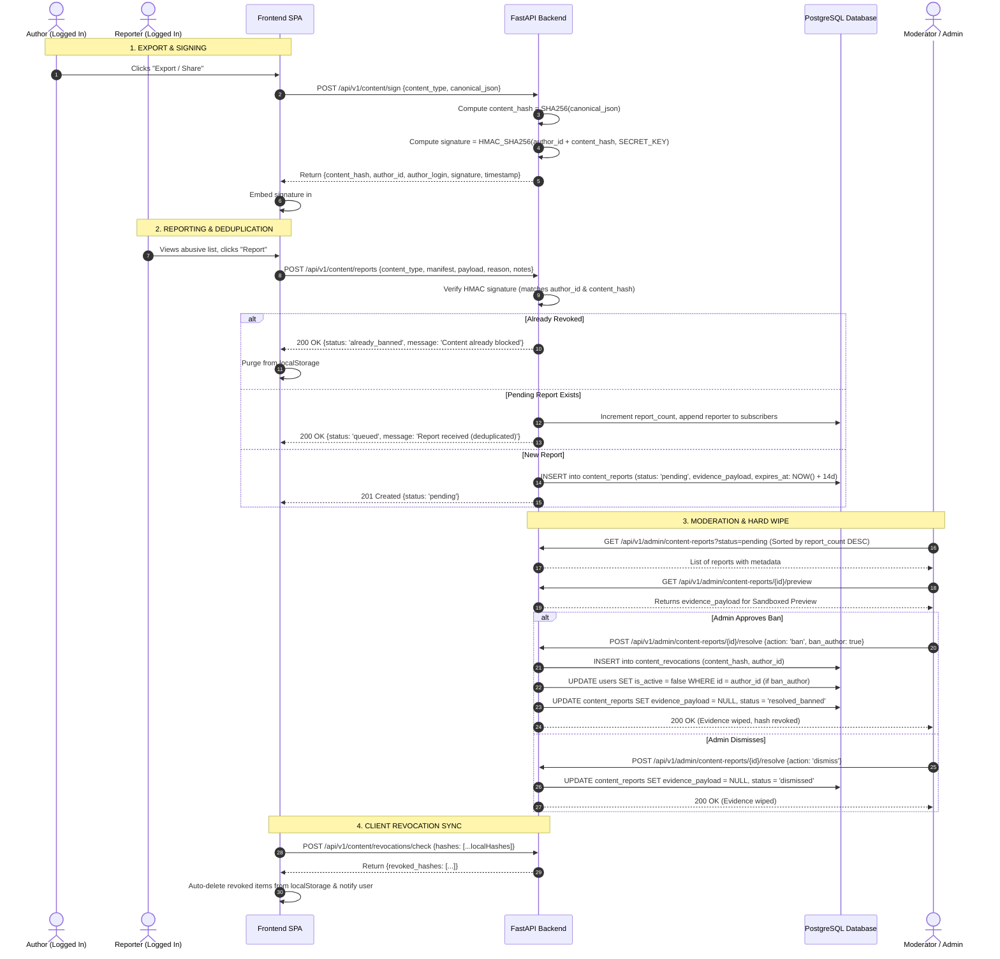

# Ephemeral Content Moderation & CAS Architecture Design

**Date:** 2026-10-14  
**Status:** PROPOSED (Awaiting User Review)  
**Scope:** `backend` (FastAPI models, moderation services, crypto signatures, background purge, revocation endpoints) + `frontend` (Report modal, admin sandboxed preview, revocation sync in localStorage)

---

## 1. Executive Summary & Problem Statement

### 1.1 The Challenge
LemonDBD allows users to create, play, and export custom user-generated content (Tier Lists, Smash or Pass rosters, Custom Minigames) entirely client-side without storing documents on the server. However, allowing untracked content sharing creates critical legal, ethical, and operational hazards:
1. **Hostile / Illegal Content Risk**: Users could create hate speech, racist rosters, or criminal content and share them via URL fragments (`#import=`) or `.json` files.
2. **Legal Safe Harbor & DSA Compliance (EU Digital Services Act)**: Under DSA Art. 14 and Art. 17, platforms cannot rely on blind bans or automated take-downs without human review, while also needing an accessible "Notice and Action" mechanism.
3. **Storage Hygiene & Toxic Retention**: Storing user reports with uploaded screenshots or persisting toxic content creates storage bloat, privacy violations (GDPR Art. 5(1)(e)), and severe criminal liability (holding prohibited images on disk).
4. **Spoofing / False Accusations**: A malicious user could edit the DOM in DevTools or modify an exported JSON file to frame an innocent user for hate speech.
5. **Report Flooding (Duplication)**: If an offensive list goes viral, dozens of users may submit identical reports, flooding the admin queue.
6. **Forking / Mutation**: A user might import a list, modify it, and re-export it. Ban decisions on the original document must not break or unjustly punish independent modifications.

### 1.2 The Solution
We introduce an **Ephemeral Content Moderation & Content-Addressable Storage (CAS)** architecture:
- **Zero-Permanent-Storage Content Model**: Custom elements continue living solely on clients (URLs and `localStorage`). The server never stores user documents in the regular database.
- **Cryptographic Author Stamp**: When a logged-in user exports or shares a custom element, a tamper-proof HMAC signature locks the `author_id` to the document's SHA-256 `content_hash`. Spoofing is mathematically impossible.
- **Deduplicated Report Queue**: Reports are grouped by `content_hash`. Multiple reports for the same list increment a `report_count` counter and record individual reporters without duplicating the payload.
- **Sandboxed Safe Preview**: Administrators inspect reported content directly in a restricted, read-only UI sandbox—preventing XSS and without downloading dangerous files to disk.
- **Zero-Retention Hard Wipe**: The moment an admin approves a ban or dismisses a report, the `evidence_payload` column is immediately wiped to `NULL`. Unreviewed reports older than 14 days are automatically wiped by a background TTL cleanup.
- **Content-Addressable Revocation & Client Sync**: Banned document hashes are recorded in `content_revocations`. When clients log in or mount the app, their local storage hashes are synchronized, automatically purging banned custom items with a friendly user notification.
- **Independent Mutation Semantics**: Because hashes are strictly content-addressable ($Hash = \text{SHA256}(\text{Document})$), edits create new distinct hashes with new author signatures. Banning a parent document does not cascade to legitimate modified forks.

---

## 2. Threat Model & Legal Architecture

### 2.1 EU Digital Services Act (DSA) Compliance
- **Art. 14 (Notice and Action Mechanisms)**: Provides authenticated users a clear "Report Content" modal with reason categories (`Hate Speech`, `Harassment`, `Explicit Content`, `Illegal Material`, `Spam`).
- **Art. 17 (Human Review & Statement of Reasons)**: Bans and revocations require an administrator to inspect the evidence payload via the Sandboxed Preview before issuing a sanction. Audit logs record the admin ID, action taken, and timestamp.

### 2.2 GDPR & Data Minimization (Art. 5(1)(c) & Art. 5(1)(e))
- **Storage Limitation**: The evidence payload (JSON of the reported list) is strictly ephemeral. It is scrubbed to `NULL` upon moderation resolution or 14-day TTL expiry.
- **Minimal Audit Trail**: Post-moderation records retain only operational metadata: `report_id`, `reporter_id`, `author_id`, `reason`, `decision`, `created_at`, `resolved_at`. No toxic text or user images persist.

### 2.3 Protection Against Criminal Liability (Anti-Hosting Safeguard)
- Storing binary image uploads (screenshots) poses severe criminal risk (e.g. if a user posts illicit imagery).
- By requiring the signed JSON document and rendering via client-side sanitizers (only trusted `/static/...` or verified HTTPS image URLs, no SVG, no data URI scripts), LemonDBD never stores prohibited media files on server storage volumes.

---

## 3. Detailed Data Flow & System Architecture



---

## 4. Database Schema Specifications

### 4.1 Table: `content_reports`
Stores reports and ephemeral evidence payloads during investigation.

```sql
CREATE TABLE content_reports (
    id SERIAL PRIMARY KEY,
    content_type VARCHAR(32) NOT NULL,            -- 'tier_list', 'smash_roster', 'minigame'
    content_hash VARCHAR(64) NOT NULL INDEX,       -- SHA-256 of canonical document
    author_id INTEGER REFERENCES users(id) ON DELETE SET NULL INDEX,
    author_login VARCHAR(50) NOT NULL,
    first_reporter_id INTEGER REFERENCES users(id) ON DELETE SET NULL,
    report_count INTEGER NOT NULL DEFAULT 1,       -- Deduplication counter
    primary_reason VARCHAR(64) NOT NULL,           -- 'hate_speech', 'harassment', 'illegal', etc.
    status VARCHAR(32) NOT NULL DEFAULT 'pending', -- 'pending', 'resolved_banned', 'dismissed', 'expired'
    evidence_payload TEXT NULL,                    -- Raw canonical JSON, WIPED TO NULL UPON RESOLUTION
    admin_notes TEXT NULL,
    resolved_by_id INTEGER REFERENCES users(id) ON DELETE SET NULL,
    resolved_at TIMESTAMP WITH TIME ZONE NULL,
    expires_at TIMESTAMP WITH TIME ZONE NOT NULL,  -- NOW() + 14 days
    created_at TIMESTAMP WITH TIME ZONE NOT NULL DEFAULT NOW(),
    updated_at TIMESTAMP WITH TIME ZONE NOT NULL DEFAULT NOW()
);

CREATE INDEX idx_content_reports_pending_count ON content_reports(status, report_count DESC) WHERE status = 'pending';
CREATE INDEX idx_content_reports_hash_status ON content_reports(content_hash, status);
```

### 4.2 Table: `content_report_subscribers`
Tracks individual reporters for deduplicated reports (prevents double-reporting by the same user and enables granular metrics).

```sql
CREATE TABLE content_report_subscribers (
    id SERIAL PRIMARY KEY,
    report_id INTEGER NOT NULL REFERENCES content_reports(id) ON DELETE CASCADE INDEX,
    reporter_id INTEGER NOT NULL REFERENCES users(id) ON DELETE CASCADE INDEX,
    reason VARCHAR(64) NOT NULL,
    notes VARCHAR(500) NULL,
    created_at TIMESTAMP WITH TIME ZONE NOT NULL DEFAULT NOW(),
    CONSTRAINT uq_report_reporter UNIQUE (report_id, reporter_id)
);
```

### 4.3 Table: `content_revocations`
Permanent index of blocked content hashes. Very lean table for sub-millisecond lookup and Redis cache synchronization.

```sql
CREATE TABLE content_revocations (
    id SERIAL PRIMARY KEY,
    content_hash VARCHAR(64) NOT NULL UNIQUE INDEX,
    content_type VARCHAR(32) NOT NULL,
    author_id INTEGER REFERENCES users(id) ON DELETE SET NULL INDEX,
    reason VARCHAR(64) NOT NULL,
    revoked_by_id INTEGER REFERENCES users(id) ON DELETE SET NULL,
    created_at TIMESTAMP WITH TIME ZONE NOT NULL DEFAULT NOW()
);
```

---

## 5. Backend Architecture & Clean Architecture Components

### 5.1 Crypto & Signature Service (`app/services/content/content_crypto.py`)
- `canonicalize_json(data: dict) -> str`: Produces a deterministic string representation (sorted keys, compact separators `separators=(',', ':')`, UTF-8).
- `compute_content_hash(canonical_str: str) -> str`: Computes SHA-256 hexdigest.
- `sign_content(user_id: int, content_hash: str) -> str`: Generates HMAC-SHA256 signature using `settings.SECRET_KEY`.
- `verify_signature(user_id: int, content_hash: str, signature: str) -> bool`: Constant-time comparison `hmac.compare_digest`.

### 5.2 Content Moderation Service (`app/services/content/moderation_service.py`)
- `submit_report(reporter_id: int, data: ReportCreateSchema) -> ReportResult`:
  1. Validates HMAC signature against `author_id` and calculated `content_hash`.
  2. Checks if `content_hash` is in `content_revocations`. If so, returns `already_banned`.
  3. Checks if `content_hash` is in `content_reports` with `status == 'pending'`. If so, increments `report_count`, inserts into `content_report_subscribers` (ignoring if same reporter), and returns `queued`.
  4. Otherwise, creates `content_reports` with `status = 'pending'`, stores `evidence_payload`, and sets `expires_at = utcnow() + timedelta(days=14)`.
- `get_pending_reports(page: int, limit: int) -> list[ReportSummary]`:
  Paginated list sorted by `report_count DESC, created_at ASC` (highest volume reports first).
- `resolve_report(report_id: int, admin_id: int, action: str, ban_author: bool, notes: str | None)`:
  1. Sets `status` to `resolved_banned` or `dismissed`.
  2. If `action == 'ban'`:
     - Inserts `content_hash` into `content_revocations`.
     - Invalidates Redis cache of revocations.
     - If `ban_author` is true, sets `author.is_active = False` and logs to `AdminAuditLog`.
  3. **Crucial Zero-Retention Step**: Sets `evidence_payload = None`.
  4. Commits transaction.
- `purge_expired_evidence()`:
  Executes periodic bulk update:
  ```python
  stmt = (
      update(ContentReport)
      .where(ContentReport.status == "pending", ContentReport.expires_at <= utcnow())
      .values(evidence_payload=None, status="expired", updated_at=utcnow())
  )
  ```

### 5.3 Revocation Query Service (`app/services/content/revocation_service.py`)
- `check_revocations(hashes: list[str]) -> list[str]`:
  Efficient `SELECT content_hash FROM content_revocations WHERE content_hash IN (:hashes)` with Redis caching (`SISMEMBER` or pipeline).

---

## 6. Frontend Architecture & UI Components

### 6.1 Report Content Modal (`frontend/src/components/common/ReportContentModal.tsx`)
- Triggerable directly from:
  - Custom Tier List View (`CustomTierListView.tsx`)
  - Smash or Pass Custom Game (`SmashOrPassHub.tsx`)
  - Minigame Custom Trial (`PlayTrialClient.tsx`)
- Props:
  - `contentType: 'tier_list' | 'smash_roster' | 'minigame'`
  - `contentHash: string`
  - `authorId: number`
  - `signature: string`
  - `documentPayload: Record<string, unknown>`
- Features:
  - Category selector (`Hate Speech / Discrimination`, `Explicit / Inappropriate Content`, `Harassment`, `Illegal Activity`, `Other`).
  - Textarea for optional description.
  - Submits to `POST /api/v1/content/reports`.
  - Immediate user feedback:
    - If already banned: shows toast *"This content was already banned and has been removed."* and cleans local storage.
    - If submitted: shows toast *"Thank you for your report. Our moderation team has been notified."*

### 6.2 Admin Sandboxed Preview (`frontend/src/components/admin/SandboxedContentPreview.tsx`)
- Inside the Admin Dashboard `/admin/reports`:
  - Renders the reported document in a strict, read-only isolated container.
  - Reuses the core display logic (e.g. tier list grid or roster cards) but:
    - Disables all clickable outbound links.
    - Sanitizes all images using `sanitizeImageUrl` (blocking scripts, mixed protocols, SVGs).
    - Prevents drag-and-drop or interactive execution.
- Action Bar:
  - `[Zatwierdź bana i unieważnij treść]` (Red, with optional checkbox: "Zbanuj również konto autora")
  - `[Odrzuć zgłoszenie]` (Neutral)
  - Displays reporter count badge (`15 zgłoszeń`).

### 6.3 Local Storage Revocation Sync Hook (`frontend/src/hooks/useContentRevocationSync.ts`)
- Runs when the user logs in and periodically (or on route change to `/tier-lists`, `/smash-or-pass`, `/minigames`):
  1. Collects all custom content hashes currently stored in `localStorage` (`tierLists:custom:...`, `smash:custom:...`, etc.).
  2. If empty, exits early.
  3. Sends `POST /api/v1/content/revocations/check` with the list of hashes.
  4. If any revoked hashes are returned:
     - Removes the offending keys from `localStorage`.
     - Displays an informational toast: *"One or more saved custom lists were removed for violating community guidelines."*

---

## 7. Edge Cases & Safety Guarantees

| Scenario | System Behavior |
| :--- | :--- |
| **User imports list, edits 1 perk, list A gets banned** | List A is $Hash_A$. The edited list is $Hash_B = \text{SHA256}(\text{List B})$. Only $Hash_A$ is revoked. The user's legitimate edited fork remains safe. |
| **User edits list to evade ban, reposts identical hate speech** | The repost is signed with the new user's credentials. When reported, the new user is identified by HMAC and banned. |
| **Malicious user alters JSON to frame someone else** | The HMAC signature checks `HMAC(frame_user_id + hash)`. If altered, verification fails with `400 Bad Signature`. Fake reports are instantly rejected. |
| **50 users report the same viral link simultaneously** | Handled idempotently: row 1 creates `content_reports`, rows 2–50 increment `report_count`. Only 1 report appears in the admin queue with counter `50`. |
| **Admin forgets to review a report for 14 days** | Background purge sets `evidence_payload = NULL` and `status = 'expired'`. Zero toxic data remains indefinitely on the server. |
| **Already-banned content is reported again** | API returns `already_banned` status immediately; client clears its local copy without writing a new report row. |

---

## 8. Verification & Testing Plan

### 8.1 Backend Unit & Integration Tests (`pytest`)
- `test_content_crypto.py`:
  - Verify deterministic JSON canonicalization across dict key orderings.
  - Verify HMAC signature generation and validation.
  - Verify signature rejection on altered payload or altered author ID.
- `test_content_reports.py`:
  - Verify report submission creates `content_reports` and `content_report_subscribers`.
  - Verify deduplication increments `report_count` and does not duplicate payload.
  - Verify reporting an already-revoked hash returns `already_banned`.
- `test_moderation_resolution.py`:
  - Verify resolving as 'ban' creates entry in `content_revocations`, bans author if selected, and **wipes `evidence_payload` to `None`**.
  - Verify resolving as 'dismiss' **wipes `evidence_payload` to `None`**.
  - Verify `purge_expired_evidence` wipes payloads older than 14 days.
- `test_revocation_check.py`:
  - Verify batch query correctly matches revoked hashes.

### 8.2 Frontend Tests & Guards
- `npm run check`: Maintain 72/72 guards passing (file length <= 600 lines, theme tokens, full i18n parity across 5 languages).
- `npm run test:unit`: Unit tests for `useContentRevocationSync` and `ReportContentModal`.
